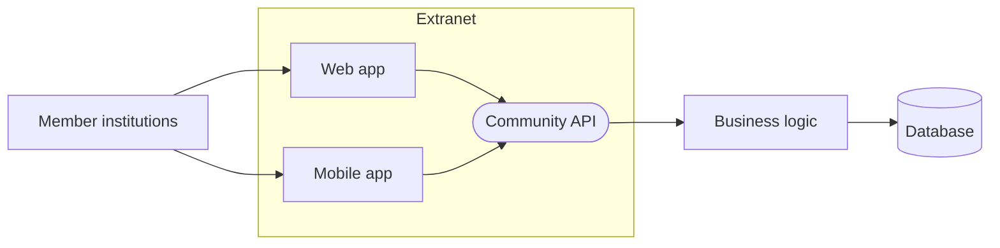

# Community API

## Description

The Community API pattern restricts the visibility of and access to an API to a closed group of users who belong to several legal entities, such as companies, non-profit organizations and governments. The API and its implementation resources are deployed in an access-restricted location, for example an extranet, and the API description is shared only with the authorized audience.

It combines elements of its siblings Public API and Solution-Internal API. Like a public API, it may have its own community pricing model and demands carefully handled contract, security and reliability. Like an internal API, it may keep endpoints close to their implementations. The design follows the same roadmap as the Public API: endpoints, operations, representations, quality of service and life cycle.

What sets it apart is collective governance: a community-wide API owner is appointed, shared funding is sought and support is organized among members.

## Problems it solves

- Sharing an API among different organizations without making it public
- Restricting who sees the API and its documentation to a known group
- Giving that group an integration point with rules and costs agreed together
- Avoiding duplicated bilateral integrations between each pair of members

## When to use

- When a consortium of financial institutions shares a reconciliation or participant lookup API
- When there is a closed network, such as an extranet, for community members
- When usage rules, funding and support are decided collectively
- When trust among members is higher than on the open internet, but still not that of a single organization

## When to avoid

- When any interested party should be able to use the API: choose the [Public API](/architecture/api-patterns/foundations/public-api)
- When only components of one application consume it: use the [Solution-Internal API](/architecture/api-patterns/foundations/solution-internal-api)
- When there is no owner or common funding to sustain the API
- When the community is too small to justify the governance of a shared contract

## Trade-offs

| Benefit | Cost / Risk |
| --- | --- |
| A single integration for all members, instead of bilateral agreements | Requires governance, a common owner and shared funding |
| Access and documentation restricted to the right audience | Network and security infrastructure for the extranet |
| Rules and costs suited to the community | Change decisions depend on consensus among organizations |
| Less exposure than a public API | Less usage scale and less return to amortize the investment |

- **Governance:** define who decides the contract's evolution and how changes are communicated to members.
- **Security:** the restricted network helps but does not replace per-member authentication and authorization.
- **Support:** part of the support may come from the members themselves, which must be agreed.

## Diagram



Only community members reach the API, which sits in an access-restricted network.

## Example

A consortium of credit cooperatives uses a common API to check whether a taxpayer ID already has an active contract at another member. Only registered institutions, inside the extranet, call the endpoint, and each call identifies the member.

```http
POST /consortium/v1/loan-contracts/lookup HTTP/1.1
Host: api.consortium.example
X-Member-Id: coop-042
Content-Type: application/json

{ "taxId": "123.456.789-09" }

HTTP/1.1 200 OK
Content-Type: application/json

{ "activeContracts": 1, "totalOutstanding": { "amountCents": 1850000, "currency": "BRL" } }
```

The document describing this endpoint is distributed only to members, not published on the internet.

## Related patterns

- [Public API](/architecture/api-patterns/foundations/public-api) — the open sibling; the Community API inherits much of its contract, documentation and support practices
- [Solution-Internal API](/architecture/api-patterns/foundations/solution-internal-api) — the closed sibling inside an application, from which the Community API may take the proximity to the implementation
- [Backend Integration](/architecture/api-patterns/foundations/backend-integration) and [Frontend Integration](/architecture/api-patterns/foundations/frontend-integration) — the integration types a community API can serve
- [API Description](/architecture/api-patterns/documentation/api-description) — shared only with the restricted audience
- [Service Level Agreement](/architecture/api-patterns/documentation/service-level-agreement) and [Pricing Plan](/architecture/api-patterns/documentation/pricing-plan) — agreements and costs defined jointly by the community
- [Open Host Service](/design/ddd/context-mapping/open-host-service) and [Published Language](/design/ddd/context-mapping/published-language) — a context relationship in which a common protocol is offered to several consumers

## Reference

- [Patterns for API Design, chapter 4: Community API](https://api-patterns.org/)
