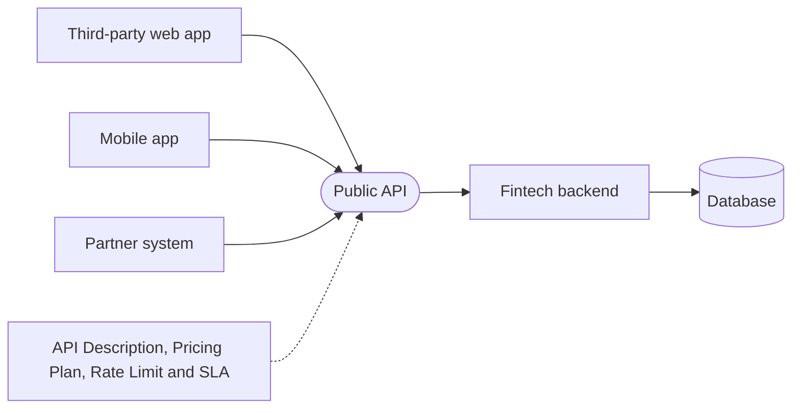

# Public API

## Description

The Public API pattern makes an API available on the public internet, together with a detailed description of its functional and non-functional properties, for an unlimited or unknown number of clients outside the organization. The target audience is not limited, although access is usually controlled with API keys.

Because consumers can be anywhere and may not even know the provider, the API needs a complete design: endpoints, operations, message representations, quality-of-service guarantees and a life-cycle support model. That includes choosing responsibility and evolution patterns, such as marking the API as a Processing Resource and adopting Version Identifiers and Semantic Versioning.

Security and reliability gain weight: use API Keys or other mechanisms, harden the API and invest in documentation and support. From an API economy point of view, define a Pricing Plan, manage subscriptions and billing, and consider Rate Limits for free plans. The terms of use, including fair use and responsibilities, go into a Service Level Agreement that the consumer accepts in order to use the API. Because they are legally binding, these documents should be written or reviewed by specialists.

## Problems it solves

- Serving unknown clients spread across different regions and organizations
- Letting third parties build products on the organization's capabilities
- Controlling access, consumption and billing without knowing each consumer in advance
- Communicating guarantees, limits and terms of use to people who never talked to the provider

## When to use

- When the fintech offers a Pix charge and statement API to merchants and external developers
- When the goal is to build an ecosystem of partners and integrators
- When the API is part of the product and can have plans and billing
- When the organization accepts commitments of stability and availability to the public

## When to avoid

- When the audience is a closed group of organizations: prefer the [Community API](/architecture/api-patterns/foundations/community-api)
- When only services of the same application use it: a [Solution-Internal API](/architecture/api-patterns/foundations/solution-internal-api) is enough and costs less
- When the organization cannot sustain support, documentation and stability in the long run
- For sensitive operations without a solid authentication, authorization and usage-limiting strategy

## Trade-offs

| Benefit | Cost / Risk |
| --- | --- |
| Wide reach and the possibility of an ecosystem and revenue | Attack surface exposed to the whole internet |
| Independent consumers, with no individual agreement | Changes break clients you do not know |
| An explicit contract and terms set clear expectations | A commitment to support, documentation and availability |
| Business models with plans and limits | Requires subscription and billing management and legal review |

- **Stability:** the more public the contract, the more expensive it is to change; plan versioning and a deprecation policy from the start.
- **Security:** API keys are a minimum; also consider strong authentication, limits and abuse monitoring.
- **Errors:** since provider and client may not know each other, error responses must be self-explanatory.

## Diagram



Clients from any origin reach the same public entry point, accompanied by documentation, pricing plan, limits and service level agreement.

## Example

The fintech publishes a Pix charge API for merchants. The consumer identifies itself with an API key, and the provider applies limits and reports the remaining quota.

```http
POST /v1/pix-charges HTTP/1.1
Host: api.fintech.example
X-Api-Key: pk_live_4f9c1a7e
Content-Type: application/json

{ "amountCents": 15990, "currency": "BRL", "description": "Pedido 4821" }

HTTP/1.1 201 Created
Content-Type: application/json
X-RateLimit-Remaining: 97

{ "id": "pc-5521", "status": "PENDING", "amountCents": 15990, "currency": "BRL" }
```

The `/v1` prefix and the limit headers show the commitments a public API usually makes: an explicit version and transparent consumption.

## Related patterns

- [Community API](/architecture/api-patterns/foundations/community-api) — visibility restricted to a closed group of organizations, with traits of Public API
- [Solution-Internal API](/architecture/api-patterns/foundations/solution-internal-api) — the opposite: reachable only inside the application
- [API Key](/architecture/api-patterns/special-purpose-representations/api-key) — identifies and controls consumer access; differs from the [Access Token](/architecture/microservices/security/access-token), which carries the identity and permissions of a request
- [API Description](/architecture/api-patterns/documentation/api-description) — a contract readable by machines and people
- [Pricing Plan](/architecture/api-patterns/documentation/pricing-plan), [Rate Limit](/architecture/api-patterns/documentation/rate-limit) and [Service Level Agreement](/architecture/api-patterns/documentation/service-level-agreement) — the commercial and operational side of the public API
- [Version Identifier](/architecture/api-patterns/versioning/version-identifier) and [Semantic Versioning](/architecture/api-patterns/versioning/semantic-versioning) — managing evolution without surprising consumers
- [Throttling](/architecture/cloud-design-patterns/resiliency/throttling) and [Rate Limiting](/architecture/cloud-design-patterns/resiliency/rate-limiting-pattern) — the protection mechanism that backs the declared limits
- [API Gateway](/architecture/microservices/external-api/api-gateway) — a common entry point that applies authentication and limits

## Reference

- [Patterns for API Design, chapter 4: Public API](https://api-patterns.org/)
