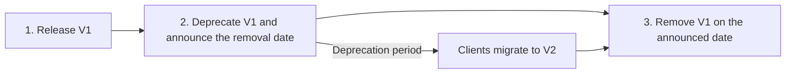

# Aggressive Obsolescence

## Description

The Aggressive Obsolescence pattern announces, as early as possible, a decommissioning date for the whole API or its obsolete parts, keeps those parts available but discouraged for a short period and removes them as soon as the date passes.

From the release onward, the provider makes clear that it reserves the right to deprecate and later retire endpoints, operations or representation elements (an input or output parameter, for example). The deadline counts from the moment the deprecation is announced, so it is relative rather than fixed at publication. The cycle has three steps: release the version, deprecate it with a removal date, and remove it when the deadline arrives. The deprecation period is short, typically a year or less for an enterprise API, just enough for the client to migrate to the new version or to an alternative. Clients that do not migrate in time lose access; depending on their market position and the alternatives available, they may also switch providers.

## Problems it solves

- Reducing the effort of maintaining rarely used or superseded parts with guaranteed service quality, including the skills needed to support old clients
- Decoupling client and provider life cycles: clients rarely upgrade at the same moment, and the provider may not even know them
- Removing only one part (an operation or message element) instead of a whole version, affecting fewer clients

- Keeping old versions indefinitely, with growing support cost and legacy code
- Clients that only migrate when forced, slowing down the evolution of the API
- The lack of a predictable rule for when a feature stops existing
- API parts the provider wants to fix or replace without carrying eternal compatibility, for economic, legal or security reasons (such as replacing weak cryptographic algorithms)

## When to use

- When the provider has the power to impose deadlines, for example on internal APIs or among close partners
- When maintaining several versions is expensive or blocks important improvements, such as security fixes
- When the provider's needs outweigh the clients' needs
- When the provider has not yet declared any life-cycle policy and needs a path for incompatible changes
- When clients are few, known and can be notified directly
- When the API still evolves fast and the provider needs the freedom to remove what did not work

## When to avoid

- When clients are numerous, unknown or slow to change, and a break would be costly for them
- When a contract or regulation requires support for a minimum period
- When there is no reliable channel to notify clients about the deprecation
- When the provider lacks market power and would lose clients to alternatives

## Trade-offs

| Benefit | Cost / Risk |
| --- | --- |
| Fewer versions and less legacy code to maintain | Clients are forced to migrate within the provider's deadline |
| Faster evolution and fixes without carrying old compatibility | Whoever misses the warnings gets broken integrations |
| Simple, predictable rule: every feature has an end date | Effort to communicate and to follow the migration |
| Frees the team and infrastructure from the old version | Risk of losing clients who do not accept the rush |

- **Warning:** signal the deprecation in the response itself (`Deprecation` and `Sunset` headers, a warning field in the body), not only by email or on the portal.
- **Deadline:** the period should be short but enough for the client to plan and ship the change; too short causes breakage, too long loses the effect.
- **Granularity:** you can deprecate the whole API, one operation or just one element of a message.
- **Monitoring:** track who still uses the feature before the date and contact the stragglers directly.
- **Price:** removing features can have commercial effects if there is a [Pricing Plan](/architecture/api-patterns/documentation/pricing-plan); usage metering helps decide what to remove.
- **Master data:** is usually harder to remove from messages than operational data.
- **After the date:** answer with a clear error (for example `410 Gone`) pointing to the successor, instead of failing obscurely.

## Diagram



The version is released, then deprecated with a fixed removal date and retired when the deadline ends, whether or not clients have migrated.

## Example

The fintech decides to retire version 1 of the Pix charge API, which returned the amount as a decimal number, in favor of version 2, which uses integer cents. V1 keeps answering until 2027-03-31, with deprecation headers, and then starts returning `410 Gone`. The request and response during the deprecation period:

```http
GET /v1/pix-charges/pix-9f3a HTTP/1.1
Host: api.fintech.example
```

```http
HTTP/1.1 200 OK
Deprecation: true
Sunset: Wed, 31 Mar 2027 23:59:59 GMT
Link: </v2/pix-charges/pix-9f3a>; rel="successor-version"
Content-Type: application/json

{"id": "pix-9f3a", "status": "PAID", "amount": "1250.00"}
```

After the date, the same call fails with an error pointing to the successor. The V1 response logic in each language:

<Tabs groupId="lang" queryString>
<TabItem value="java" label="Java">

```java
import java.time.LocalDate;

public class Main {
    static final LocalDate SUNSET = LocalDate.of(2027, 3, 31);

    static String respondV1(LocalDate today) {
        if (today.isAfter(SUNSET)) {
            return "410 Gone";
        }
        return "200 OK | Deprecation: true | Sunset: Wed, 31 Mar 2027 23:59:59 GMT"
            + " | Link: </v2/pix-charges>; rel=\"successor-version\"";
    }

    public static void main(String[] args) {
        for (LocalDate day : new LocalDate[] {LocalDate.of(2026, 11, 17), LocalDate.of(2027, 4, 1)}) {
            System.out.println(day + " -> " + respondV1(day));
        }
    }
}
```

</TabItem>
<TabItem value="python" label="Python">

```python
from datetime import date

SUNSET = date(2027, 3, 31)


def respond_v1(today: date) -> str:
    if today > SUNSET:
        return "410 Gone"
    return ("200 OK | Deprecation: true | Sunset: Wed, 31 Mar 2027 23:59:59 GMT"
            ' | Link: </v2/pix-charges>; rel="successor-version"')


for day in (date(2026, 11, 17), date(2027, 4, 1)):
    print(f"{day} -> {respond_v1(day)}")
```

</TabItem>
<TabItem value="go" label="Go">

```go
package main

import (
	"fmt"
	"time"
)

var sunset = time.Date(2027, 3, 31, 0, 0, 0, 0, time.UTC)

func respondV1(today time.Time) string {
	if today.After(sunset) {
		return "410 Gone"
	}
	return "200 OK | Deprecation: true | Sunset: Wed, 31 Mar 2027 23:59:59 GMT" +
		` | Link: </v2/pix-charges>; rel="successor-version"`
}

func main() {
	days := []time.Time{
		time.Date(2026, 11, 17, 0, 0, 0, 0, time.UTC),
		time.Date(2027, 4, 1, 0, 0, 0, 0, time.UTC),
	}
	for _, day := range days {
		fmt.Printf("%s -> %s\n", day.Format("2006-01-02"), respondV1(day))
	}
}
```

</TabItem>
</Tabs>

```text
2026-11-17 -> 200 OK | Deprecation: true | Sunset: Wed, 31 Mar 2027 23:59:59 GMT | Link: </v2/pix-charges>; rel="successor-version"
2027-04-01 -> 410 Gone
```

## Related patterns

- [Limited Lifetime Guarantee](/architecture/api-patterns/life-cycle-management/limited-lifetime-guarantee) — also forbids breaks within the announced period, but the period is absolute and fixed at publication, while here it is relative and announced at deprecation
- [Two in Production](/architecture/api-patterns/life-cycle-management/two-in-production) — retires the oldest version when a new one is released, instead of using a calendar date; obsolescence can force one of the two versions out
- [Experimental Preview](/architecture/api-patterns/life-cycle-management/experimental-preview) — an even weaker commitment: no guarantee; aggressive obsolescence at least warns before removing
- [Version Identifier](/architecture/api-patterns/versioning/version-identifier) — identifies which version is deprecated and which replaces it
- [Semantic Versioning](/architecture/api-patterns/versioning/semantic-versioning) — a major version change signals a break and triggers the deprecation cycle
- [Metadata Element](/architecture/api-patterns/element-stereotypes/metadata-element) — can carry the deprecation markers in messages
- [API Description](/architecture/api-patterns/documentation/api-description) — should list the deprecated parts and dates; the [Service Level Agreement](/architecture/api-patterns/documentation/service-level-agreement) can record the policy
- [Pricing Plan](/architecture/api-patterns/documentation/pricing-plan) — usage metering helps decide what to remove
- [Error Report](/architecture/api-patterns/special-purpose-representations/error-report) — format of the error returned after removal
- [Strangler Fig](/architecture/cloud-design-patterns/integration-and-modernization/strangler-fig) — replaces a system piece by piece; here what is replaced is the API version, with a fixed end date

## Reference

- [Patterns for API Design, chapter 8: Aggressive Obsolescence](https://api-patterns.org/)
- [RFC 8594: The Sunset HTTP Header Field](https://www.rfc-editor.org/rfc/rfc8594)
