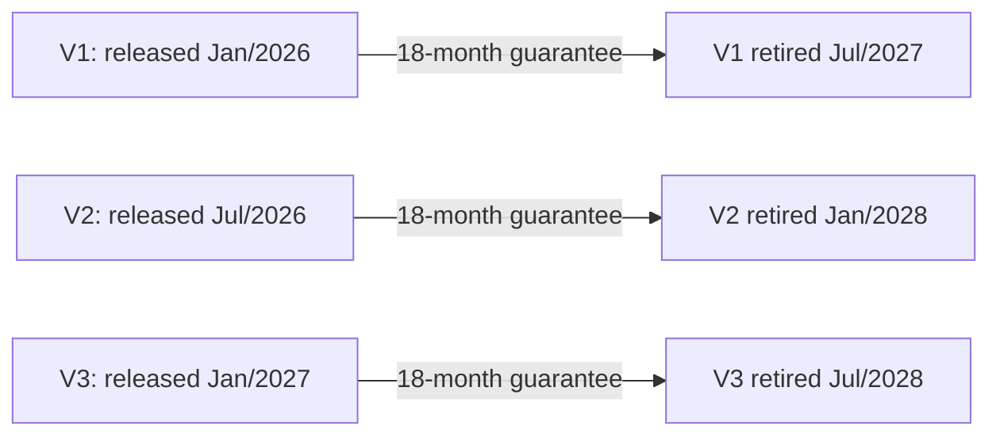

# Limited Lifetime Guarantee

## Description

The Limited Lifetime Guarantee pattern guarantees that the published API will not be broken for a fixed period, and labels each version with an expiration date known from the moment of release.

The provider promises to keep the version usable, in a compatible way, for a limited yet comfortable time, and retires it when the deadline arrives. The client is protected from unexpected breakage and outages and, when adopting the version, already knows by when it must adapt and ship a new version of its application. Because the window is measured in time rather than in the number of active versions, no extra coordination between the organizations is needed, and releasing other versions does not change the retirement date. The end of the guarantee amounts to an implicit deprecation: afterward the provider may change anything, including breaking compatibility or discontinuing the version. In practice the periods tend to be multiples of six months (6, 12, 18 or 24).

## Problems it solves

- Clients that cannot plan because they do not know how long the version they use will remain available
- Unexpected integration breakage caused by incompatible changes to the API
- Indefinite support for old versions, with no end date
- The need to coordinate each client's migration case by case
- The cost of keeping old or rarely used API parts for a long time

## When to use

- When clients need predictability to plan their own delivery cycles, such as banks and integrated partners
- When the API is public or used by many organizations, and negotiating deadlines individually is impractical
- When the provider can keep several versions active throughout the promised window
- When regulation or contracts require a minimum period of stability
- When the provider does not control client roadmaps and considers the financial or reputation damage of forcing changes high
- When the provider wants an institutionalized way to force upgrades, for example because of design or cryptography flaws that threaten the whole ecosystem

## When to avoid

- When the API is still experimental and the design changes often: prefer [Experimental Preview](/architecture/api-patterns/life-cycle-management/experimental-preview)
- When the provider cannot sustain the cost of maintaining old versions for the promised period
- When a serious security defect would force breaking the promise
- When the provider needs the freedom to remove features on short notice: consider [Aggressive Obsolescence](/architecture/api-patterns/life-cycle-management/aggressive-obsolescence)

## Trade-offs

| Benefit | Cost / Risk |
| --- | --- |
| Predictability: the client knows the end date from day one | The provider bears the cost of maintaining each version until the deadline |
| No individual coordination with each client | Several versions may be active at the same time, in an unpredictable number |
| Retirement date independent of new releases | A long period delays removing legacy code and incompatible fixes |
| Greater trust and adoption | Breaking the promise does great damage to reputation and possibly legal standing |

- **Technical debt:** keeping compatibility over time produces awkward interfaces, odd names and more regression-testing effort; the provider lives with this debt until it can change the API.
- **Freeze:** the frozen API can delay adopting new technologies and features, and the provider loses agility to handle urgent requests that break compatibility.
- **Unmaintained clients:** those whose clients nobody maintains anymore may be forced into an impossible change on the final date.
- **Duration:** choose a period that balances the clients' needs and the provider's cost; multiples of six months are common.
- **Compatibility:** during the window only compatible changes are allowed; fixes that break compatibility require a new version.
- **Communication:** publish the expiration date in the API description and in the responses, and remind clients as it approaches.
- **Application:** combine with a [Version Identifier](/architecture/api-patterns/versioning/version-identifier) to know which version each date refers to.

## Diagram



Each version carries its own retirement date, set at publication and independent of the release of the others.

## Example

The fintech publishes version 2 of the personal credit contract API and states, in the resource itself, the date until which compatibility is guaranteed. Dates and values are illustrative.

```http
GET /v2/loan-contracts/loan-5521 HTTP/1.1
Host: api.fintech.example
Accept: application/json
```

```http
HTTP/1.1 200 OK
Content-Type: application/json
API-Version: 2.0
Sunset: Fri, 31 Dec 2027 23:59:59 GMT
Link: <https://api.fintech.example/docs/lifecycle>; rel="sunset"

{
  "id": "loan-5521",
  "accountId": "acc-4821",
  "principalCents": 1500000,
  "monthlyRatePercent": "1.89",
  "installments": 24,
  "status": "ACTIVE"
}
```

Version 2 only receives compatible changes until 2027-12-31. Version 3, when released, will have its own deadline, without altering this one.

## Related patterns

- [Two in Production](/architecture/api-patterns/life-cycle-management/two-in-production) — a more lenient approach for the provider: fixes the number of active versions instead of the time; can be combined with this guarantee when clients ask for a firm date
- [Aggressive Obsolescence](/architecture/api-patterns/life-cycle-management/aggressive-obsolescence) — also forbids breaks within the announced period, but the period is relative and announced at deprecation, not at publication; more lenient for the provider
- [Experimental Preview](/architecture/api-patterns/life-cycle-management/experimental-preview) — the opposite extreme: no guarantee of stability or lifetime
- [Version Identifier](/architecture/api-patterns/versioning/version-identifier) — identifies the version the expiration date applies to
- [Semantic Versioning](/architecture/api-patterns/versioning/semantic-versioning) — communicates what changes in each version within the guarantee window
- [Service Level Agreement](/architecture/api-patterns/documentation/service-level-agreement) — the natural place to formalize the lifetime guarantee
- [API Description](/architecture/api-patterns/documentation/api-description) — where the expiration date is published, together with the SLA

## Reference

- [Patterns for API Design, chapter 8: Limited Lifetime Guarantee](https://api-patterns.org/)
