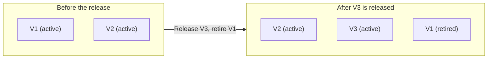

# Two in Production

## Description

The Two in Production pattern keeps two versions of an endpoint and its operations in production at the same time, without requiring compatibility between them, and updates and decommissions them in a sliding, overlapping window.

When releasing a new version, the provider retires the oldest one still running and keeps supporting the previous one. The client then chooses when to migrate: it can stay on the version in use, study the changes and adapt calmly, without risking the stability of its main system. The provider announces this policy in advance, identifies the versions (for example with a [Version Identifier](/architecture/api-patterns/versioning/version-identifier)) and redirects or rejects calls to the retired version, using protocol features such as those of HTTP. The two versions in production are two major versions: fully compatible versions (the patch version in [Semantic Versioning](/architecture/api-patterns/versioning/semantic-versioning)) may replace an active one without violating the rule. Because existing clients stay on the old version until they migrate, the provider can make bold changes in the new one. A variant, N in Production, widens the window to more than two versions: it gives clients more time and options, at the cost of more maintenance and operation for the provider.

## Problems it solves

- Clients that need time to migrate when a new version breaks compatibility
- The obligation to maintain every version ever released indefinitely
- Incompatible changes the provider must make without taking down current clients
- Provider and clients, especially of a [Public API](/architecture/api-patterns/foundations/public-api) or [Community API](/architecture/api-patterns/foundations/community-api), that evolve at different speeds and cannot be forced to upgrade right away
- The cost of keeping each old version alive (fixes, security patches, dependencies, regression tests)
- Clients' uncertainty about how many versions will be available at any moment

## When to use

- When new versions bring breaking changes and some clients do not migrate on release day
- When the provider can operate two versions in parallel, including data and deployment
- When migration depends on clients' delivery cycles that the provider does not control
- When you want a simple policy based on the number of versions rather than on calendar dates

## When to avoid

- When the cost of operating two versions is too high, for example because they need incompatible databases or data models
- When clients need a fixed date to plan: [Limited Lifetime Guarantee](/architecture/api-patterns/life-cycle-management/limited-lifetime-guarantee) gives that predictability
- When versions can always be compatible, which removes the need for coexisting versions
- When some clients do not follow releases: with each new version they lose access without a clear advance warning

## Trade-offs

| Benefit | Cost / Risk |
| --- | --- |
| Clients choose when to migrate within a window | Two versions to maintain, test, deploy and monitor |
| Breaking changes are possible without taking clients down | The cost grows in the N in Production variant |
| Simple policy that is easy to explain | Whoever does not migrate in time is cut off when a new version is released |
| Less rush for the client than with a fixed-date deprecation | Coexistence time is unpredictable: it depends on the provider's release cadence |

- **Identification:** use an explicit version identifier (in the URL, a header or the media type) for routing.
- **Release:** when releasing version N+1, version N-1 is retired; warn its clients in advance and indicate the migration.
- **Redirection:** calls to the retired version can get a clear response pointing to the successor, instead of a generic error.
- **Cadence:** releasing versions too often shortens each one's lifetime and pressures clients; plan the rhythm.
- **Responsibilities:** the provider may release incompatible versions but must sustain several; the client must migrate within a limited time but plans its schedule freely.
- **Unpredictability:** unlike Limited Lifetime Guarantee, retirement depends on other releases and cannot be planned as far ahead, unless the patterns are combined.
- **Data:** both versions usually share the same domain model; one adapter per version avoids duplicating business logic.

## Diagram



The window slides with each release: always two active versions, and the oldest leaves when a new one comes in.

## Example

The fintech keeps V1 and V2 of the statement API online. When V3 is released, V1 will be retired. Calls to V1 after that get a response pointing to the successor. Before V3 is released, both work:

```http
GET /v1/accounts/acc-4821/ledger-entries HTTP/1.1
Host: api.fintech.example
```

```http
HTTP/1.1 200 OK
Content-Type: application/json
API-Version: 1
Link: </docs/lifecycle>; rel="describedby"

[{"id": "le-7001", "amount": "125.00", "type": "PIX_IN"}]
```

```http
GET /v2/accounts/acc-4821/ledger-entries HTTP/1.1
Host: api.fintech.example
```

```http
HTTP/1.1 200 OK
Content-Type: application/json
API-Version: 2

[{"id": "le-7001", "amountCents": 12500, "currency": "BRL", "type": "PIX_IN"}]
```

After V3 is released, the call to V1 is refused with an error indicating the migration:

```http
HTTP/1.1 410 Gone
Content-Type: application/json
Link: </v3/accounts/acc-4821/ledger-entries>; rel="successor-version"

{"error": "VERSION_RETIRED", "message": "Version 1 has been retired. Use version 2 or 3.", "supportedVersions": [2, 3]}
```

V2 and V3 become the two in production. V1's decimal amount turns into integer cents from V2 onward, an incompatible change that justifies the coexistence.

## Related patterns

- [Version Identifier](/architecture/api-patterns/versioning/version-identifier) — almost always needed to tell the active versions apart; the policy should be stated in the [API Description](/architecture/api-patterns/documentation/api-description) or the [Service Level Agreement](/architecture/api-patterns/documentation/service-level-agreement)
- [Limited Lifetime Guarantee](/architecture/api-patterns/life-cycle-management/limited-lifetime-guarantee) — uses a time period instead of a number of active versions; combine it with this pattern when clients demand a firm expiration date
- [Aggressive Obsolescence](/architecture/api-patterns/life-cycle-management/aggressive-obsolescence) — retires versions on a short announced deadline, with no sliding window; can be applied to one of the two versions to force migration and make room for a newer one
- [Experimental Preview](/architecture/api-patterns/life-cycle-management/experimental-preview) — can be one of the two (or N) versions in production
- [Semantic Versioning](/architecture/api-patterns/versioning/semantic-versioning) — indicates which changes break compatibility and call for a new major version
- [Error Report](/architecture/api-patterns/special-purpose-representations/error-report) — format of the error returned for the retired version
- [Strangler Fig](/architecture/cloud-design-patterns/integration-and-modernization/strangler-fig) — also keeps old and new side by side during a transition, but for systems rather than API versions
- [API Gateway](/architecture/microservices/external-api/api-gateway) — common point to route each version to its implementation

## Reference

- [Patterns for API Design, chapter 8: Two in Production](https://api-patterns.org/)
