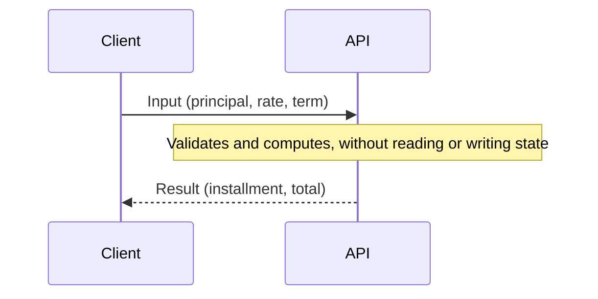

# Computation Function

## Description

The Computation Function pattern is a stateless, side-effect-free API operation that receives data from the client, computes a result that depends exclusively on that input and returns it in the response. It neither reads nor writes the provider's application state, which makes it easy to scale, move and deploy.

The operation serves to outsource a calculation that the client should not or cannot run alone, for reasons of cost, capacity, trust or specialized knowledge. The contract should define at least one precondition on the request elements and postconditions on the response content. There is no need to manage transactions on the provider, since the function stores nothing.

There are three variants: the Transformation Service, which changes the representation of the data without changing its meaning; the Validation Service, which checks the correctness of an input and returns a simple result; and the Long Running Computation, which uses asynchronous invocation (messaging, callback or a long request with a tracking link) when processing is slow.

## Problems it solves

- Calculations that require CPU, memory or knowledge the client does not have
- Calculation or validation rules that change and should not require reinstalling every client
- The need to validate data independently, before an operation that stores it
- Conversion of formats or notations between systems, centralized in a single service

## When to use

- To simulate a loan or compute installments, rates and taxes from the supplied data
- To validate a document, an address or a Pix key before sending the write request
- To convert representations, such as from one structure to another or from one notation to another
- For a liveness check (heartbeat) of a critical service

## When to avoid

- When the calculation needs the provider's state: it becomes a [Retrieval Operation](/architecture/api-patterns/operation-responsibilities/retrieval-operation)
- When the calculation is simple and fast enough for a local library, without the network cost
- When regulation or internal policy prevents sending the data to a third party
- When the result must be stored: use a [State Creation Operation](/architecture/api-patterns/operation-responsibilities/state-creation-operation) or a [State Transition Operation](/architecture/api-patterns/operation-responsibilities/state-transition-operation)

## Trade-offs

| Benefit | Cost / Risk |
| --- | --- |
| Stateless, scales and moves freely between nodes | Network latency and serialization that a local calculation would not have |
| Centralized logic, updated without changing clients | The client depends on an external service, which may become unavailable or change |
| Processing capacity concentrated on the provider | Heavy calculations create bottlenecks and affect meeting the [Service Level Agreement](/architecture/api-patterns/documentation/service-level-agreement) |
| Easy to test, since it depends only on the input | Messages may grow, since the provider does not keep intermediate results |

- **Reproducibility and trust:** the client must trust that the provider computes correctly and answers coherently.
- **Cache:** only worthwhile if several clients ask for the same calculation and the result is deterministic.
- **Security:** protection depends on the sensitivity of the data; every remote endpoint is exposed to denial of service.
- **Slow processing:** use the asynchronous variant and a [Link Element](/architecture/api-patterns/element-stereotypes/link-element) to track progress.

## Diagram



The response depends only on the data sent in the request; the provider neither queries nor changes any storage.

## Example

The fintech exposes a personal credit simulation: the client provides the amount, an illustrative monthly rate and the term, and receives the fixed installment and the total. Nothing is stored, and the call can be repeated at will. Values travel as integer cents.

```http
POST /loan-simulations HTTP/1.1
Content-Type: application/json

{ "principalCents": 1000000, "monthlyRate": 0.02, "months": 10 }
```

```http
HTTP/1.1 200 OK
Content-Type: application/json

{ "installmentCents": 111327, "totalCents": 1113270 }
```

<Tabs groupId="lang" queryString>
<TabItem value="java" label="Java">

```java
public class Main {
    public static void main(String[] args) {
        LoanSimulation result = new LoanSimulationFunction().simulate(1_000_000, 0.02, 10);
        System.out.println(result.installmentCents() + " " + result.totalCents()); // 111327 1113270
    }
}

record LoanSimulation(long installmentCents, long totalCents) {}

class LoanSimulationFunction {
    // Stateless: the result depends only on the arguments.
    LoanSimulation simulate(long principalCents, double monthlyRate, int months) {
        if (principalCents <= 0 || months <= 0) {
            throw new IllegalArgumentException("principal and term must be positive");
        }
        double factor = monthlyRate / (1 - Math.pow(1 + monthlyRate, -months));
        long installment = Math.round(principalCents * factor);
        return new LoanSimulation(installment, installment * months);
    }
}
```

</TabItem>
<TabItem value="python" label="Python">

```python
from typing import NamedTuple

class LoanSimulation(NamedTuple):
    installment_cents: int
    total_cents: int

# Stateless: the result depends only on the arguments.
def simulate(principal_cents: int, monthly_rate: float, months: int) -> LoanSimulation:
    if principal_cents <= 0 or months <= 0:
        raise ValueError("principal and term must be positive")
    factor = monthly_rate / (1 - (1 + monthly_rate) ** -months)
    installment = round(principal_cents * factor)
    return LoanSimulation(installment, installment * months)

result = simulate(1_000_000, 0.02, 10)
print(result.installment_cents, result.total_cents)  # 111327 1113270
```

</TabItem>
<TabItem value="go" label="Go">

```go
package main

import (
	"errors"
	"fmt"
	"math"
)

type LoanSimulation struct {
	InstallmentCents int64
	TotalCents       int64
}

// Stateless: the result depends only on the arguments.
// In Go, invalid input comes back as an error.
func Simulate(principalCents int64, monthlyRate float64, months int) (LoanSimulation, error) {
	if principalCents <= 0 || months <= 0 {
		return LoanSimulation{}, errors.New("principal and term must be positive")
	}
	factor := monthlyRate / (1 - math.Pow(1+monthlyRate, float64(-months)))
	installment := int64(math.Round(float64(principalCents) * factor))
	return LoanSimulation{installment, installment * int64(months)}, nil
}

func main() {
	result, _ := Simulate(1_000_000, 0.02, 10)
	fmt.Println(result.InstallmentCents, result.TotalCents) // 111327 1113270
}
```

</TabItem>
</Tabs>

## Related patterns

- [Retrieval Operation](/architecture/api-patterns/operation-responsibilities/retrieval-operation) — reads state; a Validation Service that consults internal state becomes a Retrieval Operation
- [State Creation Operation](/architecture/api-patterns/operation-responsibilities/state-creation-operation) — only writes state
- [State Transition Operation](/architecture/api-patterns/operation-responsibilities/state-transition-operation) — reads and writes state; a Computation Function often validates the request before it
- [Processing Resource](/architecture/api-patterns/endpoint-roles/processing-resource) — the endpoint that normally hosts the function
- [Parameter Tree](/architecture/api-patterns/basic-structure/parameter-tree) — common structure of the messages of complex transformations
- [Error Report](/architecture/api-patterns/special-purpose-representations/error-report) — explains why an input was rejected
- [Asynchronous Request-Reply](/architecture/cloud-design-patterns/messaging/asynchronous-request-reply) — models the Long Running Computation variant
- [Health Endpoint Monitoring](/architecture/cloud-design-patterns/resiliency/health-endpoint-monitoring) — the liveness check is an example of a Validation Service
- [Service Layer](/design/poeaa/domain-logic/service-layer) — internal service layer whose stateless operations are candidates for Computation Functions

## Reference

- [Patterns for API Design, chapter 5: Computation Function](https://api-patterns.org/)
