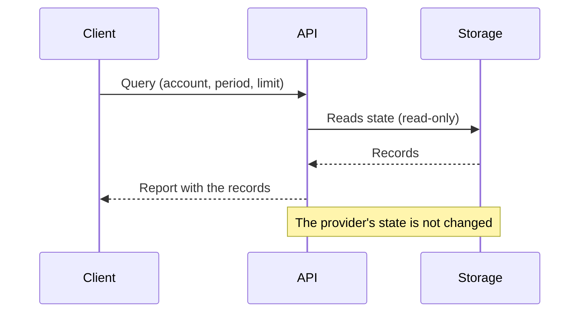

# Retrieval Operation

## Description

The Retrieval Operation pattern is a read-only API operation that returns to the client a machine-readable representation of information held by the provider, with search, filter and formatting capabilities. It accesses the provider's state but does not change it: the only acceptable side effect is infrastructure-level, such as access logs.

The operation serves ad hoc or periodic information needs, such as a month's statement, and often returns data in a structure different from the internal domain model. Simple queries use atomic parameters and return a parameter tree; richer scenarios resort to a declarative query language. Known variants are the Status Check (progress inquiry), the Time-Bound Report (report by period) and the Business Rule Validator (validating a rule against existing state).

## Problems it solves

- Consumers that need to query provider data without copying the entire database
- Data in an internal format that does not fit the clients' information needs
- The need to bound the scope, criteria and period of a report
- Read loads that need to scale independently of writes

## When to use

- For statements, listings, searches and reports over an endpoint's data
- To query the progress of a running process (status check)
- For reports over a time interval, such as an account's monthly statement
- When you want to separate the read model from the write model, as in CQRS

## When to avoid

- When the call must change state: use a [State Transition Operation](/architecture/api-patterns/operation-responsibilities/state-transition-operation) or a [State Creation Operation](/architecture/api-patterns/operation-responsibilities/state-creation-operation)
- When the result depends only on the input and not on state: a [Computation Function](/architecture/api-patterns/operation-responsibilities/computation-function) is simpler
- For high-velocity continuous flows, where a streaming model suits better than repeated queries
- When queries require aggregations so heavy that they should be precomputed in an analytical replica

## Trade-offs

| Benefit | Cost / Risk |
| --- | --- |
| Reads without side effects, easy to scale by replicating data | Can become a bottleneck if the requested queries do not match how the data is stored |
| Clients get only what they need, with filters and formats | The more flexible the query, the harder to secure, optimize and document |
| Easy to cache and to expose as a public data API | Responses may contain sensitive data and require access control |
| Separates the read model from the write model | Read replicas may lag behind writes |

- **Volume:** use [Pagination](/architecture/api-patterns/response-shaping/pagination) when the result can be large.
- **Response size:** a [Wish List](/architecture/api-patterns/response-shaping/wish-list) or [Wish Template](/architecture/api-patterns/response-shaping/wish-template) lets the client shape the response.
- **Interpretation:** [Metadata Elements](/architecture/api-patterns/element-stereotypes/metadata-element) prevent misreadings of the data.
- **Security:** in public APIs, combine with an [API Key](/architecture/api-patterns/special-purpose-representations/api-key) and a [Rate Limit](/architecture/api-patterns/documentation/rate-limit).

## Diagram



The query arrives with the search criteria, the provider reads the state without writing, and returns a report with the requested slice.

## Example

The fintech's app shows an account statement for a period. The operation filters ledger entries by date and never changes the ledger.

```http
GET /accounts/acc-42/ledger-entries?from=2026-11-01&to=2026-11-15&limit=50 HTTP/1.1
Accept: application/json
```

```http
HTTP/1.1 200 OK
Content-Type: application/json

{
  "accountId": "acc-42",
  "from": "2026-11-01",
  "to": "2026-11-15",
  "entries": [
    { "id": "le-2", "bookedOn": "2026-11-03", "amountCents": 250000, "description": "Pix received" },
    { "id": "le-3", "bookedOn": "2026-11-10", "amountCents": -12000, "description": "Card purchase" }
  ]
}
```

<Tabs groupId="lang" queryString>
<TabItem value="java" label="Java">

```java
import java.util.*;
import java.time.LocalDate;

public class Main {
    public static void main(String[] args) {
        StatementService service = new StatementService(List.of(
                new LedgerEntry("le-1", LocalDate.parse("2026-10-28"), -4_990, "Energy bill"),
                new LedgerEntry("le-2", LocalDate.parse("2026-11-03"), 250_000, "Pix received"),
                new LedgerEntry("le-3", LocalDate.parse("2026-11-10"), -12_000, "Card purchase"),
                new LedgerEntry("le-4", LocalDate.parse("2026-11-20"), -3_000, "Fee")));
        List<LedgerEntry> page = service.findByPeriod(
                LocalDate.parse("2026-11-01"), LocalDate.parse("2026-11-15"));
        page.forEach(e -> System.out.println(e.id())); // le-2, le-3
    }
}

record LedgerEntry(String id, LocalDate bookedOn, long amountCents, String description) {}

class StatementService {
    private final List<LedgerEntry> ledger;

    StatementService(List<LedgerEntry> ledger) { this.ledger = ledger; }

    // Read-only: filters the ledger without changing it.
    List<LedgerEntry> findByPeriod(LocalDate from, LocalDate to) {
        return ledger.stream()
                .filter(e -> !e.bookedOn().isBefore(from) && !e.bookedOn().isAfter(to))
                .toList();
    }
}
```

</TabItem>
<TabItem value="python" label="Python">

```python
from dataclasses import dataclass
from datetime import date
from typing import List

@dataclass(frozen=True)
class LedgerEntry:
    id: str
    booked_on: date
    amount_cents: int
    description: str

class StatementService:
    def __init__(self, ledger: List[LedgerEntry]) -> None:
        self._ledger = ledger

    # Read-only: filters the ledger without changing it.
    def find_by_period(self, start: date, end: date) -> List[LedgerEntry]:
        return [e for e in self._ledger if start <= e.booked_on <= end]

service = StatementService([
    LedgerEntry("le-1", date(2026, 10, 28), -4_990, "Energy bill"),
    LedgerEntry("le-2", date(2026, 11, 3), 250_000, "Pix received"),
    LedgerEntry("le-3", date(2026, 11, 10), -12_000, "Card purchase"),
    LedgerEntry("le-4", date(2026, 11, 20), -3_000, "Fee"),
])
for entry in service.find_by_period(date(2026, 11, 1), date(2026, 11, 15)):
    print(entry.id)  # le-2, le-3
```

</TabItem>
<TabItem value="go" label="Go">

```go
package main

import (
	"fmt"
)

type LedgerEntry struct {
	ID          string
	BookedOn    string // ISO format (YYYY-MM-DD), comparable as text
	AmountCents int64
	Description string
}

type StatementService struct {
	ledger []LedgerEntry
}

// Read-only: filters the ledger without changing it.
func (s *StatementService) FindByPeriod(from, to string) []LedgerEntry {
	var result []LedgerEntry
	for _, e := range s.ledger {
		if e.BookedOn >= from && e.BookedOn <= to {
			result = append(result, e)
		}
	}
	return result
}

func main() {
	service := &StatementService{ledger: []LedgerEntry{
		{"le-1", "2026-10-28", -4_990, "Energy bill"},
		{"le-2", "2026-11-03", 250_000, "Pix received"},
		{"le-3", "2026-11-10", -12_000, "Card purchase"},
		{"le-4", "2026-11-20", -3_000, "Fee"},
	}}
	for _, e := range service.FindByPeriod("2026-11-01", "2026-11-15") {
		fmt.Println(e.ID) // le-2, le-3
	}
}
```

</TabItem>
</Tabs>

## Related patterns

- [State Creation Operation](/architecture/api-patterns/operation-responsibilities/state-creation-operation) — pushes data to the provider; the Retrieval Operation pulls it
- [State Transition Operation](/architecture/api-patterns/operation-responsibilities/state-transition-operation) — reads and also writes state
- [Computation Function](/architecture/api-patterns/operation-responsibilities/computation-function) — does not access state; a Retrieval Operation always reads it
- [Information Holder Resource](/architecture/api-patterns/endpoint-roles/information-holder-resource) — the endpoint that most often exposes these operations
- [Pagination](/architecture/api-patterns/response-shaping/pagination), [Wish List](/architecture/api-patterns/response-shaping/wish-list) and [Wish Template](/architecture/api-patterns/response-shaping/wish-template) — control the volume and shape of responses
- [Repository](/design/poeaa/object-relational-metadata-mapping/repository) — internal query abstraction; the Retrieval Operation is its counterpart exposed by the API
- [Conditional Request](/architecture/api-patterns/message-exchange-optimization/conditional-request) — avoids resending data the client already has

## Reference

- [Patterns for API Design, chapter 5: Retrieval Operation](https://api-patterns.org/)
