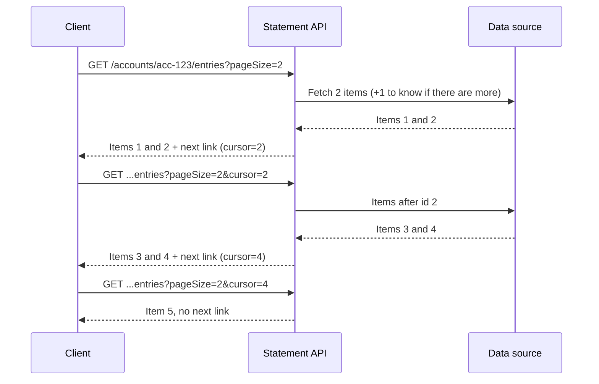

# Pagination

## Description

The Pagination pattern splits a large data set into smaller parts, the pages, and delivers one page per response message, with information the client uses to request the next ones. That way the provider does not have to assemble, and the client does not have to consume, a whole collection at once.

The page size can be fixed in the contract or chosen by the client up to a limit set by the provider. Besides the items, each response carries [Metadata Elements](/architecture/api-patterns/element-stereotypes/metadata-element) (page size, total, position) and, preferably, a [Link Element](/architecture/api-patterns/element-stereotypes/link-element) to the next page. The book describes four variants: **page-based** (the client asks for a page index), **offset-based** (the client says how many items to skip and how many to read), **cursor-based** (the client sends back an opaque identifier of the last item seen) and **time-based** (similar to the cursor, but with timestamps). The first two are interchangeable and become inconsistent if the collection changes between requests, since an item may be skipped or repeated. The cursor does not depend on the absolute position and avoids that problem, but it usually does not allow jumping to an arbitrary page.

## Problems it solves

- Huge responses that exhaust memory and network, on the provider or the client, as the collection grows
- High response times for callers that only need the first items (for example, the latest transactions of a statement)
- Unbounded queries that become a denial-of-service vector
- Lack of a standard way to walk through a large collection, item by item or page by page

## When to use

- On endpoints that return collections of large or unknown size, such as statements, lists of boletos and Pix history
- When the consumer (person or application) reads the data sequentially and rarely needs all of it
- In batch replication between systems, where the transfer must be resumable
- When the collection changes while it is being read and the read must be stable (use the cursor variant)

## When to avoid

- When the response is not a set of items and cannot be sliced
- When collections are small and bounded, and a single message is simpler
- When the client needs the full set at once, for example to sort or search on its side; in that case consider a [Data Transfer Resource](/architecture/api-patterns/endpoint-roles/data-transfer-resource)
- When random access to pages is a central requirement and the opaque cursor does not fit

## Trade-offs

| Benefit | Cost / Risk |
| --- | --- |
| Small, predictable responses, with less memory and latency | One call becomes a conversation, with more messages and more client code |
| Limits the damage of abusive queries, if the maximum page size is enforced | The provider may still load everything into memory by mistake and lose the gain |
| The client processes data a bit at a time and can stop at any point | Changes to items on pages already read go unnoticed |
| The cursor gives a stable read even with concurrent inserts | The opaque cursor prevents random access and must be treated as a contract |

- **Ordering:** the order of the items cannot change during pagination, and changing it in a new API version may break clients without warning.
- **Page size:** small pages increase the number of calls; define a default and a maximum.
- **State:** decide how long cursors or intermediate results stay valid and whether requests must be idempotent.
- **Filters:** filter before paginating, not the other way around, to reduce the work.
- **Consistency:** pagination copes with new items, but rarely with changes to items already delivered.

## Diagram



The client follows the `next` link until it no longer appears. The cursor holds the last item seen, so inserts at the start of the statement do not shift the following pages.

## Example

A statement for the fintech's digital account returns ledger entries (`LedgerEntry`) by cursor, with at most 100 items per page. Amounts in cents.

```http
GET /accounts/acc-123/entries?pageSize=2
```

```json
{
  "pageSize": 2,
  "entries": [
    { "id": 1, "amountCents": 15000 },
    { "id": 2, "amountCents": -4290 }
  ],
  "_links": { "next": { "href": "/accounts/acc-123/entries?pageSize=2&cursor=2" } }
}
```

The pagination itself, on the provider side and in the client loop:

<Tabs groupId="lang" queryString>
<TabItem value="java" label="Java">

```java
import java.util.List;

record LedgerEntry(long id, long amountCents) {}
record Page(List<LedgerEntry> items, Long nextCursor) {}

public class Main {
    static Page page(List<LedgerEntry> all, Long after, int size) {
        int max = Math.min(size, 100);
        List<LedgerEntry> rest = all.stream()
                .filter(e -> after == null || e.id() > after).toList();
        List<LedgerEntry> items = rest.subList(0, Math.min(max, rest.size()));
        Long next = rest.size() > max ? items.get(items.size() - 1).id() : null;
        return new Page(items, next);
    }

    public static void main(String[] args) {
        List<LedgerEntry> entries = List.of(new LedgerEntry(1, 15000), new LedgerEntry(2, -4290),
                new LedgerEntry(3, 800), new LedgerEntry(4, -12000), new LedgerEntry(5, 50000));
        Long cursor = null;
        do {
            Page p = page(entries, cursor, 2);
            System.out.println(p.items().stream().map(LedgerEntry::id).toList()
                    + " next=" + (p.nextCursor() == null ? "end" : p.nextCursor()));
            cursor = p.nextCursor();
        } while (cursor != null);
        // [1, 2] next=2 / [3, 4] next=4 / [5] next=end
    }
}
```

</TabItem>
<TabItem value="python" label="Python">

```python
from dataclasses import dataclass
from typing import List, Optional, Tuple

@dataclass
class LedgerEntry:
    id: int
    amount_cents: int

def page(entries: List[LedgerEntry], after: Optional[int], size: int) -> Tuple[List[LedgerEntry], Optional[int]]:
    size = min(size, 100)
    rest = [e for e in entries if after is None or e.id > after]
    items = rest[:size]
    next_cursor = items[-1].id if len(rest) > size else None
    return items, next_cursor

entries = [LedgerEntry(1, 15000), LedgerEntry(2, -4290), LedgerEntry(3, 800),
           LedgerEntry(4, -12000), LedgerEntry(5, 50000)]
cursor = None
while True:
    items, cursor = page(entries, cursor, 2)
    print([e.id for e in items], "next=" + ("end" if cursor is None else str(cursor)))
    if cursor is None:
        break
# [1, 2] next=2 / [3, 4] next=4 / [5] next=end
```

</TabItem>
<TabItem value="go" label="Go">

```go
package main

import (
	"fmt"
	"strings"
)

type LedgerEntry struct {
	ID          int64
	AmountCents int64
}

// next is nil on the last page; the cursor is the id of the last item seen.
func page(entries []LedgerEntry, after *int64, size int) (items []LedgerEntry, next *int64) {
	if size > 100 {
		size = 100
	}
	var rest []LedgerEntry
	for _, e := range entries {
		if after == nil || e.ID > *after {
			rest = append(rest, e)
		}
	}
	if len(rest) > size {
		items = rest[:size]
		last := items[size-1].ID
		next = &last
		return
	}
	return rest, nil
}

func main() {
	entries := []LedgerEntry{{1, 15000}, {2, -4290}, {3, 800}, {4, -12000}, {5, 50000}}
	var cursor *int64
	for {
		items, next := page(entries, cursor, 2)
		parts := []string{}
		for _, e := range items {
			parts = append(parts, fmt.Sprint(e.ID))
		}
		ids := "[" + strings.Join(parts, ", ") + "]"
		if next == nil {
			fmt.Println(ids, "next=end")
			break
		}
		fmt.Println(ids, fmt.Sprintf("next=%d", *next))
		cursor = next
	}
	// [1 2] next=2 / [3 4] next=4 / [5] next=end
}
```

</TabItem>
</Tabs>

## Related patterns

- [Wish List](/architecture/api-patterns/response-shaping/wish-list) and [Wish Template](/architecture/api-patterns/response-shaping/wish-template) — reduce the size of each item; pagination reduces the number of items per message, and the two can be combined
- [Metadata Element](/architecture/api-patterns/element-stereotypes/metadata-element) and [Link Element](/architecture/api-patterns/element-stereotypes/link-element) — carry the size, the position and the link to the next page
- [Retrieval Operation](/architecture/api-patterns/operation-responsibilities/retrieval-operation) — the read operation that is usually paginated
- [Data Transfer Resource](/architecture/api-patterns/endpoint-roles/data-transfer-resource) — alternative when the client needs the whole set, exchanged as a resource of its own
- [Rate Limit](/architecture/api-patterns/documentation/rate-limit) — larger pages and fewer calls help stay within the quota
- [Request Batch](/architecture/distributed-systems/node-communication/request-batch) — groups several requests into one; pagination slices one response into several
- [Lazy Load](/design/poeaa/object-relational-behavioral/lazy-load) — the same idea of bringing data only when needed, inside data access

## Reference

- [Patterns for API Design, chapter 7: Pagination](https://api-patterns.org/)
