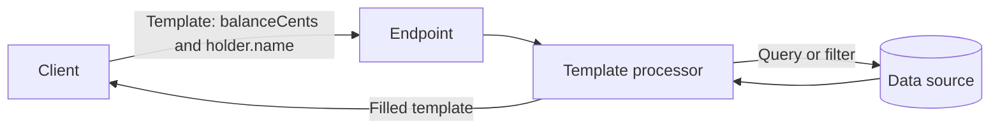

# Wish Template

## Description

The Wish Template pattern lets the client describe, in the request, a structure that mirrors the shape of the desired response, marking which elements, including nested ones, it wants. The provider uses that model as a mold and fills it with the real data.

The template is usually a [Parameter Tree](/architecture/api-patterns/basic-structure/parameter-tree) whose elements are optional or boolean: `true` signals interest, and a sample or empty value can also work. A template processor walks the tree to build the query or extract the relevant parts from the result, which can be done with JSON navigation, XPath or, for richer templates, a declarative query language that requires parsing. GraphQL is an advanced realization of the pattern: the query schema is the mold, and the resolvers do the filling.

## Problems it solves

- Clients that need different parts of deeply nested data
- A flat list ([Wish List](/architecture/api-patterns/response-shaping/wish-list)) that cannot say "only the holder's name, but the whole balance"
- One-size-fits-all responses that grow as the API evolves until they become the union of all wishes
- Difficulty removing fields from an API without breaking unknown clients

## When to use

- When the resource has a rich nested structure and clients use very different subsets
- When the flat response and the Wish List are not expressive enough
- When there are many attributes and configuration options, as in infrastructure or data analysis domains
- When the cost of a template processor is offset by the flexibility and the performance gain

## When to avoid

- When a simple Wish List already expresses the wish: it is easier to specify and to understand
- When the team cannot sustain the extra component (testing, maintenance and technical risk) embedded in the API
- When deep nesting can overload the infrastructure and the provider does not limit the depth
- When a backend per client ([Backends for Frontends](/architecture/cloud-design-patterns/gateways-and-edge/backends-for-frontends)) is simpler to operate

## Trade-offs

| Benefit | Cost / Risk |
| --- | --- |
| Expresses nested wishes precisely, level by level | The template notation is more complex to define, validate and understand |
| Smaller responses and less load on the data source | The template processor can become a large piece of middleware inside the API |
| Clients choose what they see, without tailored operations | Deep or expensive templates can overload the provider and open security holes |
| Favors data parsimony and gradual evolution | Without a schema validated on both sides, it repeats the problems of the Wish List |

- **Errors:** decide what to do with impossible wishes; silently ignoring them hides typos and renames.
- **Depth:** limit the nesting level and the cost per request.
- **Schema:** validate the template against a schema (for example, JSON Schema) to avoid surprises.
- **GraphQL:** adopting it brings a server of its own, which parses queries and calls resolvers; it is a larger investment.
- **Authorization:** apply it per field, since the client chooses what to ask for.

## Diagram



The processor walks the received template, fetches only what was marked and returns a response with the same structure.

## Example

A digital account screen needs the balance and only the holder's name, without the tax ID. The template mirrors the structure of `Account`. Amounts in cents.

```http
POST /accounts/acc-123/query
Content-Type: application/json

{ "wish": { "balanceCents": true, "holder": { "name": true } } }
```

```json
{ "balanceCents": 152340, "holder": { "name": "Maria Silva" } }
```

Filling the template on the provider, with a recursive loop (the output lists each path in alphabetical order):

<Tabs groupId="lang" queryString>
<TabItem value="java" label="Java">

```java
import java.util.*;

public class Main {
    static void fill(Map<String, Object> data, Map<String, Object> wish, String prefix) {
        for (String key : new TreeMap<>(wish).keySet()) {
            if (!data.containsKey(key)) {
                throw new IllegalArgumentException("unknown field: " + prefix + key);
            }
            Object w = wish.get(key);
            if (w instanceof Map<?, ?> nested) {
                @SuppressWarnings("unchecked")
                Map<String, Object> n = (Map<String, Object>) nested;
                @SuppressWarnings("unchecked")
                Map<String, Object> child = (Map<String, Object>) data.get(key);
                fill(child, n, prefix + key + ".");
            } else if (Boolean.TRUE.equals(w)) {
                System.out.println(prefix + key + "=" + data.get(key));
            }
        }
    }

    public static void main(String[] args) {
        Map<String, Object> account = Map.of(
                "accountId", "acc-123", "balanceCents", 152340,
                "holder", Map.of("name", "Maria Silva", "taxId", "123.456.789-09"));
        Map<String, Object> wish = Map.of("balanceCents", true, "holder", Map.of("name", true));
        fill(account, wish, "");
        // balanceCents=152340
        // holder.name=Maria Silva
    }
}
```

</TabItem>
<TabItem value="python" label="Python">

```python
from typing import Any, Dict

ACCOUNT = {"accountId": "acc-123", "balanceCents": 152340,
           "holder": {"name": "Maria Silva", "taxId": "123.456.789-09"}}

def fill(data: Dict[str, Any], wish: Dict[str, Any], prefix: str = "") -> None:
    for key in sorted(wish):
        if key not in data:
            raise ValueError("unknown field: " + prefix + key)
        if isinstance(wish[key], dict):
            fill(data[key], wish[key], prefix + key + ".")
        elif wish[key] is True:
            print(prefix + key + "=" + str(data[key]))

fill(ACCOUNT, {"balanceCents": True, "holder": {"name": True}})
# balanceCents=152340
# holder.name=Maria Silva
```

</TabItem>
<TabItem value="go" label="Go">

```go
package main

import (
	"fmt"
	"sort"
)

// Go: the error is a return value, not an exception.
func fill(data, wish map[string]any, prefix string) error {
	keys := make([]string, 0, len(wish))
	for k := range wish {
		keys = append(keys, k)
	}
	sort.Strings(keys)
	for _, key := range keys {
		value, ok := data[key]
		if !ok {
			return fmt.Errorf("unknown field: %s%s", prefix, key)
		}
		switch w := wish[key].(type) {
		case map[string]any:
			if err := fill(value.(map[string]any), w, prefix+key+"."); err != nil {
				return err
			}
		case bool:
			if w {
				fmt.Printf("%s%s=%v\n", prefix, key, value)
			}
		}
	}
	return nil
}

func main() {
	account := map[string]any{
		"accountId": "acc-123", "balanceCents": 152340,
		"holder": map[string]any{"name": "Maria Silva", "taxId": "123.456.789-09"},
	}
	wish := map[string]any{"balanceCents": true, "holder": map[string]any{"name": true}}
	_ = fill(account, wish, "")
	// balanceCents=152340
	// holder.name=Maria Silva
}
```

</TabItem>
</Tabs>

## Related patterns

- [Wish List](/architecture/api-patterns/response-shaping/wish-list) — same problem with a flat list of names; simpler, but less expressive for nested data
- [Parameter Tree](/architecture/api-patterns/basic-structure/parameter-tree) — the structure of the template and, usually, of the response
- [Pagination](/architecture/api-patterns/response-shaping/pagination) — reduces the response by splitting collections into pages, and can be combined with the template
- [Rate Limit](/architecture/api-patterns/documentation/rate-limit) — less data and fewer requests help stay within the quota
- [Embedded Entity](/architecture/api-patterns/message-granularity/embedded-entity) — the template decides, per request, which nested entities come embedded
- [Gateway Aggregation](/architecture/cloud-design-patterns/gateways-and-edge/gateway-aggregation) — aggregates data from several services into one response; the template defines the response shape on the client side
- [Data Transfer Object](/design/poeaa/distribution/data-transfer-object) — transfer object with a fixed shape; the template makes the shape variable per request

## Reference

- [Patterns for API Design, chapter 7: Wish Template](https://api-patterns.org/)
- [GraphQL](https://graphql.org/learn/)
