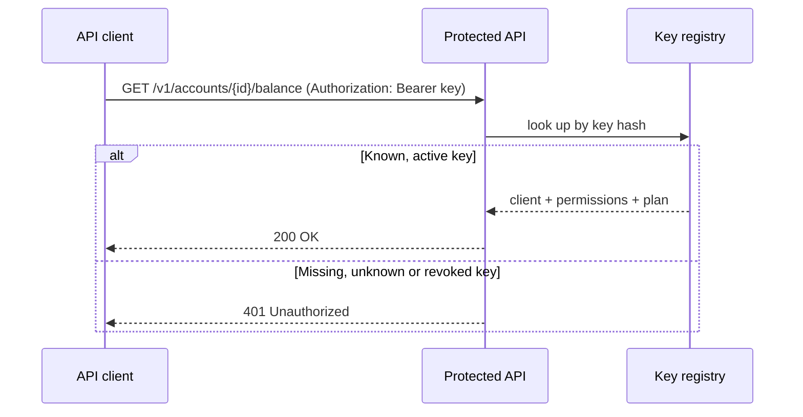

# API Key

## Description

The API Key pattern identifies an API client through a unique, hard-to-guess token issued by the provider and sent with every request as a plain string.

The key is a secret shared between the client (a program, not a person) and the endpoint. Since it is a single string, it fits in a request header (the most common and recommended place), in the message body or, only as a last resort, in the query string, where it ends up in logs and analytics tools. It identifies the *caller*, not the end user: the provider uses it to tie the request to a registered client, apply a [Rate Limit](/architecture/api-patterns/documentation/rate-limit), bill according to a [Pricing Plan](/architecture/api-patterns/documentation/pricing-plan) and allow or deny operations.

Keeping the key apart from the customer's account credentials makes it possible to issue several keys per client, with different permissions, and revoke one of them without touching the account. The provider should generate unique, unpredictable keys (for example, random bytes from a cryptographic generator), store only their hash and require HTTPS, since whoever holds the key is treated as the client.

## Problems it solves

- Tying each request to a registered client without requiring a username and password on every call
- Keeping technical teams from having to use the account credentials (and, with them, billing data) to set up integrations
- Measuring usage, applying limits and billing per client or per key
- Revoking or rotating the access of one integration without affecting the others

## When to use

- In APIs with registered clients, such as a [Public API](/architecture/api-patterns/foundations/public-api) or a [Community API](/architecture/api-patterns/foundations/community-api), where the requirement is to identify the caller
- When the security gain of full protocols does not justify the adoption cost for integrators
- When limits, metrics and billing per client are needed
- In server-to-server integrations, where the key can be stored safely

## When to avoid

- When the API acts on behalf of an end user or a third party: prefer OAuth 2.0 and OpenID Connect
- In applications that run on the user's device (web or mobile), where the key is exposed
- When there are strong confidentiality, non-repudiation or fine-grained permission requirements, which call for a full authentication and authorization protocol
- When the key would have to travel without HTTPS or another form of channel protection

## Trade-offs

| Benefit | Cost / Risk |
| --- | --- |
| Simple identification with low adoption and processing cost | It is only an identifier: it carries no expiration, scopes or user data |
| Multiple, revocable keys, independent of the account | Whoever obtains the key impersonates the client, so a leak is critical |
| Basis for Rate Limit, metrics and per-client billing | It does not authenticate end users nor support delegation to third parties |
| Small enough to go in every request | Relies on a secure channel and on good management (issuing, rotation, storage) |

- **Storage:** keep only the key's hash on the server, as is done with passwords, and show the original value once, at creation time.
- **Transport:** send it in the `Authorization` header, always over HTTPS; avoid the query string.
- **Integrity:** when the request must be proven untampered, combine the key with a shared secret used to sign the message, never transmitting that secret.
- **Scope:** the key identifies the client; permissions are attached to it at the provider, not stored inside it.

## Diagram



The client sends the key on every call; the endpoint resolves it to a registered client, which determines permissions, limits and billing.

## Example

The fintech offers a balance-lookup API to partners. Each partner receives a key, and the request looks like this (illustrative key):

```http
GET /v1/accounts/acc-1042/balance HTTP/1.1
Host: api.fintech.example
Authorization: Bearer fk_7f3a9c21d84be650
```

The registry stores only the SHA-256 hash of each key and resolves the header to the partner identifier.

<Tabs groupId="lang" queryString>
<TabItem value="java" label="Java">

```java
import java.nio.charset.StandardCharsets;
import java.security.MessageDigest;
import java.util.HashMap;
import java.util.Map;
import java.util.Optional;

class ApiKeyRegistry {
    private final Map<String, String> clientByHash = new HashMap<>();

    static String sha256(String key) throws Exception {
        byte[] digest = MessageDigest.getInstance("SHA-256")
                .digest(key.getBytes(StandardCharsets.UTF_8));
        StringBuilder hex = new StringBuilder();
        for (byte b : digest) hex.append(String.format("%02x", b));
        return hex.toString();
    }

    void register(String clientId, String key) throws Exception {
        clientByHash.put(sha256(key), clientId); // only the hash is stored
    }

    Optional<String> authenticate(String authorization) throws Exception {
        if (authorization == null || !authorization.startsWith("Bearer ")) {
            return Optional.empty();
        }
        return Optional.ofNullable(clientByHash.get(sha256(authorization.substring(7))));
    }
}

public class Main {
    public static void main(String[] args) throws Exception {
        ApiKeyRegistry registry = new ApiKeyRegistry();
        registry.register("partner-42", "fk_7f3a9c21d84be650");

        System.out.println(registry.authenticate("Bearer fk_7f3a9c21d84be650").orElse("rejected"));
        System.out.println(registry.authenticate("Bearer fk_wrong").orElse("rejected"));
    }
}
```

</TabItem>
<TabItem value="python" label="Python">

```python
import hashlib
from typing import Dict, Optional


def sha256(key: str) -> str:
    return hashlib.sha256(key.encode("utf-8")).hexdigest()


class ApiKeyRegistry:
    def __init__(self) -> None:
        self._client_by_hash: Dict[str, str] = {}

    def register(self, client_id: str, key: str) -> None:
        self._client_by_hash[sha256(key)] = client_id  # only the hash is stored

    def authenticate(self, authorization: Optional[str]) -> Optional[str]:
        if not authorization or not authorization.startswith("Bearer "):
            return None
        return self._client_by_hash.get(sha256(authorization[len("Bearer "):]))


registry = ApiKeyRegistry()
registry.register("partner-42", "fk_7f3a9c21d84be650")

print(registry.authenticate("Bearer fk_7f3a9c21d84be650") or "rejected")
print(registry.authenticate("Bearer fk_wrong") or "rejected")
```

</TabItem>
<TabItem value="go" label="Go">

```go
package main

import (
	"crypto/sha256"
	"encoding/hex"
	"fmt"
	"strings"
)

func hashKey(key string) string {
	sum := sha256.Sum256([]byte(key))
	return hex.EncodeToString(sum[:])
}

type ApiKeyRegistry struct {
	clientByHash map[string]string
}

func NewApiKeyRegistry() *ApiKeyRegistry {
	return &ApiKeyRegistry{clientByHash: map[string]string{}}
}

func (r *ApiKeyRegistry) Register(clientID, key string) {
	r.clientByHash[hashKey(key)] = clientID // only the hash is stored
}

// In Go, "not found" is the second return value instead of Optional or None.
func (r *ApiKeyRegistry) Authenticate(authorization string) (string, bool) {
	if !strings.HasPrefix(authorization, "Bearer ") {
		return "", false
	}
	clientID, ok := r.clientByHash[hashKey(strings.TrimPrefix(authorization, "Bearer "))]
	return clientID, ok
}

func main() {
	registry := NewApiKeyRegistry()
	registry.Register("partner-42", "fk_7f3a9c21d84be650")

	for _, header := range []string{"Bearer fk_7f3a9c21d84be650", "Bearer fk_wrong"} {
		if clientID, ok := registry.Authenticate(header); ok {
			fmt.Println(clientID)
		} else {
			fmt.Println("rejected")
		}
	}
}
```

</TabItem>
</Tabs>

Output:

```text
partner-42
rejected
```

## Related patterns

- [Rate Limit](/architecture/api-patterns/documentation/rate-limit) — uses the key's identity to count and limit usage per client
- [Pricing Plan](/architecture/api-patterns/documentation/pricing-plan) — links the key to the contracted plan and to billing
- [Atomic Parameter](/architecture/api-patterns/basic-structure/atomic-parameter) — the representation of the key itself: a single, simple value
- [Context Representation](/architecture/api-patterns/special-purpose-representations/context-representation) — can carry the key in the body when depending on protocol headers is undesirable
- [Access Token](/architecture/microservices/security/access-token) — a token can carry the user's identity, scopes and expiration; the API Key only identifies the API client
- [Public API](/architecture/api-patterns/foundations/public-api) — the kind of API where client identification is usually required

## Reference

- [Patterns for API Design, chapter 6: API Key](https://api-patterns.org/)
- [OWASP REST Security Cheat Sheet](https://cheatsheetseries.owasp.org/cheatsheets/REST_Security_Cheat_Sheet.html)
