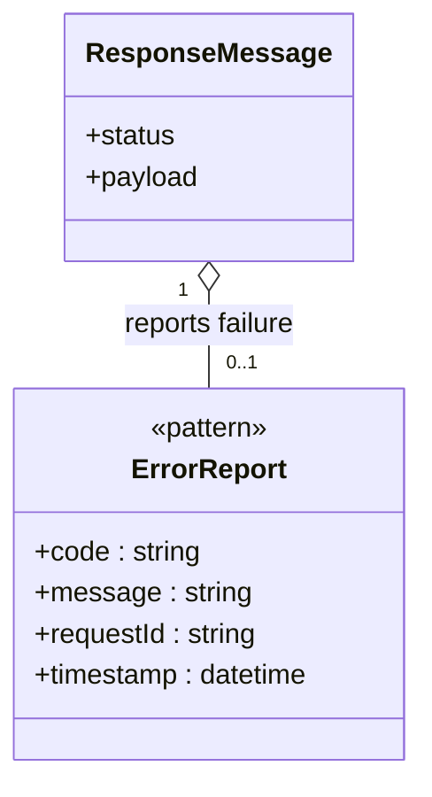

# Error Report

## Description

The Error Report pattern tells a client that a request failed through a representation inside the response message itself, with a machine-readable error code and a textual description for people, independent of the transport protocol.

The report is essentially an [Atomic Parameter List](/architecture/api-patterns/basic-structure/atomic-parameter-list): a code (which may be an [Id Element](/architecture/api-patterns/element-stereotypes/id-element)) and a text, often accompanied by a correlation identifier so the provider can find the request in its logs and by a timestamp. The code lets the client handle the error programmatically; the text helps developers, operators and support staff understand what happened and how to fix it.

Protocol codes (such as HTTP 4xx and 5xx statuses) remain useful for intermediaries and monitoring tools, but they should not be the only channel: the report in the body describes business failures at a finer grain and survives a change of protocol. The RFC 7807 format (Problem Details for HTTP APIs) is a standardized way of doing this.

## Problems it solves

- Clients that only receive a generic status and cannot tell whether to fix the request, retry or give up
- Hard diagnosis, due to missing information about the cause and the lack of an identifier to correlate with the provider's logs
- Dependence on protocol-specific codes, which do not exist when HTTP is replaced by messaging or another transport
- Ad hoc messages, different in each operation, which force the client to interpret free text

## When to use

- In any API where clients must react differently to different failures
- When business errors (insufficient balance, exceeded limit) must be told apart from transport errors
- When support and integration teams depend on an identifier to investigate failed calls
- In APIs that may be exposed through more than one protocol or cross intermediaries that rewrite headers

## When to avoid

- When the only requirement is to signal success or failure and the protocol status is enough, as in simple internal calls
- When the message would reveal internal details (stack traces, table names) or the existence of an account, which would help attackers
- When no code standard is defined: a report without stable codes forces the client to read the text

## Trade-offs

| Benefit | Cost / Risk |
| --- | --- |
| Programmatic error handling through stable codes | Codes become part of the contract and must be maintained and documented |
| Faster diagnosis, with a message and a correlation identifier | Detailed messages may leak internal or sensitive information |
| Independence from the transport protocol | Duplicates part of the HTTP status information, with a risk of inconsistency |
| Finer granularity than the protocol's categories | Messages meant for people may need internationalization |

- **Security:** do not expose stack traces or implementation details; in login failures, do not say whether the user exists.
- **Always a code:** even with translated messages, keep a machine-readable code, so the client can change the text it displays.
- **Separation of concerns:** communication problems stay in the protocol status; application processing problems go in the body's report.
- **Batches:** in a [Request Bundle](/architecture/api-patterns/message-exchange-optimization/request-bundle), report the result of each item and also of the bundle as a whole.

## Diagram



When the operation fails, the response carries an `ErrorReport` with the code, the description, the request identifier and the moment the error occurred.

## Example

A customer tries to pay a `PixCharge` of R$ 250.00, but the `Account` balance is insufficient. The response combines the HTTP status with a report in the body:

```http
HTTP/1.1 422 Unprocessable Entity
Content-Type: application/json

{"code":"INSUFFICIENT_FUNDS","message":"Insufficient balance","requestId":"req-7f3a","timestamp":"2026-11-15T10:32:00Z"}
```

The code below converts a domain failure into an `ErrorReport`, without exposing internal details, and serializes it.

<Tabs groupId="lang" queryString>
<TabItem value="java" label="Java">

```java
class InsufficientFundsException extends RuntimeException {
    InsufficientFundsException(long balanceCents, long amountCents) {
        super("balance " + balanceCents + " < " + amountCents); // internal detail, not sent to the client
    }
}

record ErrorReport(String code, String message, String requestId, String timestamp) {
    String toJson() {
        return String.format(
            "{\"code\":\"%s\",\"message\":\"%s\",\"requestId\":\"%s\",\"timestamp\":\"%s\"}",
            code, message, requestId, timestamp);
    }
}

public class Main {
    static ErrorReport toReport(RuntimeException e, String requestId, String now) {
        if (e instanceof InsufficientFundsException) {
            return new ErrorReport("INSUFFICIENT_FUNDS", "Insufficient balance", requestId, now);
        }
        return new ErrorReport("INTERNAL_ERROR", "Unexpected error", requestId, now);
    }

    public static void main(String[] args) {
        try {
            throw new InsufficientFundsException(12_000, 25_000);
        } catch (RuntimeException e) {
            System.out.println(toReport(e, "req-7f3a", "2026-11-15T10:32:00Z").toJson());
        }
    }
}
```

</TabItem>
<TabItem value="python" label="Python">

```python
import json
from dataclasses import asdict, dataclass


class InsufficientFundsError(Exception):
    def __init__(self, balance_cents: int, amount_cents: int) -> None:
        super().__init__("balance %d < %d" % (balance_cents, amount_cents))  # internal detail, not sent to the client


@dataclass
class ErrorReport:
    code: str
    message: str
    requestId: str
    timestamp: str

    def to_json(self) -> str:
        return json.dumps(asdict(self), separators=(",", ":"))


def to_report(error: Exception, request_id: str, now: str) -> ErrorReport:
    if isinstance(error, InsufficientFundsError):
        return ErrorReport("INSUFFICIENT_FUNDS", "Insufficient balance", request_id, now)
    return ErrorReport("INTERNAL_ERROR", "Unexpected error", request_id, now)


try:
    raise InsufficientFundsError(12_000, 25_000)
except Exception as error:
    print(to_report(error, "req-7f3a", "2026-11-15T10:32:00Z").to_json())
```

</TabItem>
<TabItem value="go" label="Go">

```go
package main

import (
	"encoding/json"
	"errors"
	"fmt"
)

var ErrInsufficientFunds = errors.New("insufficient funds") // internal detail, not sent to the client

type ErrorReport struct {
	Code      string `json:"code"`
	Message   string `json:"message"`
	RequestID string `json:"requestId"`
	Timestamp string `json:"timestamp"`
}

func toReport(err error, requestID, now string) ErrorReport {
	if errors.Is(err, ErrInsufficientFunds) {
		return ErrorReport{"INSUFFICIENT_FUNDS", "Insufficient balance", requestID, now}
	}
	return ErrorReport{"INTERNAL_ERROR", "Unexpected error", requestID, now}
}

// In Go the failure arrives as an error value, not as an exception.
func pay(balanceCents, amountCents int64) error {
	if balanceCents < amountCents {
		return fmt.Errorf("balance %d < %d: %w", balanceCents, amountCents, ErrInsufficientFunds)
	}
	return nil
}

func main() {
	if err := pay(12_000, 25_000); err != nil {
		body, _ := json.Marshal(toReport(err, "req-7f3a", "2026-11-15T10:32:00Z"))
		fmt.Println(string(body))
	}
}
```

</TabItem>
</Tabs>

Output:

```text
{"code":"INSUFFICIENT_FUNDS","message":"Insufficient balance","requestId":"req-7f3a","timestamp":"2026-11-15T10:32:00Z"}
```

## Related patterns

- [Context Representation](/architecture/api-patterns/special-purpose-representations/context-representation) — the error report can be part of the response context
- [Metadata Element](/architecture/api-patterns/element-stereotypes/metadata-element) — the report may include metadata, such as the possible next steps to work around the problem
- [Id Element](/architecture/api-patterns/element-stereotypes/id-element) — the error code and the request identifier follow this stereotype
- [Atomic Parameter List](/architecture/api-patterns/basic-structure/atomic-parameter-list) — the typical structure of the report: a few simple values
- [Request Bundle](/architecture/api-patterns/message-exchange-optimization/request-bundle) — calls for per-item reports in addition to the bundle report
- [Correlation Identifier](/architecture/eip/message-construction/correlation-identifier) — the `requestId` plays this role, linking the failure to the original request
- [Envelope Wrapper](/architecture/eip/message-transformation/envelope-wrapper) — the envelope carries metadata such as the report without changing the payload

## Reference

- [Patterns for API Design, chapter 6: Error Report](https://api-patterns.org/)
- [RFC 9457: Problem Details for HTTP APIs](https://www.rfc-editor.org/rfc/rfc9457)
