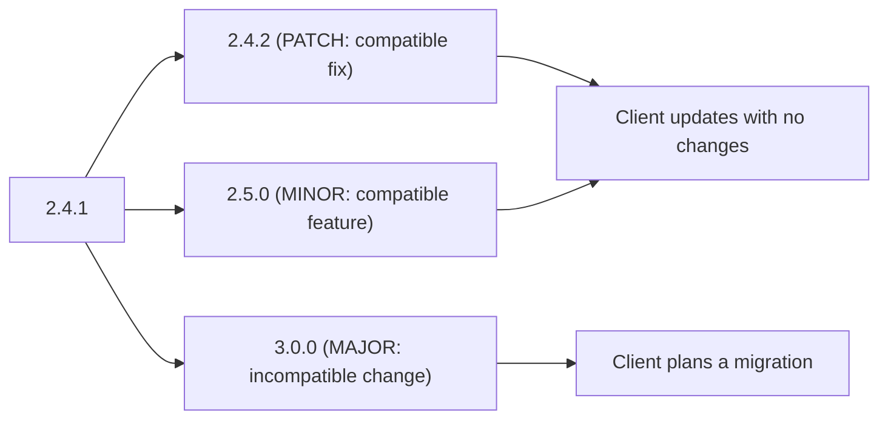

# Semantic Versioning

## Description

The Semantic Versioning pattern structures the version identifier in three numbers (`MAJOR.MINOR.PATCH`) whose parts indicate, on their own, whether a new version is compatible with the previous one.

A single version number does not say how big the change was, and each client would have to read the documentation or run tests to find out the impact. With three parts the rule is clear: increment `MAJOR` for incompatible changes, `MINOR` when adding features in a compatible way, and `PATCH` when fixing bugs without altering the contract. When a number goes up, those to its right reset to zero.

This way clients and provider compare two versions and immediately conclude whether they can swap one for the other or need to plan a migration. The pattern helps separate changes with different impact, but depends on the provider's discipline: the number is only worth something if changes are classified rigorously, and there are borderline cases where deciding what is "incompatible" is not obvious.

## Problems it solves

- Uncertainty about the impact of an update, which forces each client to analyze the change on its own
- Difficulty planning the effort and risk of migrating to a new version
- Fixes, new features and contract breaks mixed in a single number
- Lack of a common language between teams to talk about compatibility

## When to use

- In APIs with many clients that need to decide by themselves whether a new version is safe to adopt
- When the provider publishes versions often and wants to communicate the impact of each one
- When the identifier also appears in the [API Description](/architecture/api-patterns/documentation/api-description) and in automation tools that compare versions
- Together with the [Version Identifier](/architecture/api-patterns/versioning/version-identifier), to give the number a structure

## When to avoid

- When the API is internal and evolves together with its single client, so distinguishing kinds of change has little value
- If the provider cannot or will not assess the compatibility of each change rigorously, since a number that lies is worse than none
- When the context needs only the major version, as in `/v1` and `/v2` URLs, and the smaller parts would be noise for the client
- In experimental APIs, with no guarantees, covered by [Experimental Preview](/architecture/api-patterns/life-cycle-management/experimental-preview)

## Trade-offs

| Benefit | Cost / Risk |
| --- | --- |
| Compatibility readable from the number, with no manual analysis | Requires discipline to classify each change correctly |
| Clear separation between fix, feature and break | Borderline cases, such as changing a field's semantics, can be misclassified |
| Migration planning with known effort and risk | More `MINOR` and `PATCH` versions to publish and document |
| Common language between provider, clients and tools | Clients may trust the number too much and skip integration tests |

- **Increment rule:** `MAJOR` for a break, `MINOR` for a compatible feature, `PATCH` for a fix; numbers to the right are reset.
- **Where to expose it:** in the [API Description](/architecture/api-patterns/documentation/api-description) and in a single point of the messages, as in the [Version Identifier](/architecture/api-patterns/versioning/version-identifier).
- **Not everything becomes a version:** usually only the `MAJOR` version appears in the URL; the others stay in the description or in informational headers.
- **Compatibility has two sides:** adding fields may be safe for readers but break those that validate the schema strictly.

## Diagram



Given the current version, the kind of increment already tells the client whether it can update directly or must plan a migration.

## Example

A fintech's account API publishes versions of `Account`. A client uses the compatibility rule to decide whether to update on its own. The numbers below are illustrative and the result is the same in every language. The provider returns the version in an informational header:

```http
GET /accounts/9021 HTTP/1.1

HTTP/1.1 200 OK
X-Api-Version: 2.4.1

{"id": "9021", "balanceCents": 250000, "currency": "BRL"}
```

The client compares the current version with the announced one:

<Tabs groupId="lang" queryString>
<TabItem value="java" label="Java">

```java
public class SemVer {
    static int[] parse(String version) {
        String[] parts = version.split("\\.");
        return new int[] {
            Integer.parseInt(parts[0]),
            Integer.parseInt(parts[1]),
            Integer.parseInt(parts[2])
        };
    }

    static String classify(String from, String to) {
        int[] a = parse(from);
        int[] b = parse(to);
        if (b[0] != a[0]) return "breaking";
        if (b[1] != a[1]) return "compatible feature";
        if (b[2] != a[2]) return "compatible fix";
        return "same";
    }

    public static void main(String[] args) {
        System.out.println(classify("2.4.1", "3.0.0")); // breaking
        System.out.println(classify("2.4.1", "2.5.0")); // compatible feature
        System.out.println(classify("2.4.1", "2.4.2")); // compatible fix
    }
}
```

</TabItem>
<TabItem value="python" label="Python">

```python
from typing import Tuple


def parse(version: str) -> Tuple[int, int, int]:
    major, minor, patch = (int(p) for p in version.split("."))
    return major, minor, patch


def classify(current: str, new: str) -> str:
    a, b = parse(current), parse(new)
    if b[0] != a[0]:
        return "breaking"
    if b[1] != a[1]:
        return "compatible feature"
    if b[2] != a[2]:
        return "compatible fix"
    return "same"


print(classify("2.4.1", "3.0.0"))  # breaking
print(classify("2.4.1", "2.5.0"))  # compatible feature
print(classify("2.4.1", "2.4.2"))  # compatible fix
```

</TabItem>
<TabItem value="go" label="Go">

```go
package main

import (
	"fmt"
	"strconv"
	"strings"
)

func parse(version string) [3]int {
	var v [3]int
	for i, p := range strings.Split(version, ".") {
		v[i], _ = strconv.Atoi(p)
	}
	return v
}

func classify(from, to string) string {
	a, b := parse(from), parse(to)
	switch {
	case a[0] != b[0]:
		return "breaking"
	case a[1] != b[1]:
		return "compatible feature"
	case a[2] != b[2]:
		return "compatible fix"
	}
	return "same"
}

func main() {
	fmt.Println(classify("2.4.1", "3.0.0")) // breaking
	fmt.Println(classify("2.4.1", "2.5.0")) // compatible feature
	fmt.Println(classify("2.4.1", "2.4.2")) // compatible fix
}
```

</TabItem>
</Tabs>

## Related patterns

- [Version Identifier](/architecture/api-patterns/versioning/version-identifier) — defines where the number goes; Semantic Versioning defines how to compose it
- [API Description](/architecture/api-patterns/documentation/api-description) — documents the versions and what changed in each
- [Two in Production](/architecture/api-patterns/life-cycle-management/two-in-production) — two `MAJOR` versions coexist while clients migrate
- [Limited Lifetime Guarantee](/architecture/api-patterns/life-cycle-management/limited-lifetime-guarantee) — the support guarantee is usually given per `MAJOR` version
- [Consumer-Driven Contract Test](/architecture/microservices/testing/consumer-driven-contract-test) — verifies in practice that a `MINOR` or `PATCH` version really preserved the contract

## Reference

- [Patterns for API Design, chapter 8: Semantic Versioning](https://api-patterns.org/)
- [Semantic Versioning 2.0.0](https://semver.org/)
