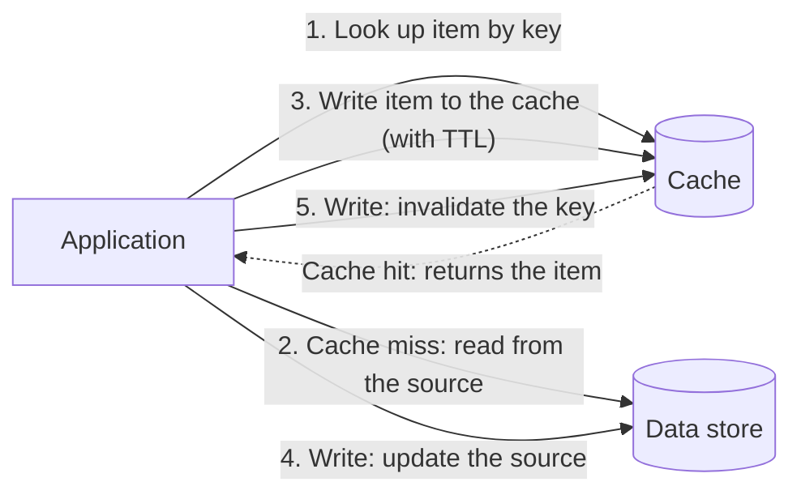

# Cache-Aside

## Description

Cache-Aside loads data into the cache on demand from the source data store. The application, not the cache, controls the flow. It checks the cache first. If the item is there (a *cache hit*), it returns it immediately. If not (a *cache miss*), it fetches the item from the source store, writes it to the cache, and returns it to the caller.

On writes, the application first updates the source store and then invalidates (removes) the corresponding cache entry. On the next read, the item is reloaded with the updated value. Order matters: if the cache is invalidated before the write to the store, another read can put the old value back into the cache.

The pattern suits caches that don't offer native *read-through* or *write-through*, because it reproduces that behavior in the application itself. It doesn't guarantee strong consistency between the cache and the source. For that reason, it's usually paired with expiration policies (TTL) that limit how long stale data can stay in the cache.

## Problems it solves

- High latency and repeated load on the data store when the same items are read many times.
- Using caches that don't load or write data to the source on their own.
- Unpredictable demand, where you don't know in advance which data will be needed and preloading everything isn't worthwhile.
- Stale data in the cache after writes, handled with explicit invalidation and expiration.
- Limited availability of heavily accessed data when the source is unavailable for a short period.

## When to use

- The cache doesn't offer native *read-through* and *write-through* operations.
- Demand is unpredictable and data should be loaded on demand.
- The load is dominated by reads of data that changes little and tolerates some update delay.
- Several processes or application instances need to share a distributed cache (for example, Azure Managed Redis).

### When to avoid

- The dataset is static and fits in the cache. In that case, it's better to preload everything at startup and not expire the items.
- Most requests would result in a *cache miss*. The cost of querying and populating the cache outweighs the gain.
- The data is sensitive or security-related, especially when the cache is shared across applications or users.
- The goal is to keep a web application's session state across multiple instances, which creates a dependency on client-server affinity.
- Flows require reading the data right after writing it (*read-after-write*). In those cases, consider *write-through*.

## Trade-offs

| Benefit | Cost / Risk |
| --- | --- |
| Lower read latency for frequently accessed data | Possibility of reading stale data between the write and the next reload |
| Less load and cost on the source store | Caching logic lives in the application code, which must read, populate, and invalidate the cache |
| Only the data that's actually used goes into the cache | The first access to each item, and every access after expiration or eviction, pays the cost of a *miss* |
| Frequent reads keep working, in a limited way, if the source goes down briefly | One more component to operate, monitor, and size |
| If the cache fails, you can fall back to the source | If many keys are lost at the same time, the source can receive a spike of requests (*cache stampede*) |

- **Expiration:** tune the TTL to the access pattern. A TTL that's too short causes constant reloads. A TTL that's too long keeps stale data around.
- **Eviction:** the cache has limited size and usually evicts items by LRU. Items that are expensive to fetch may deserve individual configuration.
- **Priming:** you can warm the cache at startup. Cache-Aside remains useful for items that expire or are evicted.
- **Consistency:** external processes can change the source without invalidating the cache. In replicated environments, keeping consistency is even harder.
- **Local cache:** a per-instance in-memory cache produces diverging copies across instances. Use shorter expiration or prefer a shared or distributed cache.
- **Semantic cache:** in workloads with language models, looking up answers by similarity of meaning reduces calls, but it's only safe with non-sensitive data that's truly equivalent.
- **Observability:** track the hit ratio, the latency of the cache and the source, and the number of evicted items.

## Diagram

On reads, the application checks the cache first and, on a *miss*, fetches the item from the source and writes it to the cache. On writes, it updates the source before invalidating the cache entry, so the next read brings the new value.

## Related patterns

- [Static Content Hosting](/architecture/cloud-design-patterns/deployment-and-topology/static-content-hosting) — also takes load off the application and the source by serving static content, often with a CDN and caching.
- [Materialized View](/architecture/cloud-design-patterns/data-management/materialized-view) — precomputes views of the data for reading, which can be kept in the cache to speed up queries.
- [CQRS](/architecture/cloud-design-patterns/data-management/cqrs) — separates reads and writes, and the read side can use Cache-Aside to gain performance.
- [Sharding](/architecture/cloud-design-patterns/data-management/sharding) — partitions data, and a distributed cache can follow the same partitioning strategy.
- [Circuit Breaker](/architecture/cloud-design-patterns/resiliency/circuit-breaker) — protects the application when the cache or the source fails and lets it fall back to the other.

## Reference

- [Documentation in the Azure Architecture Center](https://learn.microsoft.com/en-us/azure/architecture/patterns/cache-aside)
