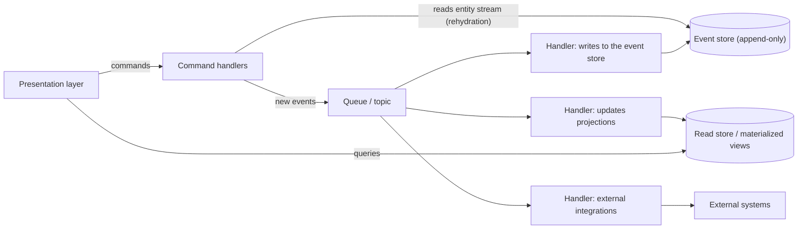

# Event Sourcing

## Description

Instead of storing only the current state of the data and overwriting it on every change (the CRUD model), Event Sourcing records the entire sequence of actions applied to an entity as immutable events in an append-only store, the **event store**. Each event describes a business fact, such as `ItemAddedToOrder` or `OrderCancelled`, and the event store becomes the source of truth (*system of record*).

Each entity has its own ordered *event stream*. The current state is obtained by replaying the events in that stream, a process called *rehydration*; periodic snapshots avoid reprocessing the entire history. Since replaying events for every query is expensive, the pattern is usually combined with projections/materialized views optimized for reading and with CQRS.

The events are also published to decoupled handlers (*event handlers*), which update read models, trigger integrations with external systems, or run background tasks. Corrections never change events that were already written: they're made with compensating events (for example, `ReservationCancelled` compensating `SeatsReserved`).

In microservices, Event Sourcing solves a core problem: how to update the database and publish messages to a broker atomically, without two-phase commit. Saving a single event is an atomic operation, and the event store also works as a broker: the events that were written are delivered to subscribers, in the same order in which they occurred for each aggregate. This enables reliable publication of domain events and choreographed sagas.

## Problems it solves

- Write contention in high-load systems, caused by read-modify-write cycles with row locking on the same entity.
- Loss of history: the CRUD model keeps only the latest state, with no native audit trail.
- Difficulty rebuilding the state at a point in the past for debugging, auditing, or disaster recovery.
- Updating the database and publishing messages atomically when 2PC isn't available or desirable, preserving event order per aggregate.
- Coupling between the operation that changes the data and the derived tasks (integrations, notifications, view updates).
- Rigidity of read models: new views can be generated by reprocessing historical events.

## When to use

- When it's important to capture the intent or reason behind changes (for example, "changed address", "closed the account") and not just the resulting state.
- When you need to minimize or avoid conflicting updates to the data.
- When there are requirements for auditing, full history, replaying events to restore state, or undoing changes.
- When the application already works naturally with events and the added cost of adoption is low.
- When you want to decouple data input from the tasks that react to it, distributing events to several consumers.
- When you use CQRS and eventual consistency of the read models is acceptable.
- In specific parts of the system that benefit the most, such as a payments ledger or an order pipeline (adoption doesn't have to be total).

### When to avoid

- Simple CRUD systems, with no need for auditing, replay, or historical reconstruction.
- Prototypes, MVPs, or short-lived systems, where the upfront investment doesn't pay off.
- Scenarios that require strong consistency and real-time updates of the data views.
- Mostly static or reference data (catalogs, lookup tables).
- Teams without experience in event-driven architectures, because of the risk of antipatterns that are hard to reverse.

## Trade-offs

| Benefit | Cost / Risk |
| --- | --- |
| *Append-only* writes without row locking, with higher throughput | Eventual consistency between the event store and the projections |
| Full audit trail and state reconstruction at any point in time | Queries require projections; there's no direct ad hoc querying over events |
| Recovery of state stores and views from the history | Rehydration is expensive on long streams, requiring snapshots |
| Decoupling between event producers and consumers | Versioning the schema of immutable events is hard |
| Natural partitioning by entity ID, making horizontal scaling easier | Migrating to or from the pattern is expensive and constrains future decisions |
| New read models can be created by reprocessing events | Conflict with requirements to delete personal data (right to be forgotten) |

- **Monolith migration:** loosely coupled entities that exchange events make it easier to migrate gradually from a monolith to microservices.
- **Alternative:** when you don't want to adopt the full model, the Transactional Outbox also guarantees atomic event publication.
- **Event design:** model events by business intent ("2 seats reserved"), not by state ("42 seats left").
- **Concurrency:** use optimistic concurrency control per stream (reject the append if the version changed) and handle conflicts between distinct entities in the business logic.
- **Ordering:** use incrementing sequence numbers per entity, in addition to timestamps.
- **Versioning:** combine tolerant deserialization, a version in the event envelope, and *upcasting*; rewriting events in place should be the last resort.
- **Idempotency:** delivery is usually *at least once*; consumers must ignore duplicates (for example, by tracking the last sequence number processed).
- **Loops:** watch out for events that generate events and can lead to infinite cycles.
- **Storage:** prefer an event store (dedicated, or an append-only table in a relational/document database); a message broker such as Apache Kafka works for distribution but doesn't replace the event store.
- **Personal data:** keep personal data out of the events (referenced by ID) or use *crypto-shredding* with a per-subject key.
- **Testing:** the *given-when-then* style (past events, command, expected events) works well, but integration tests are still needed for projections, idempotency, and schema evolution.

## Diagram

The command handlers rebuild the entity from its event stream, apply the business rules, and publish new events. Independent handlers persist the events, update the read views queried by the UI, and integrate other systems.

## Related patterns

- [CQRS](/architecture/cloud-design-patterns/data-management/cqrs) — the most common combination: the event store serves writes and the projections serve reads, with independent scaling.
- [Materialized View](/architecture/cloud-design-patterns/data-management/materialized-view) — query-optimized projections generated from the events.
- [Compensating Transaction](/architecture/cloud-design-patterns/distributed-coordination/compensating-transaction) — undoing changes through compensating events, without modifying the history.
- [Idempotent Consumer](/architecture/cloud-design-patterns/messaging/idempotent-consumer) — handlers must tolerate duplicate delivery of events.
- [Publisher-Subscriber](/architecture/cloud-design-patterns/messaging/publisher-subscriber) — distributing events to multiple decoupled consumers.
- [Sharding](/architecture/cloud-design-patterns/data-management/sharding) — event stores naturally partition by entity ID.
- [Saga](/architecture/cloud-design-patterns/distributed-coordination/saga) — event-based coordination of business processes across services.
- [Domain Event](/architecture/microservices/service-collaboration/domain-event) — the event store can be the source for publishing domain events.
- [Transactional Outbox](/architecture/microservices/transactional-messaging/transactional-outbox) — an alternative for publishing events atomically without storing the state as events.
- [Audit Logging](/architecture/microservices/observability/audit-logging) — the event log naturally implements an audit trail.

## Reference

- [Documentation in the Azure Architecture Center](https://learn.microsoft.com/en-us/azure/architecture/patterns/event-sourcing)
- [Event Sourcing on microservices.io](https://microservices.io/patterns/data/event-sourcing.html)
