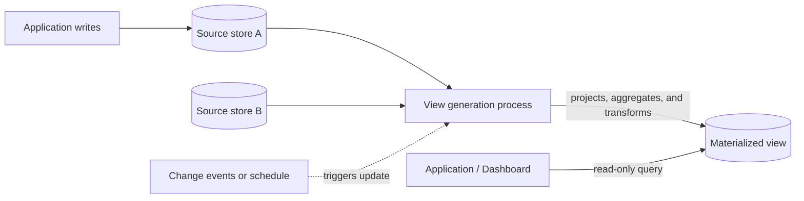

# Materialized View

## Description

The Materialized View pattern generates prepopulated views ahead of time over the data in one or more stores when that data isn't in the ideal format for the required queries. Instead of building the result on every request (with expensive joins, aggregations, and transformations), a dedicated component computes and persists a projection already shaped for reading, containing only the data the query needs, including calculated or transformed values.

The materialized view is a read-only model for consumers and is fully disposable: it can be rebuilt at any time from the sources. It can live in a different store, partition, or technology than the source, which lets you combine data from several sources and choose a read-optimized repository. The concept is broader than the native "materialized view" object of some databases: the projection can be maintained by an application process or by a data pipeline.

When the source data changes, the view needs to be updated, whether in response to change events, on a schedule, by an external trigger, or manually. In practice, it works as a specialized cache, with a staleness window that must be defined and monitored.

## Problems it solves

- Queries that need only a subset of the data but are forced to read whole entities or aggregates (for example, an order summary without the details of each item).
- Aggregations and joins across entities, partitions, or stores that are expensive to compute on every request.
- Stores with limited query capability or that can't gain new indexes without hurting writes.
- Event Sourcing data, whose current state can only be obtained by reprocessing events.
- The need to expose only a restricted subset of the data to certain consumers, for security or privacy reasons.

## When to use

- The data is hard to query directly or requires very complex queries because it's normalized, semi-structured, or unstructured.
- You want rebuildable or transient projections that improve query performance or shape data for a UI, report, or dashboard.
- There are occasionally connected or disconnected scenarios, where the view can be kept locally.
- You want to simplify queries and expose data for analysis without requiring knowledge of the source format.
- You need to give access to specific subsets of the data that shouldn't be fully exposed or modified.
- You want to combine different stores, using one optimized for writes as the source and another optimized for reads for the views.
- In microservices, to consolidate data from several services without coupling their stores.

## When to avoid

- The source data is simple and easy to query.
- The source data changes very quickly or can be accessed without a view; the processing cost doesn't pay off.
- Strong consistency is a priority, since the view may not immediately reflect the source data.
- There are many distinct queries, each requiring its own view, which drives storage and cost up too much.

## Trade-offs

| Benefit | Cost / Risk |
| --- | --- |
| Fast, simple reads, without recomputing joins and aggregations on every request | Potentially stale data (eventual consistency) |
| Lower resource consumption on the read path | Computation cost to refresh the view, proportional to volume and complexity |
| Freedom to use a read-optimized store | Additional storage and one more component to operate |
| Disposable view, rebuildable from the sources | Silent failures in the refresh signal can serve old data without warning |
| Ability to restrict the data exposed to consumers | Risk of leaking data if the pipeline includes the wrong columns or rows |

- **Refresh strategy:** choose between event-driven, scheduled, externally triggered, or manual refresh, based on the acceptable staleness window. Very frequent events can create overhead.
- **Full vs. incremental rebuild:** also decide whether the refresh blocks reads or whether the previous version keeps serving until the new one is ready.
- **Atomic publication:** build and validate a new version of the view and only then swap, so you never serve a partial view after a failure midway through the process.
- **Observability:** monitor the age of the view and alert when it exceeds the acceptable staleness.
- **Indexes and calculated columns:** they add value to reads but increase the time and cost of each refresh.
- **Security and data lifecycle:** apply the same access, retention, and deletion controls to the views as to the source; treat view definitions as versioned artifacts deployed via CI/CD.

## Diagram

Writes keep going to the source stores; a dedicated process, triggered by events or a schedule, generates the materialized view already in the query's shape, and applications read directly from it.

## Related patterns

- [CQRS](/architecture/cloud-design-patterns/data-management/cqrs) — materialized views are the typical read model when separating commands and queries.
- [Event Sourcing](/architecture/cloud-design-patterns/data-management/event-sourcing) — materialized views are usually needed to get the current state from the event stream.
- [Index Table](/architecture/cloud-design-patterns/data-management/index-table) — an alternative or complement for querying by non-indexed fields when the store doesn't support secondary indexes.
- [Cache-Aside](/architecture/cloud-design-patterns/data-management/cache-aside) — the view is a specialized cache and can be stored in a cache layer.
- [Sharding](/architecture/cloud-design-patterns/data-management/sharding) — views can consolidate data distributed across several partitions to avoid cross-shard queries.

## Reference

- [Documentation in the Azure Architecture Center](https://learn.microsoft.com/en-us/azure/architecture/patterns/materialized-view)
