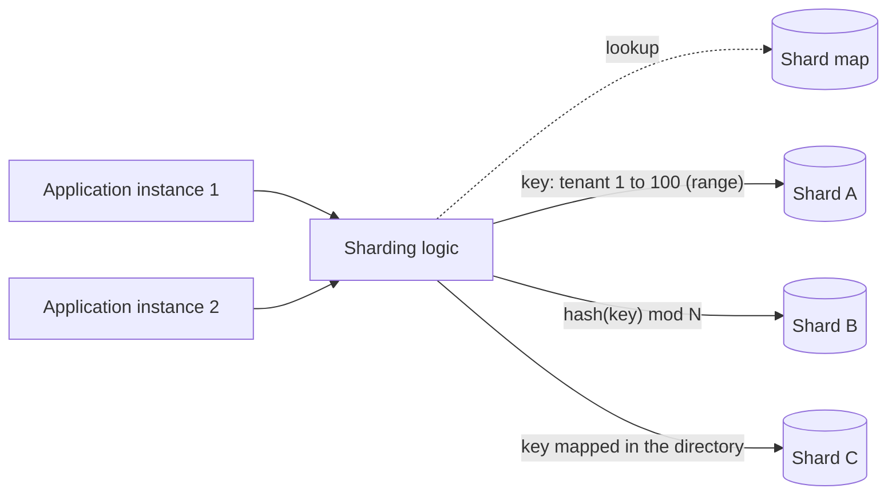

# Sharding

## Description

The Sharding pattern divides a data store into horizontal partitions, called *shards*. All shards have the same schema, but each holds a distinct subset of the data and runs on its own storage node. This way the system grows by adding shards (horizontal scaling), without depending on a single, ever-larger server.

The distribution of data is defined by a **shard key** (or *partition key*), made up of one or more attributes of the data. A sharding logic layer, which can live in the application's data access code or in the store itself when it offers transparent sharding, uses this key to route each read and write to the right shard. Because this layer hides the physical location of the data, you can move data between shards without changing the business logic.

The most common strategies for mapping the key to the shard are:

- **Lookup (directory):** a map, consulted on every access, associates each key value (for example, the tenant ID) with a shard. With *virtual shards*, many logical partitions are mapped to fewer physical partitions, and this mapping can change without altering the application code. It gives more control and makes rebalancing easier, but consulting the map adds overhead. For that reason, the map must be easy to cache and replicate.
- **Range:** items with sequential keys stay together and ordered in the same shard (for example, orders from the same month). It's simple to implement and efficient for range queries, but it tends to produce imbalance and *hotspots*. In addition, rebalancing requires splitting and merging ranges.
- **Hash:** the shard is computed from a hash of one or more attributes, which spreads out sequential keys and balances volume and load. It doesn't require maintaining a map, but with `hash(key) mod N`, adding or removing shards relocates most keys. *Consistent hashing* greatly reduces that movement.

There's also the **geographic** strategy, which places data close to users or within a legally required jurisdiction. It's usually combined with hash or lookup within each region.

## Problems it solves

- The data volume exceeds the storage capacity of a single server.
- The number of simultaneous queries and transactions exceeds what a single node can process, causing slowness and timeouts.
- The network bandwidth of a single server becomes a bottleneck.
- Legal or latency requirements demand storing data in the same geographic region as the users.
- Tenants or customer segments need physical data isolation, for security, performance, or contractual reasons.
- Vertical scaling has a ceiling and costs more and more with specialized hardware.

## When to use

- The total data volume exceeds the capacity of a database instance and there's no way left to scale vertically.
- Write throughput or query concurrency exceeds what one instance supports, and read replicas don't solve it because the write load is also high.
- Regulations require subsets of data to stay in specific geographic jurisdictions.
- Different tenants need physical isolation or different service levels (for example, dedicated shards for high-value customers).
- You want to limit the blast radius of failures or maintenance to a part of the data.

## When to avoid

- The data and throughput fit on a single instance, even considering expected growth. Vertical scaling keeps queries simple and preserves transactions.
- The bottleneck is in reads. Read replicas and caching solve it without the complexity of cross-shard queries.
- The database's native table partitioning, within a single instance, already meets your needs.
- The most frequent queries require joins across entities, multi-entity transactions, or aggregations over all the data.
- You use a managed service that already handles sharding (for example, Azure Cosmos DB). In that case, your responsibility boils down to choosing the partition key well.

## Trade-offs

| Benefit | Cost / Risk |
| --- | --- |
| Horizontal scaling of storage, compute, and network by adding shards | Permanent complexity in development, testing, operations, and recovery |
| Fault isolation: a shard with a problem doesn't take down the others | Cross-shard (*fan-out*) queries are more expensive, and the slowest shard sets the latency |
| Using several cheaper resources instead of one expensive resource | Distributed transactions are hard. In practice, you usually accept eventual consistency |
| Less contention, because each request competes for resources only within its shard | Risk of *hotspots* and imbalance over time, requiring periodic rebalancing |
| Data close to users and compliance with data residency | Changing the shard key later requires migrating all the data, an expensive and risky operation |
| Maintaining and restoring a shard without making all the data unavailable | Backup, monitoring, and schema changes must be coordinated across all shards |

- **Shard key:** this is the most critical decision. Choose a key that's immutable, high-cardinality, and uniformly distributed, aligned with the most frequent queries so that most of them hit a single shard. Avoid monotonically increasing values (autoincrement, sequential timestamps), low-cardinality attributes, and attributes that change frequently. If no single attribute works, use a composite key.
- **Uniqueness:** autoincrement fields aren't coordinated across shards and can produce duplicate IDs. Prefer globally unique identifiers.
- **Secondary queries:** to search by attributes that aren't part of the key, use secondary indexes (see Index Table). Denormalizing the data helps keep related entities in the same shard.
- **Reference data:** replicating static or slow-changing data to all shards avoids trips to another store, but brings temporary inconsistency while the copies are synchronized.
- **Rebalancing:** many small shards (or virtual shards) migrate faster and spread the load better than a few large shards.
- **Observability:** metrics and logs need to be aggregated from all shards to give a complete view of the system's health.

## Diagram

The application instances send requests to the sharding logic, which uses the shard key to find the destination. It can consult a map (lookup), compare the key against ranges (range), or compute a hash. Each shard holds a distinct subset of the data, and all use the same schema.

## Related patterns

- [Index Table](/architecture/cloud-design-patterns/data-management/index-table): creates secondary indexes to query data by attributes that aren't part of the shard key.
- [Materialized View](/architecture/cloud-design-patterns/data-management/materialized-view): precomputes views that aggregate data from several shards, avoiding expensive *fan-out* queries.
- [Cache-Aside](/architecture/cloud-design-patterns/data-management/cache-aside): caches the shard map (lookup) and heavily accessed data, reducing routing overhead.
- [Deployment Stamp](/architecture/cloud-design-patterns/deployment-and-topology/deployment-stamp): replicates complete infrastructure units per group of tenants, taking the idea of sharding to the whole stack.
- [Geodes](/architecture/cloud-design-patterns/deployment-and-topology/geodes): distributes services and data geographically, like the geographic sharding strategy.
- [Compensating Transaction](/architecture/cloud-design-patterns/distributed-coordination/compensating-transaction): undoes operations that span several shards when there's no distributed transaction.
- [Saga](/architecture/cloud-design-patterns/distributed-coordination/saga): coordinates multi-step operations across shards while maintaining eventual consistency.
- [Bulkhead](/architecture/cloud-design-patterns/resiliency/bulkhead): isolates resources so that the failure of one partition doesn't affect the others, the same isolation principle as shards.

## Reference

- [Documentation in the Azure Architecture Center](https://learn.microsoft.com/en-us/azure/architecture/patterns/sharding)
