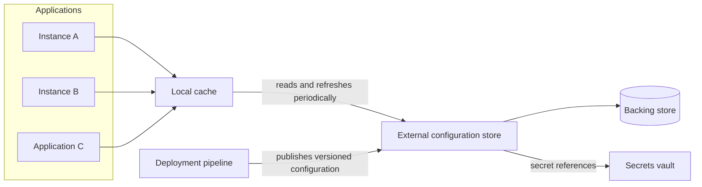

# External Configuration Store

## Description

The External Configuration Store pattern moves configuration information out of the application deployment package and into a centralized repository. Instead of each instance reading local files bundled with the code, they all query the same external source through an interface that allows configuration to be read (and, when authorized, updated) quickly, in a typed and structured way.

The backing store can be a dedicated configuration service, cloud storage, a database, or a custom system. The interface on top of it typically offers access control, versioning (per environment, such as development, staging, and production, and per release version), scopes and value inheritance, plus a local cache to reduce latency and tolerate transient failures.

Since configuration now changes application behavior at runtime, it should be treated as a deployment artifact: versioned, reviewed, tested, and released progressively, with the ability to roll back to a previous state. Secrets (passwords, API keys, certificates) are kept in a dedicated secrets vault and are only referenced by the configuration store.

## Problems it solves

- Configuration changes that require redeploying the application, with downtime and administrative effort.
- Configuration duplicated across several applications that share the same values (connection strings, queue and storage URLs, UI themes).
- Instances of the same application running with divergent configurations during an update.
- Local configuration systems that don't support multiple schema versions or more complex data types.
- Lack of auditing and governance over who changes configuration and when.
- In microservices, the need to run the same service, without modification or recompilation, in several environments (development, test, staging, production), each with distinct instances of databases, brokers, and third-party services (for example, test and production payment accounts).

## When to use

- When configuration needs to be shared across several applications or instances, or a default configuration must be enforced on all of them.
- When the native configuration system doesn't support all the required value types, such as complex structures or binary data.
- When you want a complementary store, allowing applications to override some or all of the centralized values.
- When you want to simplify the administration of many applications and, optionally, monitor configuration usage by logging accesses.
- When a microservice needs to be promoted between environments as the same artifact (for example, a container image), receiving network locations and credentials from the outside.
- When using feature flags and progressive releases as part of safe deployment practices.

### When to avoid

- When the configuration is simple, local to a single application, and only changes in normal release cycles; the external store would add operational complexity with no benefit.
- When the availability of the external store can't be guaranteed and there's no fallback mechanism at application startup.

## Trade-offs

| Benefit | Cost / Risk |
| --- | --- |
| Change behavior without redeploying the application | A wrong change quickly propagates to all applications that consume the value |
| A single, consistent source of configuration for several applications and instances | The store becomes a critical dependency; unavailability at startup can prevent the application from starting |
| Versioning, history, and rollback of configuration | Need to design the schema, scopes, inheritance, and handling of missing or invalid values |
| Centralized auditing and access control | Requires strict management of read and write permissions and separation of secrets |
| Support for feature flags and progressive release | Local caches introduce inconsistency windows until the next refresh |

- **Availability:** choose a store with high availability and backup; consider geographic replication and reading from the nearest replica.
- **Startup fallback:** the cache handles transient failures at runtime, but not unavailability at startup; include a copy of the last known values in the pipeline.
- **Cache refresh:** define an expiration or change-notification policy so applications pick up new values.
- **Security:** separate read and write permissions, encrypt sensitive values when necessary, and keep secrets in a dedicated vault.
- **Governance:** treat configuration changes with the same deployment process as code (tests, staging, progressive rollout), with auditing of reads and changes.
- **Pull models and variations:** in the simplest form, the service reads configuration at startup (environment variables, properties files, command-line arguments); with a central store it queries the source and can refresh it at runtime.
- **Validation at deploy:** you need to verify that the supplied configuration matches what the application expects (keys, types, and formats) before releasing.
- **Robustness:** define behavior for missing or invalid keys (default values and error logging), case sensitivity, and null or empty values.

## Diagram

Applications read configuration through a local cache, which is refreshed from the centralized external store; the pipeline publishes configuration versions to the store, and secrets remain in a dedicated vault, only referenced.

## Related patterns

- [Cache-Aside](/architecture/cloud-design-patterns/data-management/cache-aside) — used to cache locally the configuration read from the store, improving performance and resilience.
- [Retry](/architecture/cloud-design-patterns/resiliency/retry) — handles transient failures when accessing the configuration store.
- [Circuit Breaker](/architecture/cloud-design-patterns/resiliency/circuit-breaker) — avoids hammering an unavailable store, falling back to the last known value.
- [Deployment Stamp](/architecture/cloud-design-patterns/deployment-and-topology/deployment-stamp) — stamps often read unit-specific configuration from a central store.
- [Sidecar](/architecture/cloud-design-patterns/integration-and-modernization/sidecar) — a sidecar can fetch and deliver configuration to the application without changing its code.
- [Microservice Chassis](/architecture/microservices/cross-cutting-concerns/microservice-chassis) — the chassis usually provides the external configuration reading mechanism to all services.
- [Service Template](/architecture/microservices/cross-cutting-concerns/service-template) — the template comes ready to receive externalized configuration.
- [Client-side Discovery](/architecture/microservices/service-discovery/client-side-discovery) — configuration can use logical service names, resolved by discovery.
- [Valet Key](/architecture/cloud-design-patterns/security-and-access/valet-key) — complements restricted access control for storage resources used as the backing store.

## Reference

- [Azure Architecture Center documentation](https://learn.microsoft.com/en-us/azure/architecture/patterns/external-configuration-store)
- [Externalized Configuration on microservices.io](https://microservices.io/patterns/externalized-configuration.html)
