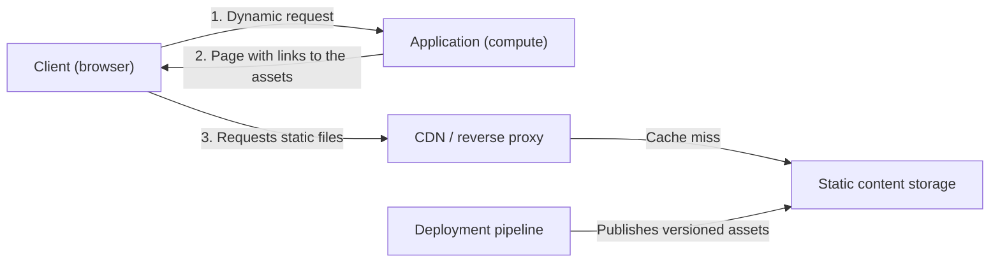

# Static Content Hosting

## Description

The Static Content Hosting pattern consists of publishing an application's static content (HTML pages, images, stylesheets, client-side JavaScript, documents, software packages) to a cloud storage service that can deliver it directly to the client over HTTP(S), without going through the application servers.

The application remains responsible for dynamic requests and only returns pages that reference the files hosted in storage. The browser or client fetches those files directly from the storage origin, often through a CDN or a reverse proxy that caches close to users.

Since storage is usually much cheaper than compute capacity, the pattern reduces cost and frees compute resources for business logic. The real gain depends on how much compute is no longer billed compared with the cost of storing and transferring the content.

## Problems it solves

- Application servers consume CPU, memory, and connections serving file downloads that don't require per-request processing.
- High cost of scaling compute instances just to support static content traffic.
- High latency for users far from the region where the application is hosted.
- Difficulty separating and tracking bandwidth and content delivery costs from application execution costs.
- The need to distribute pre-generated artifacts (installers, packages, documents) at scale.

## When to use

- Sites and applications that contain a significant share of static resources and want to reduce hosting cost.
- Fully static sites, which can be hosted entirely on the storage service (for example, the Azure Blob Storage static website feature).
- Exposing static resources to applications hosted in other environments or on on-premises servers.
- Distributing prebuilt artifacts, such as software packages, allowing clients to verify authenticity and integrity (for example, digital signatures).
- Distributing content across several geographic regions with a CDN that caches from the storage origin.
- Monitoring costs and bandwidth consumption separately from application execution costs.

## When to avoid

- When the content must be processed or personalized on every request (for example, inserting user-specific data into a document).
- When the volume of static content is very small and the overhead of keeping it in separate storage outweighs the benefit.
- When the content is private and there's no suitable authorization mechanism at the delivery layer.

## Trade-offs

| Benefit | Cost / Risk |
| --- | --- |
| Lower compute and scalability cost for the application servers | Storage, data transfer, and CDN costs need to be estimated; savings only exist if compute capacity is actually reduced |
| Lower latency with edge caching (CDN) | Cache may serve stale versions; invalidation takes time and CDN purges don't clear the browser cache |
| Scalability and availability delegated to the storage service | New delivery dependency (storage, CDN, proxy) to be monitored; cross-region replication may be asynchronous |
| Clear separation between static content and dynamic logic | Application and asset deployments need to be coordinated and versioned |
| Isolated, easy-to-track bandwidth costs | Additional security configuration (anonymous access, CORS, access tokens) |

Additional considerations:

- **Security:** use HTTPS by default; allow anonymous reads only for public content and restrict direct access to the origin when it bypasses CDN or proxy controls. Limit write permissions to trusted deployment identities.
- **Private content:** keep it in containers that require authorization and deliver it through short-lived tokens (see Valet Key); avoid shared caching for this content unless the delivery layer validates permissions on every request.
- **Versioning:** publish changed assets to versioned URLs before deploying the pages that reference them, and keep old versions as long as cached pages or rollbacks depend on them.
- **HTTP metadata:** set and verify `Content-Type`, `Content-Encoding`, and `Cache-Control` so clients interpret and cache correctly.
- **URLs and origin:** choose between a separate hostname or the same domain via a reverse proxy; configure CORS when there are cross-origin requests and use rewrites or redirects to preserve links when the layout changes.
- **Resilience and observability:** choose storage redundancy according to availability requirements and monitor availability, response time, and errors in storage, CDN, and proxy.

## Diagram

The client gets only the dynamic page from the application, which references the static files; those files are fetched directly from the CDN or proxy, which falls back to storage when there's no cached copy. The deployment pipeline publishes the versioned assets to storage independently of the application.

## Related patterns

- [Valet Key](/architecture/cloud-design-patterns/security-and-access/valet-key) — provides restricted, temporary access tokens or keys so clients can directly access resources that shouldn't be public.
- [Cache-Aside](/architecture/cloud-design-patterns/data-management/cache-aside) — another way to reduce load on the origin by keeping frequently accessed data in a cache.
- [Gateway Offloading](/architecture/cloud-design-patterns/gateways-and-edge/gateway-offloading) — also moves responsibilities out of application services into a shared layer, such as content delivery.
- [Gateway Routing](/architecture/cloud-design-patterns/gateways-and-edge/gateway-routing) — a reverse proxy can route same-domain paths to static storage and preserve URLs.
- [Geodes](/architecture/cloud-design-patterns/deployment-and-topology/geodes) — geographic distribution of services to bring content closer to users, complementing the use of a CDN.

## Reference

- [Azure Architecture Center documentation](https://learn.microsoft.com/en-us/azure/architecture/patterns/static-content-hosting)
