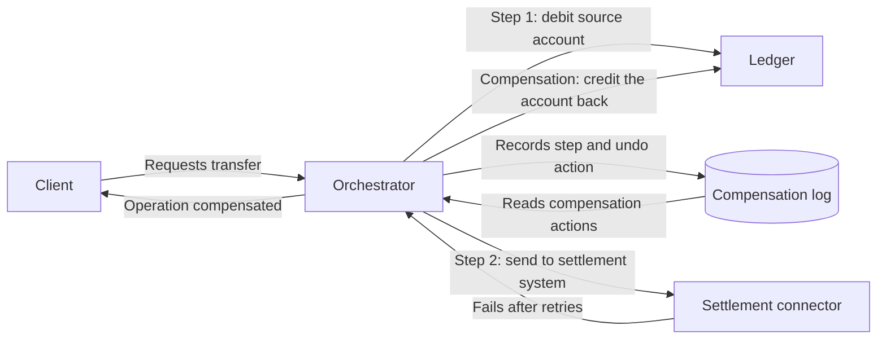

# Compensating Transaction

## Description

The Compensating Transaction pattern undoes work already performed when one or more steps of an eventually consistent operation fail. In distributed systems, a business operation is usually split into independent steps that change data across several services or data stores. During execution the system can be temporarily inconsistent, and there is no global atomic transaction capable of rolling everything back.

The compensating transaction runs actions that neutralize the effects of the steps already completed. It doesn't restore a snapshot of the original state, because that could overwrite changes made by other concurrent instances. Each compensation is a business action, such as canceling a reservation or issuing a partial refund, and therefore depends on the application.

In practice, a workflow or orchestrator records, for each completed step, what was done and how to undo it. If the operation fails unrecoverably, or if the client requests cancellation, the orchestrator walks through this record and runs the compensating actions, normally in reverse order, but not necessarily: some may run in parallel or be prioritized according to the sensitivity of each data store.

## Problems it solves

- Partial failures in operations that span several services or data stores, with no support for atomic distributed transactions.
- Inconsistent states left in the system when an intermediate step fails after others have already been committed.
- The need to undo effects in external services, such as reservations, charges, and allocations, which can't be reverted by a simple database rollback.
- Reversals that require business rules, such as cancellation fees or partial refunds.
- Explicit cancellation by the customer of a long-running operation that has already completed.

## When to use

- A business operation involves several steps, services, or data stores and must be undone if a later step fails.
- Long-running flows that follow the eventual consistency model and can't rely on atomic transactions.
- Failure recovery requires domain logic, not just a data rollback (for example, crediting the source account back when sending a transfer to the settlement system fails).

## When to avoid

- Operations can be safely repeated and most failures are transient: retry logic is usually enough, and compensation would only add complexity.
- The system can't tolerate temporary inconsistency. In that case, prefer strong consistency mechanisms or atomic transactions.
- The compensation can't reliably bring the system back to a valid state, for example when there are irreversible external effects.

## Trade-offs

| Benefit | Cost / Risk |
| --- | --- |
| Recovery from partial failures without distributed transactions | Compensation logic is application-specific and hard to generalize |
| Enables eventual consistency, less contention, and better performance | Visible inconsistency windows while steps and compensations run |
| Business-rule-driven reversal (refunds, fees, alternatives) | The compensation itself can fail and must be idempotent and resumable |
| Ability to cancel operations that have already completed | Requires reliable persistence of the state and the undo actions of each step |
| End-to-end traceability of the operation and its compensation | More operational complexity: correlation, auditing, alerts, and manual intervention |

Additional considerations:

- **Failure detection:** a step may hang instead of failing. Use timeouts to decide when it has failed.
- **Retry first:** treat errors as transient and try again. Trigger compensation only when retries are exhausted or the failure is unrecoverable.
- **Idempotency:** each step and each compensating action may run more than once, so they must be idempotent.
- **Not an identical state:** compensation neutralizes the work done. It doesn't guarantee returning to exactly the initial state, because other transactions may have changed the data in the meantime.
- **Flexible ordering:** undo the changes in the stores most sensitive to inconsistency first, and parallelize whatever you can.
- **Points of no return:** identify irreversible steps (external effects, actions with legal weight) and place them after all critical validations.
- **Short-lived locks:** reserving resources with temporary locks before doing the work reduces the chance of needing to compensate.
- **Human intervention:** for ambiguous or high-impact decisions, pause the flow for manual review. When compensation fails repeatedly, raise alerts with details and correlation IDs.
- **Resilient infrastructure:** the storage and transport of the steps must not lose the information needed to compensate. A queue with a dead-letter queue, such as Azure Service Bus, is one example.

## Diagram

The orchestrator runs the steps and records, for each completed step, the action that undoes it. When sending to the settlement system fails unrecoverably, it reads this record and triggers the compensations in reverse order: the ledger receives a new credit entry that returns the amount to the source account, without erasing the original debit. The source illustrates the pattern with a flight and hotel booking.

## Related patterns

- [Saga](/architecture/cloud-design-patterns/distributed-coordination/saga): manages data consistency across microservices and uses compensating transactions to recover from failures.
- [Retry](/architecture/cloud-design-patterns/resiliency/retry): handles transient failures and reduces the need to trigger compensations.
- [Idempotent Consumer](/architecture/cloud-design-patterns/messaging/idempotent-consumer): ensures that re-executed steps and compensations don't produce duplicate effects.
- [Scheduler Agent Supervisor](/architecture/cloud-design-patterns/distributed-coordination/scheduler-agent-supervisor): coordinates distributed operations and can trigger compensating transactions to undo work.
- [Pipes and Filters](/architecture/cloud-design-patterns/messaging/pipes-and-filters): breaks complex tasks into reusable steps, as an alternative to distributed transactions.
- [Choreography](/architecture/cloud-design-patterns/distributed-coordination/choreography): a decentralized way to coordinate steps and their compensations through events.

## Reference

- [Azure Architecture Center documentation](https://learn.microsoft.com/en-us/azure/architecture/patterns/compensating-transaction)
