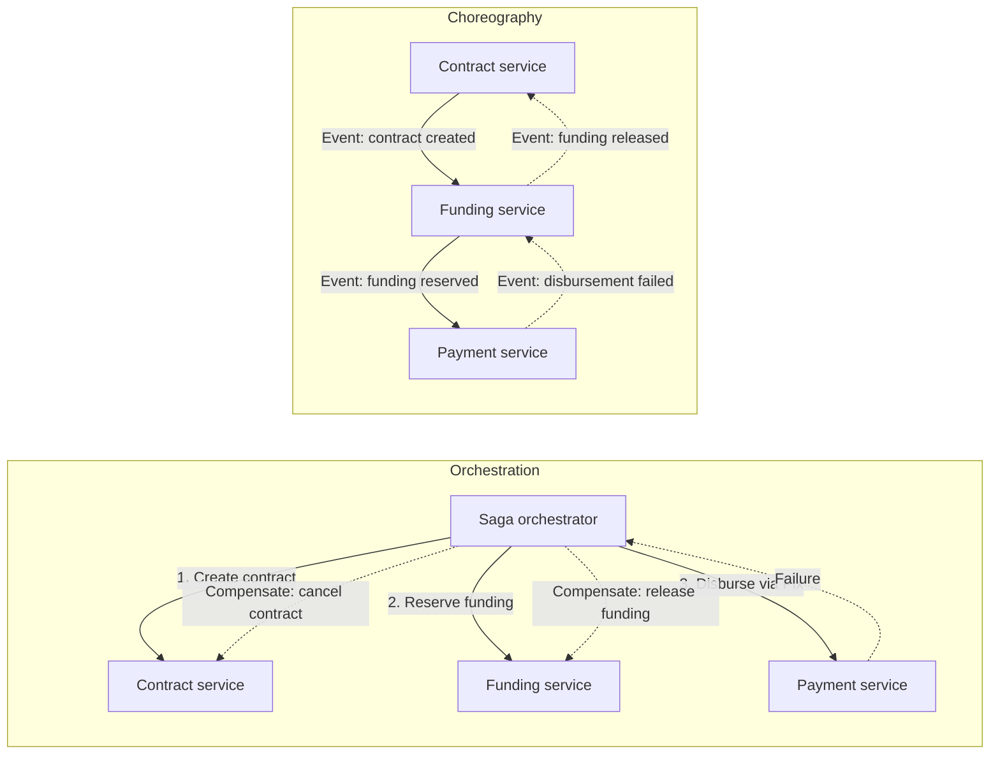

# Saga

## Description

The Saga pattern maintains data consistency in distributed systems by splitting a business operation that spans several services into a sequence of **local transactions**. Each service runs its transaction atomically in its own database and then triggers the next step through an event or message. If any step fails, the saga runs **compensating transactions** that undo, in reverse order, the effects of the steps already completed.

The steps of a saga fall into three types: **compensable** (can be reverted by an operation with the opposite effect), **pivot** (the point of no return; after it the saga must run to completion), and **retryable** (idempotent steps after the pivot, which can be re-executed until they succeed and ensure the saga reaches a consistent final state).

There are two common ways to coordinate a saga. In **choreography**, there is no central controller: each service publishes domain events that trigger the next participant's local transaction. In **orchestration**, a central component (the orchestrator) keeps the saga's state, sends commands to each participant, interprets the responses, and triggers compensations on failure.

In microservices, the Saga is the direct consequence of the Database per Service pattern: since each service owns its database and two-phase commit isn't an option, a rule such as "the order can't exceed the customer's credit limit" no longer fits in a single ACID transaction. A classic example is order creation: in choreography, the order service creates a pending order and emits an event, the customer service tries to reserve credit and publishes the result, and the order service approves or rejects the order; in orchestration, a "Create Order" orchestrator sends the command to reserve credit, receives the reply, and approves or rejects the order.

## Problems it solves

- The absence of ACID transactions across services that own independent databases (one database per microservice).
- The infeasibility or high cost of distributed transaction protocols, such as two-phase commit, in cloud environments and with heterogeneous storage technologies.
- The need to undo partial changes in a controlled way when a step in a distributed business flow fails.
- Implementing business transactions that cross services without 2PC when each service keeps its own private database (Database per Service).
- Inconsistent states between services after partial failures in long operations (for example, order created, payment declined, and inventory already reserved).

## When to use

- You need to guarantee data consistency in a distributed system without tight coupling between services.
- The business flow crosses several services, each with its own data store.
- You need to revert or compensate earlier operations when a step in the sequence fails.
- Eventual consistency is acceptable to the business while the flow is running.
- Long-running operations where holding distributed locks would be impractical.

## When to avoid

- Transactions are tightly coupled and require strict isolation and atomicity.
- Compensations would have to occur in earlier participants in a way that makes it impossible to define a reliable opposite-effect operation.
- There are cyclic dependencies between participants.
- All the data lives in a single database, where a local transaction solves the problem more simply.

## Trade-offs

| Benefit | Cost / Risk |
| --- | --- |
| Consistency across services without distributed transactions or global locks | Only eventual consistency; intermediate states are visible to other processes |
| Autonomous services, with independent databases and technologies | Each compensable step requires designing and maintaining a compensating transaction |
| Partial failures handled explicitly and in a controlled way | Compensations can also fail, requiring retries, alerts, or manual intervention |
| Choreography: no single point of failure and no extra coordination service | Choreography: the flow gets hard to understand and test as it grows; risk of cyclic dependencies |
| Orchestration: explicit flow, suited to complex processes and easy to evolve | Orchestration: extra coordination logic, and the orchestrator becomes a critical point of failure |

- **Isolation:** without isolation between sagas, anomalies such as lost updates, dirty reads, and non-repeatable reads can occur. Countermeasures include semantic locking, commutative updates, pessimistic view (reordering steps so updates fall in the retryable steps), re-reading values before updating, record versioning, and choosing the concurrency mechanism according to business risk.
- **Idempotency and transient failures:** messages may be delivered more than once, so participants must be idempotent and handle transient failures with retries.
- **Lack of isolation and automatic rollback:** without the "I" in ACID, concurrent sagas can expose anomalies, and developers must design compensations and choose isolation countermeasures carefully.
- **Atomic state change and message:** the service must update the database and publish the message atomically, which usually requires Transactional Outbox or Event Sourcing.
- **Result for the client:** when the saga is started by a synchronous request, the client can wait for completion, receive an identifier and poll for the result, or receive a notification (WebSocket, webhook) at the end.
- **Query-only steps:** if a saga step only needs to read data from another service, Command-side Replica can replace it.
- **Observability:** tracking each saga instance (correlation identifier, current state, completed and compensated steps) is essential for debugging and operational support.
- **Complexity:** debugging grows with the number of participants, and the model requires a shift in mindset when designing business flows.
- **Technology:** orchestration can be implemented with a durable workflow engine (for example, Azure Durable Functions or Logic Apps), and choreography with a message or event bus; the pattern itself doesn't depend on any specific technology.

## Diagram

In a loan origination, orchestration has a central component that sends commands to each participant and, when a step fails, triggers the compensations in reverse order. In choreography, the services themselves react to each other's events, and the compensations also propagate through events (dashed lines). Releasing the funding and canceling the contract are new actions that do not erase the original record.

## Related patterns

- [Compensating Transaction](/architecture/cloud-design-patterns/distributed-coordination/compensating-transaction) — describes how to undo the work of steps already completed, the saga's central mechanism.
- [Choreography](/architecture/cloud-design-patterns/distributed-coordination/choreography) — details the decentralized, event-based coordination used in the choreographed variant.
- [Scheduler Agent Supervisor](/architecture/cloud-design-patterns/distributed-coordination/scheduler-agent-supervisor) — an orchestration approach with supervision and recovery of distributed flows.
- [Idempotent Consumer](/architecture/cloud-design-patterns/messaging/idempotent-consumer) — ensures that reprocessed messages don't cause duplicate effects in the participants.
- [Retry](/architecture/cloud-design-patterns/resiliency/retry) — handles transient failures, especially in the retryable steps after the pivot.
- [Circuit Breaker](/architecture/cloud-design-patterns/resiliency/circuit-breaker) — avoids insisting on unavailable participants and helps decide when to compensate.
- [Event Sourcing](/architecture/cloud-design-patterns/data-management/event-sourcing) — records the sequence of events, making it easier to track the saga's state.
- [Publisher-Subscriber](/architecture/cloud-design-patterns/messaging/publisher-subscriber) — the messaging foundation for exchanging events between participants.
- [Database per Service](/architecture/microservices/service-collaboration/database-per-service) — creates the need for sagas by isolating each service's data.
- [Domain Event](/architecture/microservices/service-collaboration/domain-event) — events that drive choreographed sagas.
- [Command-side Replica](/architecture/microservices/service-collaboration/command-side-replica) — an alternative for saga steps that only query data.
- [Transactional Outbox](/architecture/microservices/transactional-messaging/transactional-outbox) — publishes the saga's messages atomically with the database update.

## Reference

- [Azure Architecture Center documentation](https://learn.microsoft.com/en-us/azure/architecture/patterns/saga)
- [Saga on microservices.io](https://microservices.io/patterns/data/saga.html)
