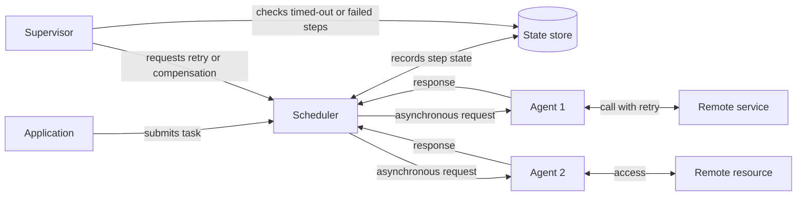

# Scheduler Agent Supervisor

## Description

The Scheduler Agent Supervisor pattern coordinates a set of distributed actions as a single logical operation: either the entire operation completes successfully, or the work already done is undone. It handles failures transparently, recovering from transient errors, longer-lasting failures, and process crashes that interrupt multi-step flows involving remote services and resources.

The solution is split into three logical roles. The **Scheduler** arranges the steps of the task into a flow, runs them in the correct order, and records the state of each one (not started, running, completed) in a durable **state store**, along with a deadline (*complete-by*). Each **Agent** encapsulates the call to a remote service or resource, applying error handling and retries within the imposed deadline, usually communicating with the Scheduler through asynchronous request and reply messages. The **Supervisor** runs periodically, examines the state store looking for steps that have failed or timed out, and requests recovery: repeating the step or undoing the entire task through a compensating transaction.

The roles are logical and can be implemented in several ways (for example, a durable orchestration engine as Scheduler, queues as the channel with the Agents, and a scheduled job as Supervisor). Because all progress is kept in the state store, any instance of the Scheduler, Agent, or Supervisor can fail and be replaced without losing the task's progress, which makes the system self-healing.

## Problems it solves

- Multi-step tasks that depend on remote services are exposed to network failures, unavailability, and slowness, and can end up in an inconsistent state.
- Non-transient failures or the crash of the orchestrator itself aren't covered by simple retries (such as the Retry pattern).
- Stuck steps, or steps that exceed the expected time, go unnoticed and block work indefinitely.
- The lack of a durable record of progress makes it impossible to resume or undo an operation after a failure.
- The need to distribute steps across workers with available capacity, separating orchestration from execution.

## When to use

- Processes in distributed environments that must be resilient to communication and operational failures in the services and resources they coordinate.
- Background jobs that orchestrate multi-step flows involving remote resources and that must either complete or be cleanly undone (for example, order processing or resource provisioning).
- Long-running flows where you need to detect timed-out steps and decide between retrying, compensating, or escalating to an operator.

### When to avoid

- The task doesn't invoke remote services or access remote resources: there is no distributed failure surface to mitigate, and coordination only adds cost.
- Simple, single-step operations where local retries (the Retry pattern) are enough.
- Scenarios where the team can't afford the complexity of testing every failure mode, versioning state, and maintaining compensations.

## Trade-offs

| Benefit | Cost / Risk |
| --- | --- |
| Resilience to transient and permanent failures, with self-healing | Complex implementation; requires fault-injection testing for each failure mode |
| Durable state allows resuming tasks after Scheduler or Agent crashes | The state store and the compensation log become critical assets that need high availability and backup |
| Automatic detection of stuck or timed-out steps by the Supervisor | The Supervisor's frequency balances detection delay against load and cost on the state store |
| Scalability: steps dispatched to Agents with capacity, priorities possible | Steps may run more than once; every step must be idempotent |
| Option to undo the task through compensation | Compensations can fail or get stuck, and the state model must represent that |

- **Retry amplification:** independent retries in the Agent, the runtime, libraries, the messaging system, and the Supervisor multiply. Define an end-to-end retry budget owned by the Scheduler.
- **Admission control:** the pattern doesn't limit in-flight work; use bounded queues, a cap on concurrent tasks, or rejection of new submissions to create backpressure.
- **Dual write:** writing the business record and the state store record isn't atomic; use stable keys to make each write repeatable, or the Transactional Outbox pattern.
- **Versioning:** long tasks span deployments; version the flow logic and the format of the persisted state.
- **Compensation states:** distinguish "compensation in progress", "completed", and "failed" instead of a single error state.
- **Concurrency:** with multiple Supervisors or Schedulers, use conditional updates or leader election to prevent two of them from recovering the same step.
- **Observability:** the behavior lives in the state store transitions; define metrics, events, and alerts for timed-out steps and recurring failures.

## Diagram

The Scheduler runs the steps, delegates remote calls to the Agents, and writes progress to the state store. The Supervisor periodically scans that state and, on finding steps that have failed or exceeded their deadline, asks the Scheduler for a retry or for compensation of the task.

## Related patterns

- [Retry](/architecture/cloud-design-patterns/resiliency/retry) — used by the Agents to handle transient failures within the step's deadline.
- [Compensating Transaction](/architecture/cloud-design-patterns/distributed-coordination/compensating-transaction) — lets you undo the steps already completed when the task can't be finished.
- [Idempotent Consumer](/architecture/cloud-design-patterns/messaging/idempotent-consumer) — needed because a step may run more than once after recovery.
- [Leader Election](/architecture/cloud-design-patterns/distributed-coordination/leader-election) — coordinates multiple Supervisor instances so they don't compete for the same recovery.
- [Asynchronous Request-Reply](/architecture/cloud-design-patterns/messaging/asynchronous-request-reply) — the communication model between Scheduler and Agents.
- [Saga](/architecture/cloud-design-patterns/distributed-coordination/saga) — a related approach to maintaining consistency in multi-step distributed transactions.
- [Circuit Breaker](/architecture/cloud-design-patterns/resiliency/circuit-breaker) — prevents Agents from overloading a remote service with persistent failures.
- [Queue-Based Load Leveling](/architecture/cloud-design-patterns/messaging/queue-based-load-leveling) — queues between Scheduler and Agents absorb spikes and help with admission control.

## Reference

- [Azure Architecture Center documentation](https://learn.microsoft.com/en-us/azure/architecture/patterns/scheduler-agent-supervisor)
