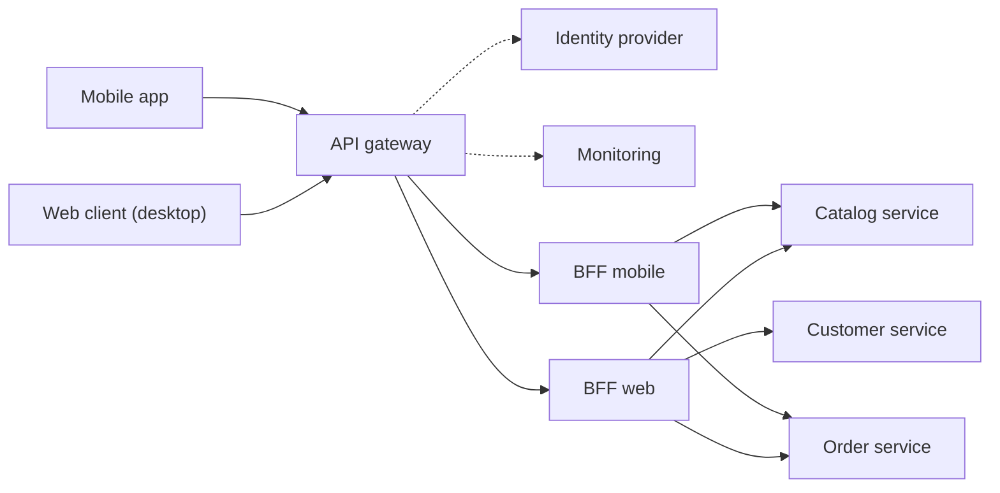

# Backends for Frontends

## Description

The Backends for Frontends (BFF) pattern proposes creating a separate backend service for each frontend interface (for example, web application, mobile app, embedded devices), instead of using a single general-purpose backend for all of them. Each BFF sits between the client and the backend services, concentrating only the logic specific to that user experience: response format and size, call aggregation, pagination, and adaptation to device limitations.

Because each BFF is smaller and simpler than a shared backend, it can be tuned to the needs of its frontend without affecting the other interfaces. In general, the frontend team owns its BFF, which gives it autonomy over language, release cadence, priorities, and feature integration, without depending on a central backend team.

Cross-cutting concerns, such as authentication, authorization, monitoring, rate limiting, and routing, should not live in the BFF; they are usually handled in a common layer, such as an API gateway, which forwards each request to the appropriate BFF. The pattern was popularized by Sam Newman.

In the microservices context (microservices.io), the BFF is a variation of the API Gateway in which each type of client gets its own dedicated gateway, for example one for the web application, another for the mobile app, and another for third-party applications that consume a public API. Each gateway offers an API designed for its client, hiding the partitioning into services from the client and reducing round trips, which is especially important on mobile networks.

## Problems it solves

- A single backend receives concurrent and sometimes conflicting demands from several frontends, causing frequent updates and development bottlenecks.
- The need to keep clients compatible with each other makes a single deployable artifact accumulate too many changes.
- Disconnect between frontend teams and a separate backend team, with delays in reaching consensus; changes requested by one frontend have to be validated by the others.
- Clients with very different capabilities (screen size, bandwidth, processing) receiving the same generic responses, with too much or too little data and many network calls.
- Fine-grained services don't match the clients' data needs, and mobile networks (high latency) tolerate only a few calls, unlike a server-side web application.
- Failures or usage spikes from one type of client affecting the availability of the others.

## When to use

- A shared or general-purpose backend requires significant development and maintenance effort.
- You want to optimize the backend for the requirements of specific client interfaces (for example, bandwidth savings on mobile, richer responses on desktop).
- The general-purpose backend is already accumulating customizations to accommodate multiple interfaces.
- A language or stack is better suited to the backend of one specific interface, but not all of them.
- A microservices architecture requires distinct APIs for web, mobile, and third-party clients, and a single shared API Gateway would become a development bottleneck.
- Frontend teams need autonomy and independent delivery cycles.

### When to avoid

- The interfaces make the same or very similar requests to the backend.
- Only one interface consumes the backend.
- A flexible query mechanism (such as GraphQL with frontend-specific resolvers) already lets each client ask for exactly the data it needs.
- An API gateway combined with microservices already meets the per-client adaptation needs.
- The team can't operate and maintain several additional services.

## Trade-offs

| Benefit | Cost / Risk |
| --- | --- |
| Experience and performance tuned to each type of client | More services to deploy, monitor, secure, and maintain |
| Fault isolation: problems in one BFF don't take down the other clients | Additional network hop, with possible increase in latency |
| Reduced API surface and per-client tuned authorization | Code duplication across BFFs |
| Autonomy for frontend teams and independent releases | Risk of business logic leaking into the BFFs |
| Simpler, more stable core backends | Learning curve and possible technical debt at the start |

- **Cost and operations:** evaluate the ideal number of BFFs; each one has its own lifecycle, pipeline, security requirements, and costs.
- **Latency and SLOs:** review the service level objectives, taking the extra hop between client and backend into account.
- **Consolidation:** if different interfaces make the same requests, consider a shared BFF, weighing the risk that diverging requirements complicate its evolution.
- **Responsibility:** keep only user-experience-specific logic in the BFF; business rules stay in the backend services and cross-cutting concerns in a common layer.
- **Implementation:** gateways under heavy load benefit from non-blocking, event-driven I/O; protect calls to services with Circuit Breaker.
- **Observability:** use distributed tracing and request correlation to follow the flow from client to gateway, BFF, and microservices.

## Diagram

Clients go through a gateway that handles authentication, authorization, and monitoring and routes each request to the BFF for its interface. Each BFF aggregates and adapts the calls to the backend services to the client's needs: the mobile BFF returns lightweight, paginated responses, and the web BFF can aggregate several pages and more data into a single response. In an Azure implementation, for example, the gateway could be API Management and the BFFs could be Azure Functions.

## Related patterns

- [API Gateway](/architecture/microservices/external-api/api-gateway) — the BFF is the variation of API Gateway with one gateway per type of client.
- [API Composition](/architecture/microservices/service-collaboration/api-composition) — a BFF often implements it to combine data from several services.
- [Microservice Architecture](/architecture/microservices/architectural-style/microservice-architecture) — the architectural style that motivates the need for BFFs.
- [Gateway Aggregation](/architecture/cloud-design-patterns/gateways-and-edge/gateway-aggregation) — a BFF often aggregates calls to several services to reduce client requests.
- [Gateway Offloading](/architecture/cloud-design-patterns/gateways-and-edge/gateway-offloading) — moves cross-cutting concerns (TLS, authentication, monitoring) to the gateway, keeping the BFFs focused on the client experience.
- [Gateway Routing](/architecture/cloud-design-patterns/gateways-and-edge/gateway-routing) — forwards each request to the right BFF from a single entry point.
- [Gatekeeper](/architecture/cloud-design-patterns/security-and-access/gatekeeper) — protects the BFFs and backend services by validating and sanitizing requests before they reach them.
- [Rate Limiting](/architecture/cloud-design-patterns/resiliency/rate-limiting-pattern) — controls the volume of calls the BFFs make to backend services.
- [Bulkhead](/architecture/cloud-design-patterns/resiliency/bulkhead) — the per-client isolation provided by BFFs follows the same principle of containing failures in compartments.
- [Cache-Aside](/architecture/cloud-design-patterns/data-management/cache-aside) — BFFs and gateways can use caching to optimize repeated responses, especially for mobile clients.

## Reference

- [Azure Architecture Center documentation](https://learn.microsoft.com/en-us/azure/architecture/patterns/backends-for-frontends)
- [Backend for Front-end on microservices.io](https://microservices.io/patterns/apigateway.html)
