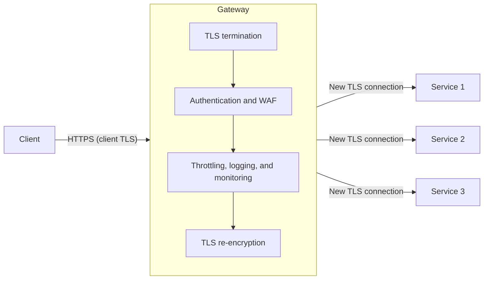

# Gateway Offloading

## Description

The Gateway Offloading pattern moves shared or specialized features to a gateway (reverse proxy) that would otherwise have to be implemented and maintained in every backend service. These are the so-called cross-cutting concerns: TLS termination and client-facing certificate management, authentication, rate limiting (*throttling*), request logging, monitoring, protocol translation, and even static redirects for legacy URLs.

The gateway sits at the edge of the system, receives client connections, applies these capabilities centrally, and forwards the request to the backend, ideally over a new encrypted connection. This keeps the backend services simpler and focused on business logic, while specialized teams (for example, security or networking) take care of the centralized features.

Business logic should never be moved to the gateway: it concentrates only generic functions shared by several services or routes.

## Problems it solves

- Duplicated configuration, management, and maintenance of common features across every deployment of every service.
- Risk of deployment errors when propagating updates to a shared resource (for example, renewing a certificate) across many instances.
- The need for highly specialized knowledge (token validation, encryption, TLS certificate management) spread across all product teams.
- Difficulty implementing authentication, authorization, logging, monitoring, and throttling consistently across a large number of services.
- Lack of a baseline of observability when a service isn't properly instrumented.
- Legacy URL handling scattered across each application's pipeline.

## When to use

- When several deployments share a common concern, such as TLS certificates or encryption.
- When a feature common across applications has distinct resource requirements (memory, storage, network connections) and benefits from being scaled separately.
- When you want to hand responsibility for network security, throttling, or other edge concerns to a specialized team.
- When you want to standardize policies (for example, WAF, TLS policy, rate limits) at a single control point.

## When to avoid

- When the gateway would need to hold service-specific logic or routing rules, coupling backend changes to gateway configuration changes and reducing deployment independence.
- When the offloaded feature is lightweight and the workload is highly latency-sensitive, so the additional network hop isn't worth it.
- When centralization creates a change-management bottleneck, for example if the gateway team's release cycle is slower than the service teams'.

## Trade-offs

| Benefit | Cost / Risk |
| --- | --- |
| Simpler backend services, without duplicated infrastructure code | The gateway becomes a single point of failure unless there are multiple instances and high availability |
| Certificate, policy, and configuration management in one place | Operational responsibility concentrated in one team and one shared component |
| Consistent security (WAF, authentication, TLS policy) | The gateway is a high-value target: a compromise exposes all downstream services |
| Baseline observability even for poorly instrumented services | Extra network hop and additional processing time on every request |
| Lower resource consumption per node and consolidated cost | Must be sized for peaks, otherwise it becomes a bottleneck for all services |

Additional considerations:

- **High availability:** run multiple instances and use *connection draining* or graceful shutdown so in-flight requests aren't dropped.
- **Bypass prevention:** configure backends to accept traffic only through the gateway, otherwise authentication, throttling, and inspection can be bypassed.
- **End-to-end TLS:** when terminating TLS at the gateway, re-establish TLS to the backend; treat all networks as untrusted and maintain a process for issuing, rotating, and revoking backend certificates.
- **Identity propagation:** define whether the backend authorizes the original caller, the gateway's identity, or both; authenticate the gateway to the backend and don't trust forwarded headers without verification.
- **Client context:** the original source IP, protocol, and hostname are lost unless the gateway forwards them explicitly (for example, `X-Forwarded-*` headers).
- **Traceability:** generate correlation IDs to follow transactions between the gateway and services.
- **Latency:** *connection pooling* and *keep-alive* connections to the backends partially reduce the cost of the extra hop.
- **Redirects:** match only the intended legacy URLs; redirects that depend on business state or authorization belong in the application.

## Diagram

The client connects to the gateway, which terminates TLS, applies the shared capabilities (authentication, inspection, rate limiting, logging), and opens new encrypted connections to the backend services, which are freed from those responsibilities. As a one-off example, a service such as Azure Application Gateway with WAF can play this role.

## Related patterns

- [Gateway Routing](/architecture/cloud-design-patterns/gateways-and-edge/gateway-routing) — uses the same gateway to route requests to multiple services through a single endpoint.
- [Gateway Aggregation](/architecture/cloud-design-patterns/gateways-and-edge/gateway-aggregation) — the gateway combines several backend calls into a single response to the client.
- [Backends for Frontends](/architecture/cloud-design-patterns/gateways-and-edge/backends-for-frontends) — dedicated gateways per client type, which can also concentrate offloaded functions.
- [Gatekeeper](/architecture/cloud-design-patterns/security-and-access/gatekeeper) — a dedicated host that validates and sanitizes requests before passing them on, reinforcing security at the edge.
- [Throttling](/architecture/cloud-design-patterns/resiliency/throttling) — one of the most common features to offload to the gateway.
- [Rate Limiting](/architecture/cloud-design-patterns/resiliency/rate-limiting-pattern) — call rate control that can be applied centrally.
- [Federated Identity](/architecture/cloud-design-patterns/security-and-access/federated-identity) — authentication delegated to an identity provider is usually validated at the gateway.
- [Sidecar](/architecture/cloud-design-patterns/integration-and-modernization/sidecar) — an alternative that offloads cross-cutting concerns to a process alongside each service, instead of a central point.
- [Ambassador](/architecture/cloud-design-patterns/integration-and-modernization/ambassador) — a proxy that offloads client-side connectivity tasks, complementary to the gateway at the edge.

## Reference

- [Azure Architecture Center documentation](https://learn.microsoft.com/en-us/azure/architecture/patterns/gateway-offloading)
