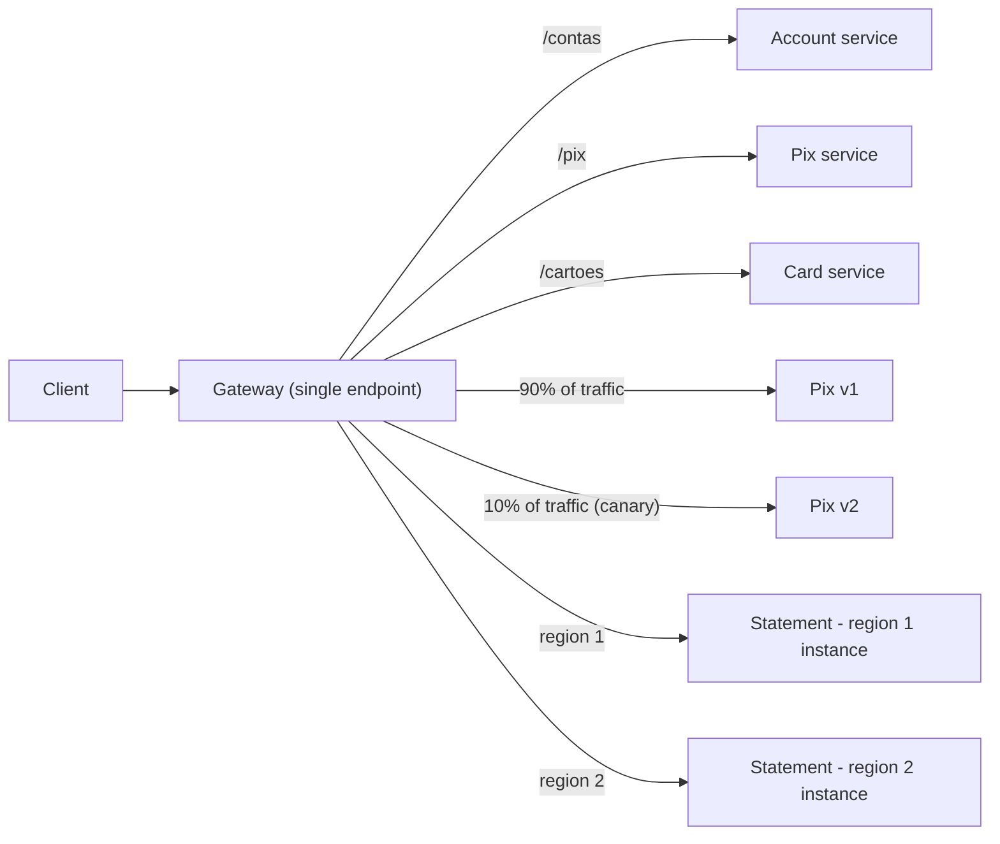

# Gateway Routing

## Description

The Gateway Routing pattern puts a gateway in front of a set of applications, services, or deployments and exposes everything through a single endpoint. The gateway inspects each request at layer 7 (URL path, host, headers, port, or source IP) and forwards it to the appropriate backend destination.

This way, the client knows and talks to just one endpoint. The gateway can forward to distinct services (accounts, Pix, cards), to multiple instances of the same service (load balancing and availability, including across regions), or to different versions of a service (blue-green, canary, gradual rollout). The backend topology is encapsulated in the gateway, and changes to it come down to routing configuration adjustments.

A common reverse proxy, such as Nginx, already implements the pattern. On Azure, for example, Application Gateway offers regional routing and Front Door offers global routing.

## Problems it solves

- Clients need to know each service's endpoint and change whenever an API is added, removed, split, or consolidated.
- Instances come and go elastically, and the client would have to keep track of that registration and deregistration.
- Deployment strategies with several versions coexisting (blue-green, canary) would require changing the client every time the traffic percentage changes.
- Rolling back a problematic version, which without the gateway may require redistributing clients or switching DNS.
- Exposing public endpoints from internal or virtual endpoints, such as cluster virtual IPs.

## When to use

- A client consumes several services that can sit behind a gateway.
- You want to simplify clients with a single endpoint.
- You need to route requests from external endpoints to internal virtual endpoints.
- The client consumes services across several regions for latency or availability gains.
- You want to shift traffic away from higher-carbon-emission regions when there are alternatives in the backend pool.
- The number of service instances varies over time.
- The deployment strategy requires multiple versions of the service to be accessed at the same time.

## When to avoid

- Simple applications that use only one or two services, where the gateway just adds a hop and another component to operate.
- Scenarios where the extra network hop is unacceptable for latency and there's no routing benefit to offset it.
- Internal service-to-service communication that already resolves discovery and balancing through another mechanism, such as a service mesh or service discovery.

## Trade-offs

| Benefit | Cost / Risk |
| --- | --- |
| The client knows a single endpoint and is decoupled from the backend topology | The gateway can become a single point of failure if it isn't redundant |
| Services can be split, consolidated, or replaced without changing the client | The gateway can become a bottleneck and needs to scale with demand |
| Gradual rollouts and fast rollback through configuration | One more network hop, with some added latency |
| Traffic sent only to healthy nodes and distributed across instances and regions | Misconfigured routing rules affect many services at once |
| Single point to manage domains, certificates, and encryption in transit | One more component to operate, monitor, and secure |

- **Availability:** deploy the gateway with redundancy and fault tolerance and combine it with backend health checks.
- **Scale and testing:** load-test the gateway to avoid causing cascading failures in the services.
- **Scope:** choose a global gateway for multi-region deployments and a regional one when you need fine-grained control of balancing within a region.
- **Security:** the gateway is the public endpoint; restrict direct access to the backends so they're reachable only through the gateway or a private network.
- **Responsibility:** keep only routing in the gateway and avoid putting business logic in it.
- **Observability:** record metrics and logs per route and per backend to diagnose errors and latency.

## Diagram

The client sends all requests to the gateway, which routes them by path to distinct services (accounts, Pix, and cards), splits Pix traffic between the current version and a canary version, and distributes the statement load across instances in different regions.

## Related patterns

- [Gateway Aggregation](/architecture/cloud-design-patterns/gateways-and-edge/gateway-aggregation) — also uses a gateway, but to combine several backend calls into a single request.
- [Gateway Offloading](/architecture/cloud-design-patterns/gateways-and-edge/gateway-offloading) — moves cross-cutting responsibilities such as TLS, authentication, and rate limiting to the gateway.
- [Backends for Frontends](/architecture/cloud-design-patterns/gateways-and-edge/backends-for-frontends) — creates gateways or backends dedicated to each type of client, each with its own routing rules.
- [Geodes](/architecture/cloud-design-patterns/deployment-and-topology/geodes) — active-active multi-region deployment that usually sits behind a global gateway.
- [Strangler Fig](/architecture/cloud-design-patterns/integration-and-modernization/strangler-fig) — uses routing in a facade to gradually migrate features from a legacy system to a new one.
- [Health Endpoint Monitoring](/architecture/cloud-design-patterns/resiliency/health-endpoint-monitoring) — provides the health signals the gateway uses to send traffic only to healthy instances.
- [Gatekeeper](/architecture/cloud-design-patterns/security-and-access/gatekeeper) — puts a dedicated host between clients and services to validate and sanitize requests, and can be combined with routing.

## Reference

- [Azure Architecture Center documentation](https://learn.microsoft.com/en-us/azure/architecture/patterns/gateway-routing)
