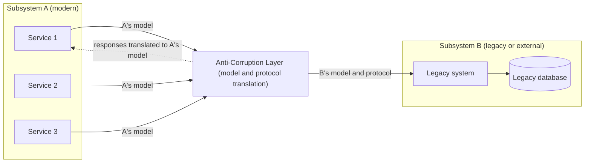

# Anti-Corruption Layer

## Description

The Anti-Corruption Layer is a facade or adapter layer placed between subsystems that don't share the same semantics. It translates the requests one subsystem makes to the other, so that dependencies on external or legacy systems don't constrain the application's design. The pattern was originally described by Eric Evans in the book *Domain-Driven Design*.

Subsystem A always communicates with the layer using its own data model and architecture. The layer, in turn, calls subsystem B respecting B's model, protocols, and APIs. All the translation logic (of schemas, protocols, formats, and domain concepts) is concentrated in this layer, which can be implemented as a component inside the application or as an independent service.

This way, one side can remain unchanged without compromising the design and technology choices of the other. The pattern is especially useful in gradual migrations, where functionality is moved little by little from a legacy system to a modern one.

From the Domain-Driven Design perspective, the layer is a Context Mapping pattern: it protects the model of a downstream Bounded Context from the influence of another context's model, which may be legacy, third-party, or simply poorly aligned with the domain. Evans describes it as a combination of Facade, Adapter, and translators: the facade offers the context a simple interface in its own language, the adapter talks to the external system, and the translators convert concepts and structures between the two models. It is an alternative to Conformist, for when adopting the upstream model would compromise the domain.

In the microservices context (microservices.io), the pattern answers the question of how to keep a legacy monolith's domain model from contaminating the domain model of a new service. When extracting a service from the monolith, the layer translates between the two models, letting the service be born with its own vocabulary and invariants.

## Problems it solves

- Legacy systems with confusing data schemas, obsolete APIs, or old protocols "contaminating" the domain model of a new application.
- The modern application having to support outdated infrastructure, formats, or semantics just to interoperate with the legacy system.
- Coupling to external systems the team doesn't control (vendors, partners, other teams), whose changes would leak into the domain.
- Phased migrations in which the new and legacy systems must coexist and talk to each other for a long time.
- New microservices extracted from a monolith unintentionally inheriting concepts and entities from the legacy model.
- Technical debt piling up in the new components because of inherited rules and models.

## When to use

- A migration will happen in several stages and you need to maintain integration between the new and legacy systems.
- Two or more subsystems have different semantics but need to communicate.
- You need to integrate with an external system whose data model or contract shouldn't influence the internal domain.
- There is legacy code inside a monolith that needs to be isolated from new modules.

## When to avoid

- There are no significant semantic differences between the new and legacy systems; the layer would only add latency and maintenance.
- The intent is to put business rules or orchestration in the layer: it should be limited to translation logic.
- The integrated system already exposes a clean, stable contract that is compatible with the application's domain model.

## Trade-offs

| Benefit | Cost / Risk |
| --- | --- |
| New domain model protected from legacy concepts and limitations | Added latency on every call between the systems |
| Less technical debt in the new components | One more component to deploy, operate, monitor, and version |
| Gradual migration is possible, with no "big bang" rewrite | The layer can become a bottleneck or single point of failure if it doesn't scale |
| Changes in the external system are contained in a single place | Risk of the layer accumulating business rules and becoming a new monolith |
| Clear boundary to validate and sanitize data between different trust levels | Maintaining transactional and data consistency between the two sides is harder |

- **Scalability:** plan how the layer will scale along with the traffic between the subsystems.
- **Granularity:** assess whether more than one layer is needed (for example, per feature or technology) and whether it should mediate all communication or only a subset of resources.
- **Lifecycle:** in monolith-to-microservices migrations, the layer tends to be transitional and can be removed once the corresponding legacy functionality is decommissioned; decide whether the layer is permanent or will be retired once all the legacy system has been migrated.
- **Operations:** integrate the layer into the monitoring, release, and configuration processes of the other applications.
- **Observability:** use correlation IDs and structured logs to diagnose translation failures and measure latency.
- **Security:** since the layer mediates systems with different trust levels, apply input validation and sanitization at this boundary.
- **Communication models:** besides synchronous request and response, the layer can translate messages asynchronously and in an event-driven way, decoupling the modern domain from the legacy system's throughput limits. As an Azure example, an API gateway (API Management) can expose the facade while serverless functions (Azure Functions) do the domain mapping.

## Diagram



The services in subsystem A speak only their own model to the Anti-Corruption Layer, which translates the calls into subsystem B's model and protocol and converts the responses back. Neither side needs to know the other's internal structure.

## Example

A new Digital Account context needs to look up accounts in the legacy core banking system, which exposes records with cryptic fields and numeric statuses. Instead of spreading that format throughout the domain, the context defines the `AccountDirectory` interface in its own language and implements it with a translator that converts the legacy record into an object of its own model.

```java
public interface AccountDirectory {
    Account findById(AccountId id);
}

public class LegacyCoreAccountDirectory implements AccountDirectory {
    private final LegacyCoreClient core;

    public LegacyCoreAccountDirectory(LegacyCoreClient core) { this.core = core; }

    public Account findById(AccountId id) {
        LegacyAccountRecord r = core.fetchCta(id.value());
        return new Account(
            id,
            new HolderName(r.nmTit().trim()),
            translateStatus(r.stCta()));
    }

    private AccountStatus translateStatus(int code) {
        return switch (code) {
            case 1 -> AccountStatus.ACTIVE;
            case 2 -> AccountStatus.BLOCKED;
            default -> AccountStatus.CLOSED;
        };
    }
}
```

The Digital Account domain only knows `AccountDirectory` and `Account`; changes in the core banking system are confined to the translator.

## Related patterns

- [Database per Service](/architecture/microservices/service-collaboration/database-per-service) — the new service keeps its own database, and the layer translates access to data still held by the monolith.
- [Strangler Fig](/architecture/cloud-design-patterns/integration-and-modernization/strangler-fig) — the anti-corruption layer is commonly used during the incremental replacement of a legacy system.
- [Gateway Routing](/architecture/cloud-design-patterns/gateways-and-edge/gateway-routing) — can direct requests to the new system or to the legacy one (via the layer) during the migration.
- [Ambassador](/architecture/cloud-design-patterns/integration-and-modernization/ambassador) — also an intermediary between the application and external services, but focused on connectivity concerns rather than semantic translation.
- [Messaging Bridge](/architecture/cloud-design-patterns/messaging/messaging-bridge) — bridges incompatible messaging systems, useful when the layer works asynchronously.
- [Backends for Frontends](/architecture/cloud-design-patterns/gateways-and-edge/backends-for-frontends) — another form of adaptation layer, aimed at fitting contracts to each client's needs.
- [Context Map](/design/ddd/context-mapping/context-map) — where the layer is recorded as a relationship policy between contexts.
- [Conformist](/design/ddd/context-mapping/conformist) — an alternative where the downstream adopts the upstream model without translating.
- [Big Ball of Mud](/design/ddd/context-mapping/big-ball-of-mud) — the messy region that the layer contains.
- [Bounded Context](/design/ddd/model-in-practice/bounded-context) — the boundary whose model the layer protects.

## Reference

- [Azure Architecture Center documentation](https://learn.microsoft.com/en-us/azure/architecture/patterns/anti-corruption-layer)
- [DDD Reference, Eric Evans (2015)](https://www.domainlanguage.com/ddd/reference/)
- [Anti-corruption layer on microservices.io](https://microservices.io/patterns/refactoring/anti-corruption-layer.html)
