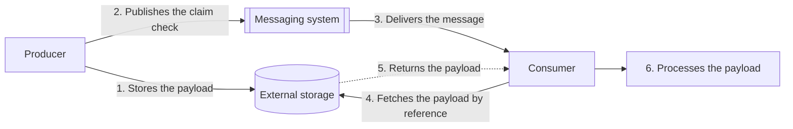

# Claim Check

## Description

The Claim Check pattern separates payload storage from message delivery. Instead of sending a large payload through the messaging system, the producer writes the full content to an external data store and publishes only a reference to it, the *claim check* (like a coat-check ticket). The messaging system never sees or stores the payload.

The flow is simple: the producer generates the payload, saves it to the external store, and only after the write succeeds publishes the message with the reference. The consumer receives the message, reads the reference, fetches the payload directly from the store, and then processes it.

In the Enterprise Integration Patterns formulation (Hohpe and Woolf), the focus is on reducing the volume of data that travels through a chain of steps without losing information: data that is only needed later on is kept in a persistent repository (a file or a database) under a unique key, removed from the message, and replaced by that key. Any later component that needs the data uses the key to retrieve it, typically with a Content Enricher. The analogy is checked luggage at the airport: you hand over the suitcase, get a receipt, and pick it up at your destination. Unlike the Content Filter, which discards the fields for good, the Claim Check only stores them temporarily. Beyond performance, this also simplifies troubleshooting, since the intermediate steps deal with smaller, more readable messages.

As a result, the broker carries only small messages, while the external store handles access control, durability, and content lifecycle policies independently of the messaging system.

## Problems it solves

- Messages rejected for exceeding the maximum size allowed by the messaging system.
- Resource pressure on the broker: large payloads consume disproportionate memory and disk, competing with other messages.
- Throughput drops caused by the longer time to serialize, transfer, and deserialize large messages.
- Higher costs when message size pushes the workload into more expensive tiers or capacity units.
- Data that's only needed in later steps of a flow, which clutters and slows down the intermediate steps and makes debugging harder.
- Exposure of sensitive data to intermediate components (queue monitoring tools, routers, logs).

## When to use

- Payloads frequently exceed the maximum message size supported by the transport.
- Large messages degrade broker performance for all the producers and consumers that share it.
- The payload (or part of it) contains sensitive information that shouldn't be visible in the messaging layer; the content goes to a store with dedicated access controls.
- Messages go through several routing steps that serialize, deserialize, encrypt, or decrypt; carrying only the token reduces repeated processing and accumulated latency.

## When to avoid

- End-to-end latency matters more than payload size, and the extra network hops to write and fetch the content aren't acceptable.
- A transport or tier exists that supports the payload size without a meaningful loss of throughput or latency (for example, the Azure Service Bus Premium tier accepts large messages); sending inline is simpler.
- It isn't feasible to coordinate two independent systems (messaging and storage) or to maintain a reference format that producers and consumers understand over time.
- Simpler alternatives solve the problem: compression or a more compact serialization, or splitting the payload into smaller messages (Splitter/Aggregator) when consumers can process or reassemble the parts.

## Trade-offs

| Benefit | Cost / Risk |
| --- | --- |
| Small messages, with no rejections for exceeding size limits | An additional dependency on an external store that must be available and durable |
| Higher throughput and less pressure on the broker | Extra latency from the network hop to fetch the payload |
| Option to use a cheaper messaging tier | Storage, network transfer, and payload cleanup costs |
| Sensitive data kept out of the messaging path, with dedicated access control | Authorization management between producers/consumers and the store |
| Payload protection through store features (versioning, backup, replication) | Writing the payload and publishing the token aren't atomic: risk of orphaned payloads or tokens with no content |

- **Payload lifecycle:** define which component owns deletion and align message expiration with payload retention, so a valid claim check never points to deleted data.
- **Consistency:** publish the token only after the write succeeds; since retries can deliver the same claim check more than once, consumers should be idempotent.
- **Conditional application:** decide whether every message uses a claim check or whether the decision is made per message; in that case, the schema should indicate whether the payload is inline or external.
- **Token security:** don't embed credentials in the claim check; authorization should be an independent interaction with the store. If you need to grant temporary access, use the Valet Key.
- **Integrity:** include a hash or signature of the content in the message when you need to verify it, and define what to do on a mismatch.
- **Framework support:** take advantage of native messaging SDK features when they exist (for example, NServiceBus's DataBus).

## Diagram

The producer writes the payload to the external store and publishes only the reference to the messaging system; the consumer uses that reference to fetch the content directly from the store before processing it.

## Related patterns

- [Content Enricher](/architecture/eip/message-transformation/content-enricher) — retrieves the stored payload from the key and puts it back into the message.
- [Content Filter](/architecture/eip/message-transformation/content-filter) — also shrinks the message, but discards the data permanently.
- [Process Manager](/architecture/eip/message-routing/process-manager) — coordinates the flow in which the claim check travels through several steps.
- [Valet Key](/architecture/cloud-design-patterns/security-and-access/valet-key) — grants temporary, restricted access to the store when the consumer needs explicit permission to fetch the payload.
- [Idempotent Consumer](/architecture/cloud-design-patterns/messaging/idempotent-consumer) — ensures safe processing of claim checks delivered more than once because of retries.
- [Competing Consumers](/architecture/cloud-design-patterns/messaging/competing-consumers) — multiple consumers can process claim checks in parallel, fetching payloads on demand.
- [Publisher-Subscriber](/architecture/cloud-design-patterns/messaging/publisher-subscriber) — the claim check can be distributed to many subscribers without replicating the large payload.
- [Queue-Based Load Leveling](/architecture/cloud-design-patterns/messaging/queue-based-load-leveling) — queues with small messages smooth out load spikes at a lower resource cost on the broker.
- [Retry](/architecture/cloud-design-patterns/resiliency/retry) — handles transient failures when writing or fetching the payload from the external store.

## Reference

- [Documentation in the Azure Architecture Center](https://learn.microsoft.com/en-us/azure/architecture/patterns/claim-check)
- [Pattern page on Enterprise Integration Patterns](https://www.enterpriseintegrationpatterns.com/StoreInLibrary.html)
