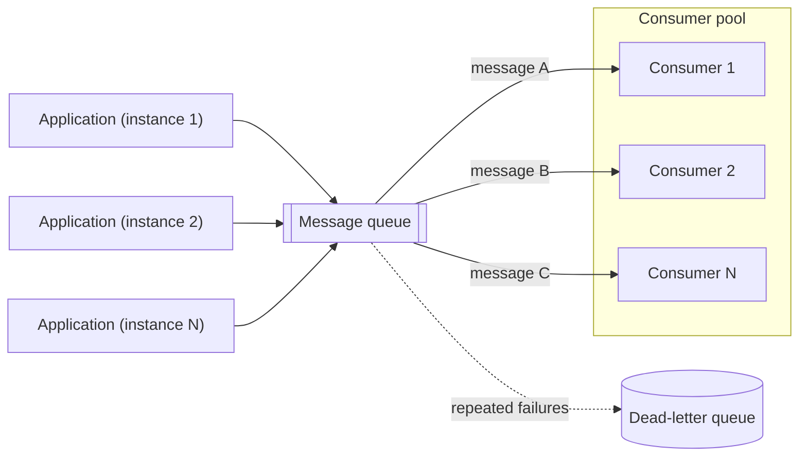

# Competing Consumers

## Description

The Competing Consumers pattern lets multiple consumer instances concurrently process messages received on the same messaging channel. Producers publish requests as messages to a queue, and a pool of consumers pulls and processes those messages asynchronously, without the producer needing to know which instance will do the work.

Each message is delivered to only one consumer: the instances "compete" for the available messages. This differs from [Publisher-Subscriber](/architecture/cloud-design-patterns/messaging/publisher-subscriber), where every subscriber receives every message. The queue acts as both a buffer and a natural load-balancing mechanism: idle consumers grab the next message, while slow messages don't block the others.

In Enterprise Integration Patterns (Hohpe and Woolf), the pattern is described as multiple consumers on the same point-to-point channel, where the messaging system decides which one gets each message. It only makes sense on point-to-point channels: on a publish-subscribe channel, additional consumers just receive copies of every message. The EIP also points out that real concurrency requires coordination, which can cost performance at high volume, and that distributing work up front can leave one consumer idle while another builds up a backlog. In Kafka-style systems, parallelism is limited by the number of partitions (one consumer per partition within the group), and messages are assigned to partitions by a router, usually based on the message key, which preserves the order of related messages.

When the messaging system offers transactional reads or temporary locking (for example, *peek-lock*), a message whose processing fails becomes visible again and can be processed by another instance. Messages that fail repeatedly should be diverted to a *dead-letter queue*.

## Problems it solves

- Highly variable and unpredictable request volume that overloads a single consumer instance at peak times.
- Synchronous request processing that blocks the application's business logic.
- Lost messages or work when a single consumer fails and the producer depends on it directly.
- The need to coordinate multiple consumers so that each message is processed by only one of them, with the load distributed evenly.
- Over-provisioning capacity to handle spikes that only happen occasionally.

## When to use

- The workload can be split into tasks that run asynchronously.
- The tasks are independent of each other and can be processed in parallel.
- The volume of work varies widely and calls for a scalable solution (including scaling down to zero when the queue is empty).
- The solution needs high availability and resilience when a task's processing fails.

### When to avoid

- The workload isn't easy to split into discrete tasks, or the tasks are strongly dependent on each other.
- The tasks must run synchronously and the application has to wait for each one to finish before moving on.
- The tasks must run in a specific sequence (unless the messaging system offers sessions or grouping that route related messages to the same consumer).

## Trade-offs

| Benefit | Cost / Risk |
| --- | --- |
| Higher throughput through parallel processing | Processing order isn't guaranteed |
| Redundancy: one consumer failing doesn't stop processing | "At-least-once" delivery requires idempotent consumers |
| Elastic scaling based on queue depth, reducing cost during idle periods | Additional messaging infrastructure to operate and monitor |
| Decoupling between producers and consumers | Returning results to the producer needs an extra channel (a reply queue or shared storage) and correlation |
| Load leveling during spikes | The queue itself can become a bottleneck at high scale |

- **Ordering:** design the system so it doesn't depend on message order; when order matters, use sessions or partitions that pin groups of messages to a single consumer.
- **Idempotency:** since a message may be processed more than once (redeliveries after failures or timeouts), operations should be idempotent.
- **Poison messages:** malformed messages, or ones that depend on unavailable resources, should be moved to a *dead-letter queue* after a maximum number of attempts instead of returning to the queue indefinitely.
- **Result handling:** if the producer needs the result, store it somewhere both sides can access or use a reply queue, clearly signaling when processing has finished.
- **Messaging scale:** at high volume, partition the queues or spread messages across several queues to keep the queue from becoming a bottleneck.
- **Messaging reliability:** use a durable messaging system that guarantees no enqueued message is lost.
- **Cost:** cap the maximum number of concurrent consumers to control spend and protect shared downstream resources.
- **Observability:** monitor queue depth, age of the oldest message, failure rate, and *dead-letter queue* volume.

- **EIP perspective:** the limits between throughput and ordering, and between balancing and idleness, are intrinsic to the pattern; consumers that share partitions don't really compete, they just split the work statically.

## Diagram

Multiple application instances publish messages to a single queue; each message is delivered to only one consumer in the pool, which can scale with queue depth. Messages that fail repeatedly are diverted to the *dead-letter queue* for analysis.

## Related patterns

- [Queue-Based Load Leveling](/architecture/cloud-design-patterns/messaging/queue-based-load-leveling) — the queue between producers and consumers absorbs spikes and levels the load.
- [Publisher-Subscriber](/architecture/cloud-design-patterns/messaging/publisher-subscriber) — contrast: in Pub/Sub every subscriber receives each message; here, only one consumer does.
- [Idempotent Consumer](/architecture/cloud-design-patterns/messaging/idempotent-consumer) — ensures that message redeliveries don't cause duplicate effects.
- [Priority Queue](/architecture/cloud-design-patterns/messaging/priority-queue) — lets consumers process the most important messages first.
- [Sequential Convoy](/architecture/cloud-design-patterns/messaging/sequential-convoy) — processes groups of related messages in order without giving up concurrency across groups.
- [Asynchronous Request-Reply](/architecture/cloud-design-patterns/messaging/asynchronous-request-reply) — a way to return results to the producer when processing is asynchronous.
- [Compute Resource Consolidation](/architecture/cloud-design-patterns/deployment-and-topology/compute-resource-consolidation) — consumers can be consolidated into shared compute units.
- [Point-to-Point Channel](/architecture/eip/messaging-channels/point-to-point-channel) — the type of channel on which consumers compete (EIP).
- [Message Dispatcher](/architecture/eip/messaging-endpoints/message-dispatcher) — an alternative in which a single consumer distributes work to performers (EIP).
- [Polling Consumer](/architecture/eip/messaging-endpoints/polling-consumer) — a possible consumption mode for each competing consumer (EIP).
- [Event-Driven Consumer](/architecture/eip/messaging-endpoints/event-driven-consumer) — another possible consumption mode (EIP).
- [Retry](/architecture/cloud-design-patterns/resiliency/retry) — handles transient failures during message processing.
- [Throttling](/architecture/cloud-design-patterns/resiliency/throttling) — limits resource consumption when consumer scaling puts pressure on downstream services.

## Reference

- [Documentation in the Azure Architecture Center](https://learn.microsoft.com/en-us/azure/architecture/patterns/competing-consumers)
- [Pattern page on Enterprise Integration Patterns](https://www.enterpriseintegrationpatterns.com/CompetingConsumers.html)
