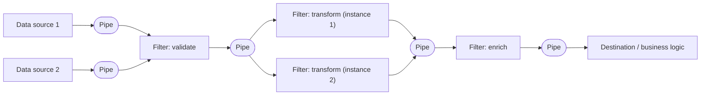

# Pipes and Filters

## Description

The Pipes and Filters pattern breaks a complex processing task down into a sequence of independent, reusable steps. Each step is a **filter**: a self-contained component, usually stateless, that performs a single responsibility, such as validating, transforming, enriching, or discarding data. Filters are connected by **pipes**, channels that simply carry the output of one filter to the input of the next, with no routing or business logic.

Each filter knows only its input and output schemas, not the other filters. That's why filters can be reordered, replaced, added, or removed, as long as one's output is compatible with the next one's input. A standardized message schema across filters increases this flexibility and favors reuse by composition: new pipelines are assembled from existing filters.

Because filters are deployed independently, each one can scale separately, run on hardware suited to its load (for example, more powerful machines for CPU-intensive steps), and have multiple instances running in parallel to remove bottlenecks. When input and output are structured as a stream, subsequent filters can start working before the previous one has finished the whole batch. In the Enterprise Integration Patterns formulation (Hohpe and Woolf), the motivation is an event that requires several steps, such as decrypting an order, validating the sender's certificate, and eliminating duplicates, without coupling the steps to each other. Since every filter has the same interface (one input port and one output port), they can be combined in different orders, and the topology changes just by changing the pipe connections. A filter with multiple outputs is a Message Router.

A common implementation uses a sequence of message queues as pipes, with each filter consuming from one queue and publishing to the next.

## Problems it solves

- Monolithic processing modules that duplicate similar steps across several flows, making reuse hard and requiring the same code to be changed in multiple places
- Being unable to scale separately steps with very different resource requirements
- Difficulty reordering, inserting, or removing steps without rewriting and retesting all of the processing
- Bottlenecks caused by one slow step that limits the throughput of the entire flow
- Failures in one step that bring down all the processing, with no isolation and no way to resume from the point of failure

## When to use

- The processing can be naturally split into a set of independent steps
- The steps have different scalability or hardware requirements (filters that scale together can be grouped in the same process)
- You need flexibility to reorder, add, or remove steps over time
- The system benefits from distributing steps across different servers or regions, close to the resources they use
- You want a reliable solution that minimizes the impact of a step failing while data is being processed
- Data pipelines, ETL, media processing (moderation, resizing, watermarking, metadata stripping, CDN publishing), and event ingestion

### When to avoid

- The application follows a synchronous request-response model and the processing has to finish within the initial request
- The steps aren't independent or must run together in a single transaction
- Each step needs so much context or state that loading and persisting it at every filter makes the approach inefficient or causes excessive contention on shared storage
- The processing is simple enough that the overhead of distributing and operating several components isn't justified

## Trade-offs

| Benefit | Cost / Risk |
| --- | --- |
| Modularity and reuse of filters across multiple pipelines | More components to deploy, version, and operate |
| Independent scalability and per-step parallelism | Higher total latency due to hops between pipes and serialization |
| Flexibility to reorder, insert, or replace steps | Requires compatible message contracts and schema governance |
| Failure isolation and the ability to resume from a given step | Need for durable pipes, idempotency, and message deduplication |
| Each filter can run on the most suitable hardware or location | End-to-end observability and tracing are harder in a distributed environment |

- **Pipe reliability:** use infrastructure that guarantees messages between filters aren't lost (durable queues, acknowledgment after processing).
- **Idempotency:** if a filter fails after receiving or publishing a message and the work is reprocessed by another instance, the same effect can happen twice; design idempotent filters.
- **Repeated messages:** the pipeline should detect and eliminate duplicates; some messaging infrastructures offer automatic deduplication.
- **Context and state:** each filter runs in isolation and should receive enough context to do its work; external state adds the cost of loading and persisting it at each step.
- **Message tolerance:** filters should ignore, and pass along unchanged, any data that doesn't concern them.
- **Error handling:** each filter should decide whether a failure stops the pipeline or is propagated (for example, to a dead-letter queue).
- **Testing:** changes to one filter can affect the whole chain; keep end-to-end tests of the pipeline.
- **Bottlenecks:** throughput is limited by the slowest filter; monitor queues and scale the slow steps.

## Diagram

Data from different sources enters the pipeline and passes through independent filters connected by pipes (for example, queues). The slowest filter ("transform") runs with several instances in parallel to increase throughput, without affecting the other steps.

## Related patterns

- [Competing Consumers](/architecture/cloud-design-patterns/messaging/competing-consumers) — multiple instances of a filter consume from the same pipe to distribute the load and increase throughput
- [Compute Resource Consolidation](/architecture/cloud-design-patterns/deployment-and-topology/compute-resource-consolidation) — filters that scale together can be grouped in the same process to reduce cost and overhead
- [Compensating Transaction](/architecture/cloud-design-patterns/distributed-coordination/compensating-transaction) — filters can implement compensable operations, offering an alternative to distributed transactions
- [Claim Check](/architecture/cloud-design-patterns/messaging/claim-check) — avoids moving large payloads through the pipes by passing only a reference to the stored data
- [Idempotent Consumer](/architecture/cloud-design-patterns/messaging/idempotent-consumer) — ensures that reprocessing and duplicate messages don't cause repeated effects in the filters
- [Queue-Based Load Leveling](/architecture/cloud-design-patterns/messaging/queue-based-load-leveling) — queues used as pipes absorb load spikes between steps
- [Retry](/architecture/cloud-design-patterns/resiliency/retry) — filters can retry operations that fail transiently before propagating the error
- [Message Router](/architecture/eip/message-routing/message-router) — a filter with multiple outputs that chooses the destination channel (EIP view)
- [Routing Slip](/architecture/eip/message-routing/routing-slip) — makes the sequence of filters vary per message
- [Message Filter](/architecture/eip/message-routing/message-filter) — a filter that discards messages that don't meet a criterion
- [Choreography](/architecture/cloud-design-patterns/distributed-coordination/choreography) — a decentralized alternative in which services react to events instead of following a fixed chain

## Reference

- [Documentation in the Azure Architecture Center](https://learn.microsoft.com/en-us/azure/architecture/patterns/pipes-and-filters)
- [Pattern page on Enterprise Integration Patterns](https://www.enterpriseintegrationpatterns.com/PipesAndFilters.html)
