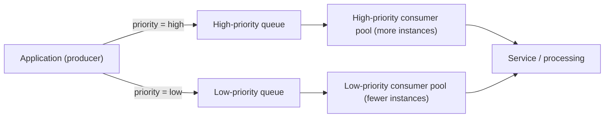

# Priority Queue

## Description

The Priority Queue pattern prioritizes the requests sent to a service so that higher-priority requests are received and processed before lower-priority ones. Instead of following arrival order alone (FIFO), the producer assigns a priority value to each message, and consumers process messages according to that priority. This is useful when the application offers different service levels or SLAs for different request types or customers.

There are two main approaches. With a **single queue**, all messages go to the same queue, which orders them by priority, and consumers pull the highest-priority ones first. With **multiple queues**, each priority level has its own queue and the producer routes the message to the matching queue.

With multiple queues, consumers can be organized in two ways: a **single pool**, which always drains the highest-priority queue first and only then serves the others (simple to operate, but at the risk that low-priority messages are never processed), or **dedicated pools** per queue, where higher-priority queues get more consumers or more powerful resources, providing failure isolation and independent performance per level.

## Problems it solves

- Critical tasks get stuck behind less important ones in a FIFO queue, delaying what's urgent.
- Difficulty meeting differentiated SLAs (for example, premium versus standard customers) with a single processing flow.
- Demand spikes degrade all work equally, including business-critical operations.
- No mechanism for concentrating compute resources and reliability efforts on the most critical flows.
- High costs from sizing all capacity for the most demanding service level.

## When to use

- You need to meet different latency or service-level objectives for distinct classes of work, such as premium and standard customer requests.
- Work arrives in bursts and critical operations must be protected, processing high-priority messages first and deferring the rest.
- Some tasks need immediate attention while others can wait or run during lower-demand periods.
- Different task types require distinct processing characteristics and performance guarantees.

## When to avoid

- All work items have similar business importance and strictly FIFO processing matters more than prioritization.
- Tasks have strong ordering dependencies across priority levels, and reordering them would cause inconsistent results or require complex coordination logic.
- Volume is low enough that all messages are processed quickly, making prioritization unnecessary complexity.

## Trade-offs

| Benefit | Cost / Risk |
| --- | --- |
| Critical work is processed with lower latency | Low-priority messages can suffer starvation |
| Meets differentiated SLAs per customer or request type | More queues and pools increase operational and monitoring complexity |
| Dedicated pools isolate failures between priority levels | Extra cost for queues, consumers, and read/query operations billed per call |
| Resources can be sized according to the importance of the work | Loss of global FIFO ordering across messages of different priorities |
| Non-urgent tasks can be shifted to idle hours, reducing costs | Need to define and govern clear priority criteria |

Additional considerations:

- **Define priorities clearly:** establish distinct, measurable levels (for example, "high priority = process within 10 seconds") and allocate resources accordingly.
- **Avoid starvation:** decide whether every high-priority item must be processed before any low-priority item; if possible, dynamically raise the priority of old messages (aging).
- **Scalability:** adjust the size of each consumer pool based on the depth of the queue it serves.
- **Observability:** monitor queue depth, processing latency, delivery count, and throughput per priority level.
- **Problematic messages:** use dead-letter queues after a configurable number of attempts so a faulty message doesn't block the priority path.
- **Preemption:** with multiple queues and a single pool, implement an algorithm that guarantees higher-priority queues are always served first.
- **Demand spikes:** combine with Queue-Based Load Leveling when the arrival rate can exceed the consumers' capacity.

## Diagram

The producer assigns a priority to each message and sends it to the matching queue; each queue is served by a dedicated consumer pool, and the high-priority pool has more capacity to process critical work with lower latency. As a one-off example, in Azure this can be done with an Azure Service Bus topic with per-subscription filters and consumers on Azure Functions.

## Related patterns

- [Queue-Based Load Leveling](/architecture/cloud-design-patterns/messaging/queue-based-load-leveling) — smooths demand spikes before processing and combines well with prioritization.
- [Competing Consumers](/architecture/cloud-design-patterns/messaging/competing-consumers) — lets multiple consumers process messages from each queue in parallel, increasing throughput and availability.
- [Throttling](/architecture/cloud-design-patterns/resiliency/throttling) — limits resource consumption and can favor higher-priority requests under load.
- [Publisher-Subscriber](/architecture/cloud-design-patterns/messaging/publisher-subscriber) — topics and subscriptions with filters can route messages to queues of different priorities.
- [Bulkhead](/architecture/cloud-design-patterns/resiliency/bulkhead) — dedicated consumer pools per priority isolate failures between levels.
- [Sequential Convoy](/architecture/cloud-design-patterns/messaging/sequential-convoy) — useful when processing order matters, a situation in which prioritization may be inappropriate.

## Reference

- [Documentation in the Azure Architecture Center](https://learn.microsoft.com/en-us/azure/architecture/patterns/priority-queue)
