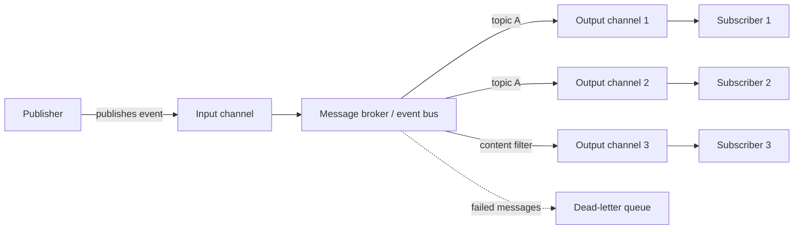

# Publisher-Subscriber

## Description

The Publisher-Subscriber (pub/sub) pattern lets an application announce events asynchronously to multiple interested consumers, without knowing who they are. The sender (*publisher*) packages the event into a message with a well-known format and sends it to a single input channel; from there, an intermediary, such as a message broker or event bus, copies the message to the output channel of each interested consumer (*subscriber*).

Each subscriber independently decides what it wants to receive, usually by subscribing to topics or defining content filters. As a result, the publisher can get back to its work right after publishing, and new consumers can be added or removed without any change to the sender.

The broker also retains messages while a subscriber is unavailable, which isolates failures, allows deferred or scheduled processing, and eases integration between systems with different platforms, languages, and protocols, including between on-premises and cloud environments.

In the vocabulary of Enterprise Integration Patterns (Hohpe and Woolf), the same pattern is the Publish-Subscribe Channel: the channel has one input and a separate output per subscriber, and each output delivers a copy of the event to a single subscriber, which consumes it once and removes it from its channel. Since all traffic passes through this fan-out point, it's also a convenient place to peek at messages for debugging, similar to a Message Store, without changing the applications.

## Problems it solves

- Direct coupling: the sender has to know the identity and endpoint of each consumer, deliver to each one, and handle failures individually.
- Adding or removing consumers requires changing the sender, which prevents teams from evolving and deploying components independently.
- Point-to-point queues serve a single consumer; supporting several requires one queue per consumer, increasing routing complexity.
- Consumers that only need part of the information have no native mechanism, with simple queues, to filter by content or category.
- The sender is blocked or slowed down while waiting for delivery to multiple destinations.
- Each subscriber must receive and consume each event exactly once, without copies piling up or being processed in duplicate.
- Teams need to observe channel traffic for debugging without touching the existing flow or adding logging code to every application.
- One consumer's failure propagates to the sender or to the other consumers.

## When to use

- An application needs to broadcast information to a significant number of consumers.
- You need to communicate with independently developed applications or services, possibly on different platforms, languages, or protocols.
- The sender can send information without requiring a real-time response from the consumers.
- The integrated systems accept an eventual consistency model for their data.
- Consumers have availability requirements or operating windows that differ from the sender's.

### When to avoid

- There are few consumers and each needs very different information; the broker adds complexity with no scaling benefit, and direct communication or separate queues may be a better fit.
- The interaction needs to be near real time or the publisher needs a synchronous response; prefer request-reply.
- Consumers need to process messages in a specific, guaranteed order.
- The operation requires an atomic transaction between the publisher and its consumers; consider a direct database transaction or the Saga pattern.

## Trade-offs

| Benefit | Cost / Risk |
| --- | --- |
| Decoupling between publisher and subscribers, with independent evolution and deployment | One more infrastructure component (the broker) to operate, monitor, and secure |
| A more responsive and scalable publisher: publish once and move on | Added latency and eventual consistency between systems |
| Failure isolation: the broker retains messages until the subscriber recovers | Accumulated messages can exhaust broker resources if subscribers don't keep up |
| New consumers join with no change to the sender | End-to-end traceability is harder; requires correlation IDs |
| Filtering by topic or content, delivering to each consumer only what it cares about | Delivery order isn't guaranteed, and duplicate messages are possible |
| Fits consumption-based billing models and on-demand scaling | One-way channels: replies require a separate return channel |

- **Delivery guarantees:** *at-most-once* has the lowest cost but can lose messages; *at-least-once* guarantees delivery but produces duplicates; *exactly-once* eliminates duplicates at the price of more coordination and latency. Without broker-side deduplication, make subscribers idempotent.
- **Ordering:** if order matters, use ordered partitions or sessions, knowing this limits scale; preferably, design subscribers that tolerate any arrival order.
- **Topic granularity:** broad topics are simple to manage but force filtering in the subscriber; narrow topics reduce filtering but multiply the number of topics. Wildcard subscriptions (e.g., `orders.*`) help.
- **Security:** authenticate and authorize publishers and subscribers per topic, encrypt messages in transit and, if they're sensitive, at rest in the broker. The broker also serves as a network segmentation boundary.
- **Problematic messages:** divert malformed messages (poison messages) to a dead-letter queue for analysis.
- **Size and validity:** for large payloads, store the content externally and send a reference (Claim Check). Use expiration and release timestamps to discard stale messages or schedule processing.
- **Schema evolution:** prefer backward-compatible changes (optional fields), version on breaking changes (e.g., `orders.v1`, `orders.v2`), and have subscribers ignore unknown fields.
- **Backpressure:** use the broker's flow control to limit unacknowledged messages per subscriber and scale out with Competing Consumers.
- **Technology:** prefer off-the-shelf messaging products over building your own broker. On Azure, for example, Service Bus (topics and subscriptions), Event Grid (push notifications), or Event Hubs (streaming); outside of it, RabbitMQ, Apache Kafka, or Redis.

## Diagram

The publisher sends each event once to the input channel; the broker copies the message to the output channel of each interested subscriber, according to topics or filters, and diverts messages that can't be processed to a dead-letter queue.

## Related patterns

- [Competing Consumers](/architecture/cloud-design-patterns/messaging/competing-consumers) — scales out the processing of each subscription with multiple instances consuming from the same channel.
- [Idempotent Consumer](/architecture/cloud-design-patterns/messaging/idempotent-consumer) — lets you safely handle the duplicate messages of at-least-once delivery.
- [Claim Check](/architecture/cloud-design-patterns/messaging/claim-check) — avoids message size limits by sending only a reference to the externally stored payload.
- [Priority Queue](/architecture/cloud-design-patterns/messaging/priority-queue) — ensures higher-priority messages are processed before the others.
- [Choreography](/architecture/cloud-design-patterns/distributed-coordination/choreography) — uses published events so services coordinate a business flow without a central orchestrator.
- [Saga](/architecture/cloud-design-patterns/distributed-coordination/saga) — coordinates distributed transactions when consistency between publisher and consumers is needed.
- [Event Sourcing](/architecture/cloud-design-patterns/data-management/event-sourcing) — stored events are often published to update other systems and views.
- [Asynchronous Request-Reply](/architecture/cloud-design-patterns/messaging/asynchronous-request-reply) — an alternative when the sender needs a response, since pub/sub channels are one-way.
- [Queue-Based Load Leveling](/architecture/cloud-design-patterns/messaging/queue-based-load-leveling) — the broker's buffer absorbs load spikes between publisher and subscribers.
- [Point-to-Point Channel](/architecture/eip/messaging-channels/point-to-point-channel) — in EIP, the alternative in which each message goes to a single receiver.
- [Durable Subscriber](/architecture/eip/messaging-endpoints/durable-subscriber) — retains messages for subscribers that are offline.
- [Message Channel](/architecture/eip/messaging-channels/message-channel) — the general channel concept that this pattern specializes.
- [Event Message](/architecture/eip/message-construction/event-message) — the type of message normally broadcast on this channel.
- [Messaging Bridge](/architecture/cloud-design-patterns/messaging/messaging-bridge) — integrates different messaging systems when publishers and subscribers use distinct brokers.

## Reference

- [Documentation in the Azure Architecture Center](https://learn.microsoft.com/en-us/azure/architecture/patterns/publisher-subscriber)
- [Pattern page on Enterprise Integration Patterns](https://www.enterpriseintegrationpatterns.com/PublishSubscribeChannel.html)
