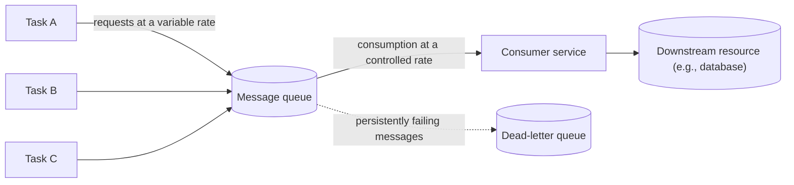

# Queue-Based Load Leveling

## Description

The Queue-Based Load Leveling pattern places a queue between the tasks that generate work (producers) and the service that performs that work (consumer). Instead of calling the service synchronously, each task publishes a message with the necessary data to the queue, which acts as a durable buffer until the service pulls and processes it.

As a result, the request arrival rate is no longer coupled to the processing rate. Intermittent demand spikes pile up in the queue and are consumed at the pace the service can sustain, which smooths the load and protects both the service and the tasks that depend on it.

Multiple tasks, generating requests at widely varying rates, can share the same queue. The number of queues and consumer instances can be adjusted to demand, making it possible to size the service for the average load instead of the peak load.

## Problems it solves

- Unpredictable demand spikes that overload a service and make it slow or unavailable.
- Failures caused by contention when many concurrent requests hit the same resource (database, cache, storage, partner API).
- Timeouts and throttling on the caller when the service doesn't respond in time.
- Temporary service unavailability directly affecting whoever generates the work: with the queue, tasks keep publishing messages even if the service is down.
- Over-provisioning infrastructure just to absorb occasional spikes.

## When to use

- The load has intermittent spikes that can overload downstream services.
- You want to decouple request intake from processing capacity to gain resilience and control costs.
- The downstream service has hard throughput limits or applies throttling when it reaches a threshold.
- The work can be processed asynchronously, without the caller needing an immediate response.

## When to avoid

- The caller requires a synchronous, low-latency response.
- The volume is predictably low and steady, so the queue's complexity brings little benefit.
- The average production rate sustainably exceeds the consumption capacity: the queue only postpones the problem, growing indefinitely.

## Trade-offs

| Benefit | Cost / Risk |
| --- | --- |
| Resilience to spikes and to temporary service failures | Higher latency between submission and processing |
| Sizing for the average load, reducing cost | One more component to operate, monitor, and secure |
| Independent scaling of producers and consumers | One-way communication; replies need an additional mechanism |
| Processing failures isolated from intake | At-least-once delivery requires idempotent consumers |
| Controlled, predictable throughput on the downstream resource | Processing order isn't guaranteed with parallel consumers |

Additional considerations:

- **Rate control:** cap the consumers' aggregate rate. Autoscaling consumers without that cap just shifts the overload to downstream dependencies. Test under load and tune the number of queues and instances.
- **Queue depth:** monitor the size and age of messages; scale consumers within safe limits or drop/reject work at the producer when necessary.
- **Durability:** choose a queue that persists messages to durable or replicated storage, and know its size and retention quotas; consider geo-recovery if needed.
- **Idempotency:** since most queues deliver messages at least once, repeated processing must produce the same result (no duplicate records or repeated charges).
- **Problematic messages:** route persistently failing messages to a dead-letter queue and monitor it for investigation and resubmission.
- **Ordering:** if it's mandatory, use features such as sessions or ordered partitions (for example, message sessions in Azure Service Bus); otherwise, design consumers to handle messages in any order.
- **Replies:** if the producer needs a response, combine with a reply queue or with the Asynchronous Request-Reply pattern.

## Diagram

Multiple tasks publish messages at irregular rates to the same queue, which absorbs the spikes; the service consumes messages at its own pace and protects the downstream resource, while messages that can't be processed are isolated in a dead-letter queue.

## Related patterns

- [Competing Consumers](/architecture/cloud-design-patterns/messaging/competing-consumers) — multiple instances consume from the same queue to increase processing throughput.
- [Throttling](/architecture/cloud-design-patterns/resiliency/throttling) — limits resource consumption; load leveling keeps demand from reaching the throttling threshold.
- [Rate Limiting](/architecture/cloud-design-patterns/resiliency/rate-limiting-pattern) — controls the rate at which consumers access the downstream resource.
- [Priority Queue](/architecture/cloud-design-patterns/messaging/priority-queue) — lets you process more important messages before the others.
- [Asynchronous Request-Reply](/architecture/cloud-design-patterns/messaging/asynchronous-request-reply) — offers a way to return responses to the caller in asynchronous flows.
- [Idempotent Consumer](/architecture/cloud-design-patterns/messaging/idempotent-consumer) — ensures that messages delivered more than once don't cause duplicate effects.
- [Claim Check](/architecture/cloud-design-patterns/messaging/claim-check) — reduces the size of queued messages by storing the payload outside the queue.
- [Retry](/architecture/cloud-design-patterns/resiliency/retry) — handles transient failures when publishing or processing messages.

## Reference

- [Documentation in the Azure Architecture Center](https://learn.microsoft.com/en-us/azure/architecture/patterns/queue-based-load-leveling)
