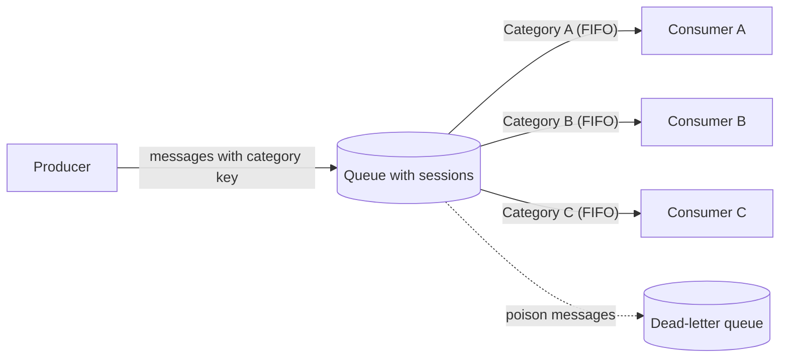

# Sequential Convoy

## Description

The Sequential Convoy groups related messages by a category key (for example, an order ID) and processes each group sequentially, one message at a time, while different groups are processed in parallel. This guarantees FIFO order within each group without the ordering requirement becoming a bottleneck for the whole system.

The producer tags each message with the category key, and the messaging broker uses that key to partition messages into logical groups. A consumer takes an exclusive lock on a group and receives its messages strictly in the order they were enqueued; other consumers serve other groups at the same time. The unit of parallelism stops being the message and becomes the category.

Many brokers offer this behavior natively, through sessions, message groups, or ordered partitions. On Azure, for example, Service Bus message sessions implement the pattern.

## Problems it solves

- A single consumer preserves order, but doesn't scale as load grows.
- Multiple consumers competing for a shared queue increase throughput, but may process messages from the same group out of order or simultaneously, corrupting state.
- Operations on the same entity (create, update, delete) arrive interleaved with operations on other entities and need to be applied in the correct sequence.
- Avoids race conditions and makeshift reordering or locking logic in consumer code.

## When to use

- Messages arrive in order and must be processed in that same order.
- Messages can be categorized so that each category is an independent unit of scale.
- Many categories are active at the same time, which allows real parallelism across groups.

### When to avoid

- Extremely high-throughput scenarios (millions of messages per minute), where the FIFO requirement limits the achievable scale.
- Message order doesn't matter; in that case Competing Consumers offers simpler horizontal scaling, without the cost of per-session coordination.
- There are few categories with highly concentrated volume, which makes processing practically serial.

## Trade-offs

| Benefit | Cost / Risk |
| --- | --- |
| FIFO order guaranteed within each category | Per-category throughput is limited to the processing time of one message |
| Horizontal scaling across categories | Key choice is critical: too coarse limits parallelism, too fine brings no ordering benefit |
| Eliminates race conditions and reordering workarounds | A poison message blocks all following messages in the same category |
| Decoupling between producers and consumers | Depends on broker features (sessions/locks), which may require more expensive tiers |
| Independent, replaceable consumers | Contention and latency on the session lock; lock timeout and renewal tuning |

- **Poison messages:** count delivery attempts and move the message to a dead-letter queue after a limit, freeing the rest of the group.
- **Arrival order:** network latency between producer and broker can reorder messages before partitioning; use sequence numbers and an end-of-sequence marker.
- **Key correctness:** a wrong key on the producer sends the message to the wrong group and corrupts state; validate keys on the producer and, if needed, on the consumer.
- **Broker availability:** it's a shared dependency of all categories; evaluate availability zones and disaster recovery.
- **Observability:** monitor the number of active sessions, backlog per session, and dead-lettered messages, with an investigation and reprocessing flow.
- **Cost:** each active session tends to occupy one consumer execution or instance; define concurrency limits.
- **Evolution:** the design should absorb new categories without structural changes to the consumers.

## Diagram

The producer sends interleaved messages from several categories to a single queue; the broker delivers each category exclusively to one consumer, which processes it in order, while different categories advance in parallel.

## Related patterns

- [Competing Consumers](/architecture/cloud-design-patterns/messaging/competing-consumers) — scales consumption in parallel, but loses order; the Sequential Convoy closes that gap by partitioning by category.
- [Queue-Based Load Leveling](/architecture/cloud-design-patterns/messaging/queue-based-load-leveling) — the queue absorbs load spikes; the Sequential Convoy adds partitioning with per-category ordering.
- [Priority Queue](/architecture/cloud-design-patterns/messaging/priority-queue) — can be combined to maintain FIFO within each priority level.
- [Idempotent Consumer](/architecture/cloud-design-patterns/messaging/idempotent-consumer) — protects against reprocessing when a session lock expires and the message is delivered again.
- [Retry](/architecture/cloud-design-patterns/resiliency/retry) — defines attempts before moving failed messages to the dead-letter queue without blocking the group indefinitely.

## Reference

- [Documentation in the Azure Architecture Center](https://learn.microsoft.com/en-us/azure/architecture/patterns/sequential-convoy)
