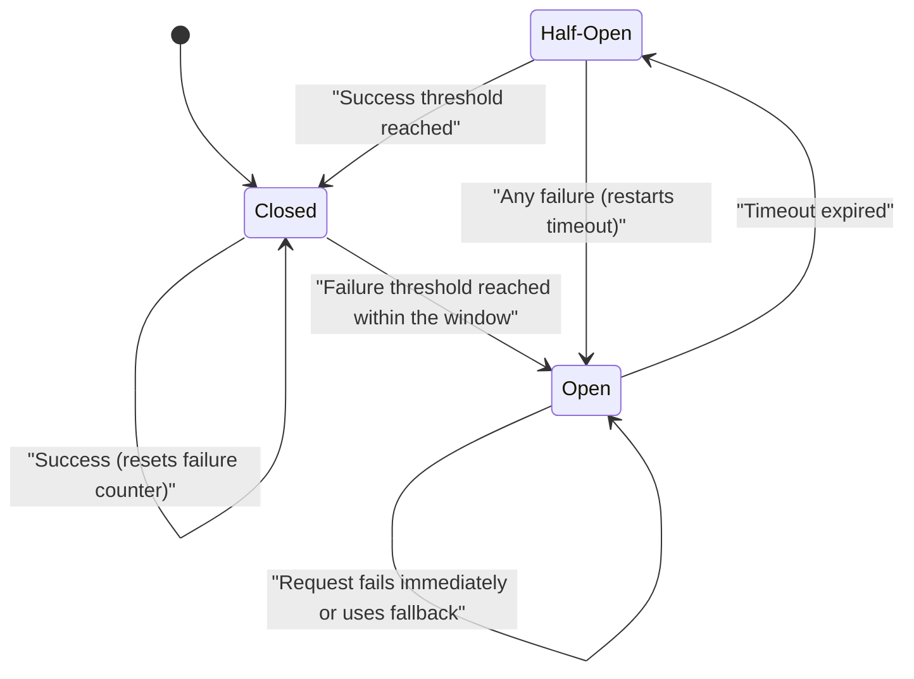

# Circuit Breaker

## Description

The Circuit Breaker temporarily blocks access to a remote service or resource when failures exceed a threshold. This way the application stops retrying an operation that is likely to fail. It acts as a proxy between the caller and the dependency: it monitors recent failures and decides whether the call proceeds or fails immediately.

The proxy is a state machine inspired by the electrical circuit breaker. In **Closed**, requests pass through normally and a failure counter (reset periodically) is incremented on each error. When the threshold is reached within a time window, the circuit goes to **Open**: calls fail immediately (or receive a default or cached response) and a timer starts. When the timer expires, the circuit moves to **Half-Open** and lets a limited number of test requests through. If they succeed, the circuit goes back to Closed. If any of them fails, it goes back to Open and the timer restarts.

The pattern complements [Retry](/architecture/cloud-design-patterns/resiliency/retry), but has a different goal. Retry insists, hoping the operation eventually succeeds. Circuit Breaker prevents calls that are likely to fail. When the two are used together, the retry logic must respect the exceptions from an open circuit and stop trying.

In microservice architectures, this context is even more common: a service usually calls another one synchronously (RPC or REST). If the called service is down or very slow, the caller ends up with threads stuck waiting, exhausts its own resources, and stops responding too, and the failure spreads through the system. The central question is how to keep a network or service failure from propagating in a cascade. In this case, the circuit sits in a proxy around the remote client and opens after consecutive failures above a threshold.

## Problems it solves

- Cascading failures: calls blocked waiting for a timeout tie up threads, memory, and connections, and end up taking down parts of the system unrelated to the problem.
- Wasted resources and high latency from repeating calls to a dependency that is down or degraded for a long period.
- Excess load on a service that is trying to recover, caused by aggressive client retries.
- Lack of a clear signal that a dependency is unavailable. Circuit state changes can feed monitoring and alerts.
- The need for graceful degradation: returning default values, cached data, or reduced functionality instead of a slow error.

## When to use

- To prevent cascading failures when calling remote services or shared resources that may become unavailable for varying periods.
- To protect the application from slow dependencies and keep service level objectives (SLOs) even when a service has high latency.
- To handle intermittent connectivity problems in distributed environments.
- To steer traffic based on real-time failure signals, for example to another region in multi-region deployments.

### When to avoid

- When accessing local, private application resources, such as in-memory structures. In those cases the circuit only adds overhead.
- As a substitute for business-logic exception handling.
- When well-known retry algorithms are enough and the dependencies were designed to support them.
- When waiting for the circuit to recover causes unacceptable delays.
- In message-driven or event-driven architectures that already isolate failures with dead-letter queues and reprocessing.
- When the platform or infrastructure already handles recovery, for example with health checks on global load balancers or a service mesh.

## Trade-offs

| Benefit | Cost / Risk |
| --- | --- |
| Fast failure and stable response time when a dependency goes down | Requests that could have succeeded are rejected while the circuit is open |
| Isolates failures and avoids exhausting threads, connections, and memory | Tuning thresholds, windows, and timeouts is hard, and bad values cause spurious openings or oscillation |
| Gives the dependency time to recover without overload | The application needs fallback and degradation strategies for each protected operation |
| State changes become useful signals for observability and alerting | More complexity: state shared across instances, concurrency, and testing failure behavior |

- **Exception types:** not every failure weighs the same. Timeouts may require more occurrences to open the circuit than service-unavailable errors. Responses such as HTTP 429 or 503, which carry the suggested wait time, can open the circuit immediately (accelerated circuit breaking).
- **Granularity:** a single circuit for several independent providers (for example, different shards) can block healthy paths. Use one circuit per resource.
- **Recovery:** the time in Open needs to match the likely recovery time. A growing timer, probing with a health endpoint, or a manual reset by an operator can help.
- **Concurrency and performance:** the circuit shouldn't block concurrent requests or add significant overhead to each call.
- **Dependency timeouts:** long timeouts on external services reduce protection, because threads stay stuck before the circuit notices the failure.
- **Observability:** log successes, failures, and state transitions, and use distributed tracing for end-to-end visibility.
- **Where to implement:** in the application itself, in a library, or transversally in a sidecar or service mesh, without changing code.
- **Choosing timeouts:** this is the hardest part in practice. Values that are too strict generate false positives (the circuit opens unnecessarily), and values that are too loose increase latency and keep threads stuck for longer.
- **Synchronous calls between microservices:** the pattern protects the caller, which ends up handling dependency failures, but each protected call needs a defined alternative response (fast error, default value, or cache).
- **Reprocessing:** while Open, requests can be recorded in a journal and resent when the dependency is back.

## Diagram

The circuit starts in Closed and opens when failures exceed the threshold. In Open, calls fail fast until the timeout expires. In Half-Open, a few test calls decide whether the circuit closes again or opens once more.

## Related patterns

- [Retry](/architecture/cloud-design-patterns/resiliency/retry): handles transient failures by repeating the operation. Combined with the Circuit Breaker, it should stop trying when the circuit is open.
- [Health Endpoint Monitoring](/architecture/cloud-design-patterns/resiliency/health-endpoint-monitoring): the circuit can probe a health endpoint to decide when to leave the Open state.
- [Bulkhead](/architecture/cloud-design-patterns/resiliency/bulkhead): isolates resources per consumer or dependency and, together with the Circuit Breaker, limits the reach of failures.
- [Sidecar](/architecture/cloud-design-patterns/integration-and-modernization/sidecar): lets you implement the circuit outside the application code, as in service meshes.
- [Ambassador](/architecture/cloud-design-patterns/integration-and-modernization/ambassador): an out-of-process proxy can centralize circuit breaking, retries, and monitoring of remote calls.
- [Throttling](/architecture/cloud-design-patterns/resiliency/throttling): services that limit clients (HTTP 429) give signals the circuit can use to open faster.
- [Cache-Aside](/architecture/cloud-design-patterns/data-management/cache-aside): the cache can provide degraded responses while the circuit is open.

- [Microservice Chassis](/architecture/microservices/cross-cutting-concerns/microservice-chassis): the chassis can embed the circuit breaker (for example, via a library) in every service.
- [API Gateway](/architecture/microservices/external-api/api-gateway): uses circuit breakers when invoking back-end services.
- [Server-side Discovery](/architecture/microservices/service-discovery/server-side-discovery): the router can apply circuit breaking when forwarding requests.
- [Remote Procedure Invocation](/architecture/microservices/communication-styles/remote-procedure-invocation): synchronous communication between services is the scenario where the pattern is most needed.

## Reference

- [Azure Architecture Center documentation](https://learn.microsoft.com/en-us/azure/architecture/patterns/circuit-breaker)
- [Circuit Breaker on microservices.io](https://microservices.io/patterns/reliability/circuit-breaker.html)
