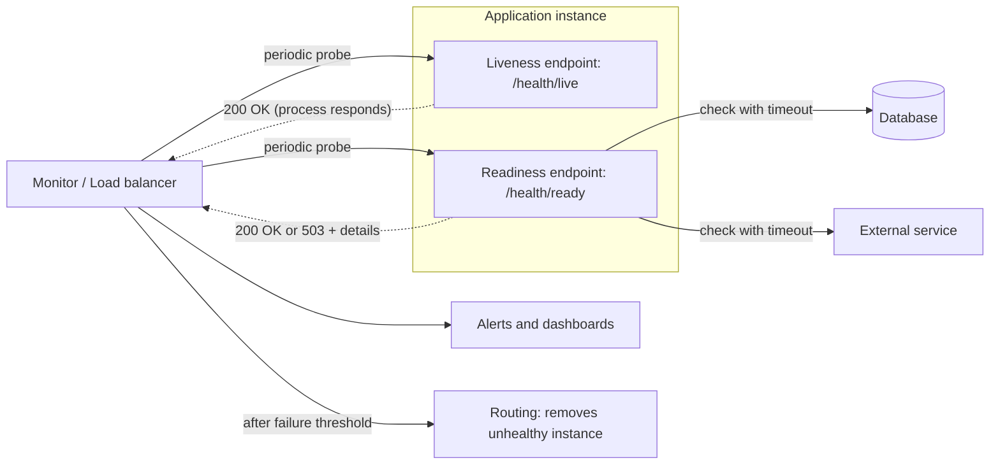

# Health Endpoint Monitoring

## Description

The application exposes health endpoints (for example, `/health` over HTTPS or gRPC's standard health checking protocol) that external tools query at regular intervals. On receiving the request, the application runs functional checks, on itself and on the dependencies it needs, and returns a status indicator. The monitoring tool evaluates the status code, the response content, and the latency against configured success criteria.

Checks can have different depths. **Shallow checks** (liveness) only confirm that the process responds, without touching dependencies, and avoid unnecessary restarts when an external service goes down. **Deep checks** (readiness) also validate the required dependencies and indicate whether the instance can actually serve requests. It's common to expose separate endpoints for each signal and to give the application a startup period before treating slowness as a failure.

In the context of microservices, an instance can keep running without being able to serve requests (for example, because it has exhausted its database connections). That's why the endpoint handler (typically `/health`) usually checks the connection to the infrastructure the service depends on, host conditions such as disk space, and application-specific logic. The client performing the check can be a monitoring service, a service registry, or a load balancer, which then routes only to healthy instances.

The results feed alerts, dashboards, and controlled remediation actions, such as taking an unhealthy instance out of the load balancer or failing over between zones and regions. The pattern is one piece of a broader observability strategy: probe results should be combined with metrics, logs, traces, and SLOs in a workload health model.

## Problems it solves

- Detecting that an application or service has become unavailable or partially degraded, including when internal instrumentation can't report anything because the application is down
- Having little direct control over the cloud environment and depending on third-party services that can fail due to network latency, throttling, or transient faults
- Load balancers and traffic routers sending requests to instances that can't handle them
- Having no way to continuously verify that the service meets the agreed service level objectives (SLOs)
- A running instance that can't serve requests (for example, with no database connections available) continuing to receive traffic without triggering an alert
- Having to diagnose in the dark which component or dependency caused the degradation

## When to use

- Verifying that websites and web applications are available and working correctly
- Monitoring middle-tier or shared services, to detect and isolate failures that may affect other applications
- Providing health signals to load balancers, orchestrators, and traffic routers (instance removal, self-healing, failover)
- Validating availability from locations that represent users, including DNS, TLS certificate expiration, and content served by a CDN

## When to avoid

- The components don't expose a health interface that is compatible with, or reachable by, the monitoring tool. In that case, prefer platform metrics, log-based alerts, or internal heartbeats
- There's no way to produce a useful signal without degrading the application (heavy queries, expensive calls, or full integration tests on every probe). In that case, use the telemetry the application already collects, such as error rates and dependency data
- It's enough to confirm that a process or host is up, with no application logic or dependency chain to verify. A platform-managed transport probe does the job

## Trade-offs

| Benefit | Cost / Risk |
| --- | --- |
| Fast detection of unavailability and degradation | Probes consume CPU, memory, and connections that could serve real traffic |
| Routing only to healthy instances and self-healing | Deep checks can cause cascading failures by taking working instances out of service because of a slow dependency |
| Standardized visibility into the health of each component and dependency | Exposed endpoints increase the attack surface and the risk of leaking sensitive information |
| Caching the status reduces the cost of checks | The cache opens a window in which the status doesn't reflect the real state |
| Foundation for failover between zones and regions | Requires redundant capacity sized to absorb the redirected traffic |

- **Periodic checking:** the interval between probes leaves a window in which an instance can fail and still receive requests, and a shallow check may declare an unhealthy instance healthy. Combine with metrics and client-side retries.
- **Response validation:** an HTTP 200 shows basic availability, but says little about trends and upcoming problems. Consider whether it's worth validating the content and latency as well.
- **Granularity:** decide how many endpoints to expose (critical vs. lower-priority services, or one per core service), each with its own uptime and response-time expectations.
- **Side effects:** prefer read-only checks. Synthetic transactions that change state need isolated test accounts and data, and cleanup afterward.
- **Cascade mitigation:** use per-dependency timeouts, circuit breaker logic, and a "degraded" status (instead of "unhealthy") when an optional dependency fails. Configure consecutive-failure thresholds so transient failures don't trigger actions.
- **Frequency and cost:** the total cost depends on the interval, the depth of the check, the number of instances, and the probe locations. Tune the cache TTL to the acceptable detection delay.
- **Security:** require authentication compatible with the monitoring tool, restrict network access to the probe origins, and return only the minimum necessary, keeping detailed diagnostics behind authorization. A non-standard port or a hard-to-guess path is not access control.
- **Monitor reliability:** verify that the monitoring agent itself works (self-test, an endpoint that returns a known value) to avoid false positives.

## Diagram

The monitor periodically queries the liveness endpoint, which doesn't touch dependencies, and the readiness endpoint, which checks the required dependencies with timeouts. When readiness fails repeatedly, the monitor or load balancer raises alerts and stops sending traffic to the instance.

## Related patterns

- [Circuit Breaker](/architecture/cloud-design-patterns/resiliency/circuit-breaker) — keeps an unstable dependency from taking down the deep check and causing cascading failures
- [Retry](/architecture/cloud-design-patterns/resiliency/retry) — handles transient failures. The monitor's failure thresholds follow the same tolerance logic
- [Gateway Routing](/architecture/cloud-design-patterns/gateways-and-edge/gateway-routing) — routing can use health signals to send requests only to healthy instances
- [Geodes](/architecture/cloud-design-patterns/deployment-and-topology/geodes) — failover between regions depends on reliable health signals from each geographic node
- [Deployment Stamp](/architecture/cloud-design-patterns/deployment-and-topology/deployment-stamp) — each stamp exposes health endpoints that guide global routing and failover
- [Sidecar](/architecture/cloud-design-patterns/integration-and-modernization/sidecar) — a sidecar can implement or aggregate health checks without changing the application
- [Cache-Aside](/architecture/cloud-design-patterns/data-management/cache-aside) — the same idea of caching the result of expensive checks to reduce the cost of probes
- [Service Registry](/architecture/microservices/service-discovery/service-registry) — the registry invokes the health endpoint to keep only healthy instances available
- [Application Metrics](/architecture/microservices/observability/application-metrics) — complements the health signal with continuous measurements
- [Bulkhead](/architecture/cloud-design-patterns/resiliency/bulkhead) — isolating resources keeps probe load from competing for capacity with production traffic

## Reference

- [Azure Architecture Center documentation](https://learn.microsoft.com/en-us/azure/architecture/patterns/health-endpoint-monitoring)
- [Health Check API on microservices.io](https://microservices.io/patterns/observability/health-check-api.html)
