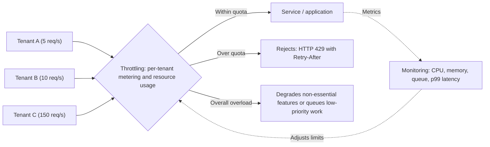

# Throttling

## Description

The Throttling pattern limits the resources that an application instance, a tenant, or an entire service can consume. This way the system keeps working and meeting its service level objectives (SLOs) under sudden or prolonged load. Instead of relying only on scaling (which takes time and costs money), the service sets a usage ceiling and, when it's exceeded, starts restricting the requests of one or more consumers.

Throttling is a continuous control loop, not an isolated decision. The system measures saturation at three layers (infrastructure utilization, application state, and per-client/tenant counters), applies limits at well-defined points, and adjusts those limits as traffic changes. The most common strategies are: per-principal limits (client, user, or tenant), gradual degradation of non-essential features, queue-based load leveling, deferring lower-priority operations, and reducing your own outbound calls when a dependency is having problems.

**Difference from Rate Limiting:** in Throttling, the one imposing the limit is the **service**, which protects itself by controlling how much each client or tenant can consume (for example, by returning HTTP 429 or 503 with `Retry-After`). In [Rate Limiting](/architecture/cloud-design-patterns/resiliency/rate-limiting-pattern), the one limiting itself is the **client**: it controls the pace of its own calls so it doesn't run into the limits of an external service and avoids errors and retries. The two complement each other: a service that applies throttling should, in turn, respect the throttling of the dependencies it calls.

## Problems it solves

- Sudden demand spikes that exhaust CPU, memory, connections, or bandwidth before autoscaling can add capacity.
- A single tenant or client ("noisy neighbor") monopolizing shared resources and degrading the others.
- SLO/SLA violations from slowness or widespread outages when load exceeds capacity.
- Costs with no upper bound caused by scaling indefinitely to meet any volume of demand.
- Automated abuse (scripts, bots, misconfigured integrations) consuming the system with seemingly legitimate traffic.
- Overload that cascades between services when nobody signals back-pressure.

## When to use

- To keep the system within its SLOs even under high load.
- To prevent a single tenant or client from monopolizing the application's resources in multitenant environments.
- To absorb bursts of activity while autoscaling is still provisioning capacity.
- To cap the maximum level of resources (and therefore cost) the system needs.
- To offer different service levels per plan or contract (per-tier quotas).
- To reduce low-value processing at peak times or when the power grid's carbon intensity is high.

## When to avoid

- When the load is predictable and the provisioned capacity serves it with room to spare; limits add complexity with no benefit.
- As a substitute for edge protection against DDoS/WAF: application-level throttling measures legitimate traffic and doesn't absorb volumetric attacks.
- As a substitute for caching: a cache reduces average load but doesn't cap the peak.
- When the cost of rejecting a request (heavy authentication, deep parsing) is similar to the cost of serving it; in that case, you first need to make rejection cheap.
- When demand grows faster than any possible scaling and refusing requests is unacceptable to the business; the answer there is capacity reservation, not throttling.

## Trade-offs

| Benefit | Cost / Risk |
| --- | --- |
| Stability and SLO compliance under load | Some requests are rejected or delayed, and some clients get a degraded experience |
| Isolation between tenants (avoids noisy neighbor) | Requires attributing each request to a principal and measuring consumption per principal |
| Clear ceiling on resource usage and predictable cost | Poorly calibrated limits waste capacity or let the system saturate |
| Buys time for autoscaling to act | If demand grows faster than new capacity, the system can still fail |
| Protection against automated abuse | Limits applied at very broad boundaries (e.g., regional gateway) affect users who didn't cause the load |

Additional considerations:

- **Limit dimension:** limit whatever saturates first (in-flight requests, queue depth, CPU, memory, or a dependency's limit), not necessarily requests per second.
- **Algorithm:** token bucket accepts controlled bursts; leaky bucket keeps a constant flow rate; fixed window is simple but allows bursts at the window boundary; sliding window smooths this out at the cost of more state.
- **Distributed counters:** local counters are fast but undercount when the client hits multiple replicas; a central counter (e.g., in a distributed cache) is accurate but adds latency to every decision.
- **Proactive shedding:** start rejecting a growing fraction of requests as you approach the limit, using p99 latency relative to the SLO as the trigger, instead of waiting for saturation.
- **Client response:** return HTTP 429 (limit exceeded) or 503 (temporary overload) with `Retry-After` and enough context (which limit, which scope) for the client to adapt.
- **Back-pressure propagation:** don't hide 429/503 from dependencies with silent retries or generic 500 errors; that amplifies retries and spreads the overload.
- **Cost per operation:** normalize limits by actual cost (for example, writes more restricted than reads).
- **Runtime configuration:** allow limits to be adjusted without a new deploy and consider adaptive limits, always with a fixed ceiling.
- **Observability:** continuous performance instrumentation is a prerequisite for detecting load, reacting quickly, and returning to normal when it subsides.

## Diagram

The service measures each tenant's consumption and overall resource usage. Requests within quota proceed to the application, those that exceed the limit receive a 429 with `Retry-After`, and, under general overload, non-essential features are degraded or low-priority work is deferred. Monitoring feeds back and continuously adjusts the limits.

## Related patterns

- [Rate Limiting](/architecture/cloud-design-patterns/resiliency/rate-limiting-pattern) — the client-side counterpart: the consumer controls its own call pace to respect the throttling of the services it uses.
- [Queue-Based Load Leveling](/architecture/cloud-design-patterns/messaging/queue-based-load-leveling) — smooths spikes by queuing work, one of the throttling strategies.
- [Priority Queue](/architecture/cloud-design-patterns/messaging/priority-queue) — lets you serve higher-value tenants or operations first and drop or defer lower-priority work.
- [Bulkhead](/architecture/cloud-design-patterns/resiliency/bulkhead) — complements throttling by limiting concurrency and isolating resources at fan-out points.
- [Retry](/architecture/cloud-design-patterns/resiliency/retry) — clients must honor `Retry-After` and use backoff so rejections don't turn into retry storms.
- [Circuit Breaker](/architecture/cloud-design-patterns/resiliency/circuit-breaker) — stops calls to overloaded dependencies, in line with reducing outbound calls.
- [External Configuration Store](/architecture/cloud-design-patterns/deployment-and-topology/external-configuration-store) — lets you adjust limits at runtime, without a deploy.
- [Cache-Aside](/architecture/cloud-design-patterns/data-management/cache-aside) — reduces the average load on the origin, but doesn't replace throttling for bounding the worst case.
- [Gateway Offloading](/architecture/cloud-design-patterns/gateways-and-edge/gateway-offloading) — centralizes the enforcement of quotas and limits in a gateway.

## Reference

- [Azure Architecture Center documentation](https://learn.microsoft.com/en-us/azure/architecture/patterns/throttling)
