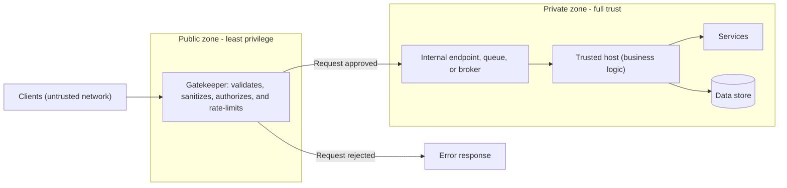

# Gatekeeper

## Description

The Gatekeeper pattern protects applications and services by placing a dedicated component between clients and the system. This component (the *gatekeeper*) is the only point exposed to the untrusted network: it receives requests, validates and sanitizes them, and only then forwards the approved ones to a *trusted host* through an internal endpoint, a queue, or a broker.

The core idea is to separate the code that exposes the public endpoints from the code that processes business rules and accesses storage and other services. The gatekeeper runs with minimal privileges and has no access to credentials, keys, or data; the trusted host, which does have that access, isn't exposed externally. If the gatekeeper is compromised, the attacker gets no direct access to the application's data or secrets.

Unlike a traditional network firewall, the gatekeeper makes application-driven decisions: it can inspect the request content in detail, check authentication and authorization, reject unexpected or malformed payloads, and apply rate limiting before any traffic reaches the back end. It's common to organize it in layers, for example a web application firewall at the edge and an API gateway internally.

## Problems it solves

- Direct exposure of services that hold credentials, storage keys, and sensitive data to untrusted networks.
- A compromise of the public hosting environment resulting in unrestricted access to internal data and services.
- Input validation and sanitization scattered and inconsistent across several back-end services.
- A wide attack surface, with many components directly reachable from the internet.
- Difficulty applying rate limiting efficiently when each node has to coordinate counting state with the others.

## When to use

- The application handles sensitive information.
- The exposed services need strong protection against malicious traffic (injection, bots, abuse, DDoS).
- There are mission-critical operations whose back end can't be exposed directly.
- You want to separate request validation and sanitization from business processing.
- You want to centralize security controls and throttling in a single entry point.

### When to avoid

- The back-end platform's native controls already meet security and validation requirements without an additional layer.
- The extra network hops and validation latency violate strict end-to-end latency requirements.
- The system is simple, internal, and low-risk, and the operational cost of another layer isn't justified.

## Trade-offs

| Benefit | Cost / Risk |
| --- | --- |
| Reduced attack surface; back end reachable only through private endpoints | Extra network hops and processing increase latency |
| A compromised gatekeeper doesn't expose credentials or data | One more component to deploy, scale, monitor, and maintain |
| Centralized, consistent validation, authorization, and throttling | Can become a single point of failure without redundancy |
| Throttling at the gatekeeper avoids state coordination between back-end nodes | Can become a capacity bottleneck under traffic spikes |
| Clear separation between trust boundaries | Risk of business logic "leaking" into the gatekeeper, coupling the layers |

- **Privileges:** the gatekeeper should run with least privilege and in a compute boundary separate from the trusted host; the trusted host must not expose any external endpoint.
- **Responsibility:** the gatekeeper only validates and sanitizes; it doesn't process business rules or access data. The trusted host can still perform complementary validations.
- **Communication:** use secure channels (TLS) between the gatekeeper and the trusted hosts whenever the environment allows, and managed identities instead of stored secrets.
- **Availability:** deploy redundant, auto-scaling instances to mitigate the single-point-of-failure risk.
- **Observability:** centralize logs and metrics from all layers and propagate a correlation ID from the edge to trace each transaction; configure alerts for spikes in blocked requests or errors.

## Diagram

Clients only reach the gatekeeper, which runs with minimal privileges and discards invalid requests. Approved requests follow an internal channel to the trusted host, the only one that holds credentials to access services and data.

## Related patterns

- [Gateway Offloading](/architecture/cloud-design-patterns/gateways-and-edge/gateway-offloading) — offloads cross-cutting functions (TLS, authentication, validation) to a gateway, which can act as a gatekeeper.
- [Gateway Routing](/architecture/cloud-design-patterns/gateways-and-edge/gateway-routing) — the gatekeeper often also routes approved requests to the correct back end.
- [Rate Limiting](/architecture/cloud-design-patterns/resiliency/rate-limiting-pattern) — rate limiting is usually applied at the gatekeeper.
- [Throttling](/architecture/cloud-design-patterns/resiliency/throttling) — resource consumption control that can be centralized at the entry point.
- [Valet Key](/architecture/cloud-design-patterns/security-and-access/valet-key) — complements the gatekeeper by granting restricted, temporary access to resources without exposing keys.
- [Federated Identity](/architecture/cloud-design-patterns/security-and-access/federated-identity) — delegates authentication to an identity provider whose tokens the gatekeeper validates.
- [Queue-Based Load Leveling](/architecture/cloud-design-patterns/messaging/queue-based-load-leveling) — a queue between the gatekeeper and the trusted host decouples the layers and absorbs spikes.
- [Quarantine](/architecture/cloud-design-patterns/security-and-access/quarantine) — also validates and isolates external content before releasing it for consumption by the workload.

## Reference

- [Documentation in the Azure Architecture Center](https://learn.microsoft.com/en-us/azure/architecture/patterns/gatekeeper)
