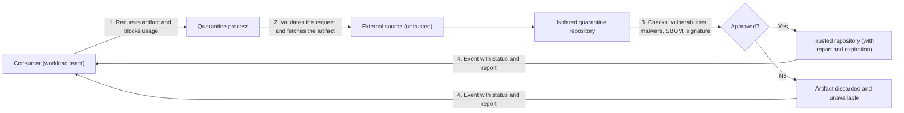

# Quarantine

## Description

The Quarantine pattern ensures that third-party software artifacts (container images, library packages, infrastructure as code modules, operating system images, vendor installers) are consumed by the workload only after they've been verified and marked as trusted by a well-defined process. Every external artifact is treated, by default, as **untrusted**.

The consumer signals its intent to use an artifact and blocks its use. A quarantine process, independent of the development cycle, fetches the artifact from the external source, keeps a copy in an isolated repository, and runs a series of checks (vulnerability scanning, malware detection, SBOM analysis, signature and provenance validation, etc.). The process doesn't change the artifact's content; it only decides whether it moves from "untrusted" to "trusted".

If all checks pass, the artifact is published to a trusted repository, with annotations and an evidence report that includes an expiration date. Otherwise, it remains unavailable. At the end, the process emits an event with the status and the report, and consumers decide how to use the approved artifact.

## Problems it solves

- Direct consumption of artifacts from public sources or vendors without any security validation.
- Introduction of known vulnerabilities, malware, or tampered dependencies into the software supply chain.
- Compromised data integrity and confidentiality caused by malicious external components.
- Instability caused by artifacts that are incompatible with the rest of the solution.
- Lack of traceability about the origin of each external artifact and the validations applied to it.
- Inconsistent checks, performed manually and differently on each ingestion.

## When to use

- The workload integrates artifacts developed outside the team's scope, such as images from public registries, packages from public repositories (NuGet, PyPI, Maven, npm), community IaC modules, or vendor operating system images.
- The team considers the risk of a compromised artifact significant enough to justify the mitigation.
- There's a clear, shared understanding of the validation rules that apply to each type of artifact.
- The organization wants to standardize and centralize the validation of external artifacts for several teams.

### When to avoid

- The artifact is produced by the team itself or by a trusted partner team.
- The cost of building and maintaining the quarantine process is higher than the risk of not verifying the artifact.
- There's no consensus on which checks to apply; without consistent rules the pattern loses effectiveness.

## Trade-offs

| Benefit | Cost / Risk |
| --- | --- |
| Reduces the attack surface of the software supply chain | Building and operating the quarantine process and infrastructure has a cost |
| Auditable evidence of each artifact's origin and validations | Validations can take time and delay adopting new versions or fixes |
| Clear segmentation between trusted and untrusted artifacts | Requires identity and network controls to keep the repositories isolated |
| Standardized, automated checks for all teams | Poorly calibrated rules produce false positives or block legitimate artifacts |
| Supports secure deployment practices | Passing quarantine doesn't guarantee permanent trust in the artifact |

- **Point-in-time validation:** quarantine is the first opportunity for validation; the artifact still needs continuous scanning and pipeline checks before each release promotion.
- **Expiration:** the verification report should have a validity period; once it expires, the artifact is considered unsafe again.
- **Trusted invocation:** signaling and ingestion should be automated, and policies should prevent consumption of artifacts outside the trusted repository.
- **Long-running processes:** the orchestration must support time-consuming tasks and keep going until all of them finish.
- **Centralization or outsourcing:** the process can be maintained by a central team or contracted from specialists; weigh financial and operational costs against the level of control needed.
- **Observability:** keep an audit trail and alerts for unexpected imports into the trusted repository.

## Diagram

The consumer requests an external artifact, which is copied to an isolated repository and run through the checks. Only approved artifacts reach the trusted repository, and the consumer is notified of the outcome in both cases.

## Related patterns

- [Gatekeeper](/architecture/cloud-design-patterns/security-and-access/gatekeeper) — also places an intermediary that validates and controls access before anything reaches trusted resources.
- [Sidecar](/architecture/cloud-design-patterns/integration-and-modernization/sidecar) — quarantine works as a helper operational process, separate from the development cycle.
- [Pipes and Filters](/architecture/cloud-design-patterns/messaging/pipes-and-filters) — the checks can be organized as a sequence of independent steps.
- [Scheduler Agent Supervisor](/architecture/cloud-design-patterns/distributed-coordination/scheduler-agent-supervisor) — useful for orchestrating long-running validation tasks and handling failures.
- [Asynchronous Request-Reply](/architecture/cloud-design-patterns/messaging/asynchronous-request-reply) — the consumer requests quarantine and receives the result asynchronously.
- [Publisher-Subscriber](/architecture/cloud-design-patterns/messaging/publisher-subscriber) — the end of quarantine is signaled by an event consumed by interested parties.

## Reference

- [Documentation in the Azure Architecture Center](https://learn.microsoft.com/en-us/azure/architecture/patterns/quarantine)
