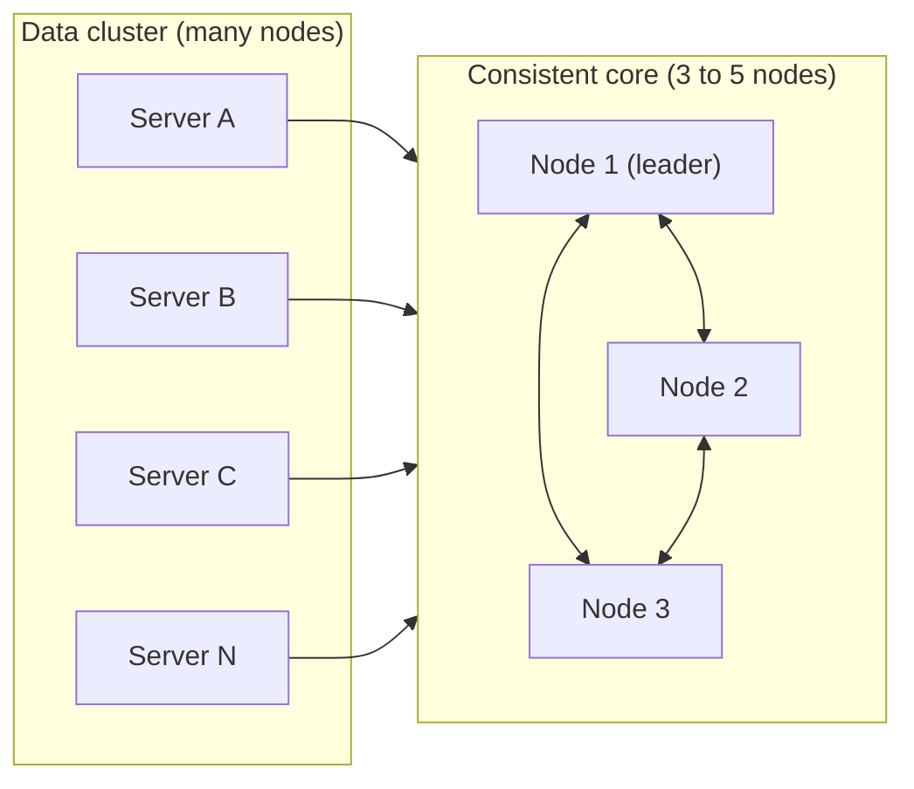

# Consistent Core

## Description

Consistent Core splits the cluster into two parts: a small group of nodes (typically three to five) that runs a consensus algorithm and provides fault-tolerant linearizability, and a data cluster, which can have hundreds of nodes. The core holds the metadata and makes the decisions that require a single, reliable view of the system, such as the membership list, the mapping of partitions to servers, and leader selection.

The data cluster doesn't take part in consensus. It queries the core and uses primitives built on top of it, such as [Lease](/architecture/distributed-systems/cluster-management/lease) and [State Watch](/architecture/distributed-systems/cluster-management/state-watch), to coordinate. That way, the cost of the quorum is confined to a few nodes, while the volume of data and client requests scales across the rest.

It's the architecture behind services like ZooKeeper, etcd, and Consul, and also behind metadata components in systems such as Kafka and Kubernetes.

## Problems it solves

- Coordination decisions (who the leader is, who the members are, where each partition lives) require strong consistency, but running consensus across every node of a large cluster kills throughput.
- The coordination component can't be a single point of failure.
- The data cluster needs to grow without the cost of the quorum growing with it.
- Different nodes need to see the same metadata state, with no divergence.

## When to use

- Large clusters that need consistent membership, leader election, or a partition map.
- Systems where metadata is small and changes rarely compared to the volume of data.
- When you want to reuse an existing coordination service (ZooKeeper, etcd, Consul) instead of implementing consensus in every product.

### When to avoid

- Small clusters, where the data cluster itself can already run the consensus.
- When it's tempting to store application data in the core: it wasn't designed for high write volume.
- Systems that must keep coordinating with no external dependency at all, even during a network partition (see [Emergent Leader](/architecture/distributed-systems/cluster-management/emergent-leader) and [Gossip Dissemination](/architecture/distributed-systems/cluster-management/gossip-dissemination)).

## Trade-offs

| Benefit | Cost / Risk |
| --- | --- |
| Linearizability for coordination decisions | The core becomes a critical dependency: without a quorum, the cluster can't make new decisions |
| The data cluster scales without paying the cost of consensus | Operational complexity of maintaining a second cluster |
| Centralized, consistent metadata | Every client depends on the core's latency and availability |
| Reuse of mature implementations | The core's write throughput is limited, and the metadata volume must stay low |

Additional considerations:

- Clients should cache metadata and use notifications to invalidate it, instead of querying the core on every request.
- The core needs sessions and retry handling so that client commands aren't applied twice.
- Monitor the core's data size and write rate.

## Diagram

Consensus happens only among the few nodes of the core; the data servers are its clients and use its metadata and primitives to coordinate.

## Related patterns

- [Replicated Log](/architecture/distributed-systems/data-replication/replicated-log) — the core replicates metadata commands through a replicated log.
- [Majority Quorum](/architecture/distributed-systems/data-replication/majority-quorum) — defines how many core nodes must agree and how many failures it tolerates.
- [Fixed Partitions](/architecture/distributed-systems/data-partitioning/fixed-partitions) — the mapping of partitions to servers is usually stored in the core.
- [Lease](/architecture/distributed-systems/cluster-management/lease) — an exclusive-access primitive with expiration, implemented on top of the core.
- [State Watch](/architecture/distributed-systems/cluster-management/state-watch) — lets clients be notified of metadata changes.
- [Emergent Leader](/architecture/distributed-systems/cluster-management/emergent-leader) — an alternative when you don't want a separate core.
- [Service Registry](/architecture/microservices/service-discovery/service-registry) — service registries are often backed by a consistent core.

## Reference

- [Pattern page in the Patterns of Distributed Systems catalog](https://martinfowler.com/articles/patterns-of-distributed-systems/consistent-core.html)
