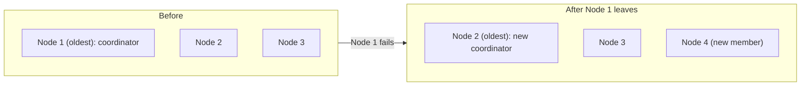

# Emergent Leader

## Description

In peer-to-peer clusters, all nodes are equal and there's no explicit election as in [Leader and Followers](/architecture/distributed-systems/data-replication/leader-and-followers). Even so, someone has to coordinate global tasks, such as assigning partitions to nodes and reacting to members joining and leaving.

In Emergent Leader, nodes are ordered by the time they joined the cluster, and the oldest one takes on the coordinator role. Because every node knows the membership list and the ages (usually propagated by [Gossip Dissemination](/architecture/distributed-systems/cluster-management/gossip-dissemination)), they all reach the same conclusion about who the leader is, without exchanging voting messages. If the oldest node leaves, the next one in the order takes over.

The coordinator decides membership changes and distributes partitions (see [Fixed Partitions](/architecture/distributed-systems/data-partitioning/fixed-partitions)). This style appears in systems like Akka Cluster, where the oldest node is used for coordination tasks.

## Problems it solves

- Peer-to-peer systems need a coordinator, but they have no fixed leader and no election process.
- You don't want to depend on a separate [Consistent Core](/architecture/distributed-systems/cluster-management/consistent-core), which can reduce availability.
- Elections with voting carry a cost and complexity you want to avoid for lightweight coordination tasks.

## When to use

- Gossip-based peer-to-peer clusters, where everyone knows the membership.
- When the coordinator's role is lightweight (assigning partitions, handling membership) and tolerates temporarily divergent views.
- When availability matters more than strict consistency in coordination decisions.

### When to avoid

- Decisions that require guaranteed exclusivity: during a network partition, the two sides can elect different coordinators (split brain).
- When the membership view isn't reliable or converges slowly.
- When the leader needs to order data writes; in that case, use [Leader and Followers](/architecture/distributed-systems/data-replication/leader-and-followers) with quorum-based election.

## Trade-offs

| Benefit | Cost / Risk |
| --- | --- |
| No explicit election or voting | Risk of two coordinators during partitions or divergent views |
| No dependency on an external consensus service | Weaker consistency guarantees |
| Simple to implement on top of an ordered membership list | The quality of the decision depends on failure detection and gossip convergence |
| High availability | Membership changes can cause suboptimal coordinator switches |

Additional considerations:

- Coordinator actions should be idempotent, to tolerate temporary duplication.
- You can require the membership view to be stable before acting.
- Observability of whom each node considers the leader helps diagnose divergences.

## Diagram

The coordinator is always the oldest node in the membership list; when it leaves, the next one in the order takes over without a vote.

## Related patterns

- [Leader and Followers](/architecture/distributed-systems/data-replication/leader-and-followers) — a model with explicit election, an alternative to this one.
- [Leader Election](/architecture/cloud-design-patterns/distributed-coordination/leader-election) — cloud leader election, with explicit coordination.
- [Gossip Dissemination](/architecture/distributed-systems/cluster-management/gossip-dissemination) — propagates the membership list and node ages.
- [Consistent Core](/architecture/distributed-systems/cluster-management/consistent-core) — an alternative when you need strongly consistent coordination.
- [Fixed Partitions](/architecture/distributed-systems/data-partitioning/fixed-partitions) — partitions the coordinator assigns to nodes.

## Reference

- [Pattern page in the Patterns of Distributed Systems catalog](https://martinfowler.com/articles/patterns-of-distributed-systems/emergent-leader.html)
