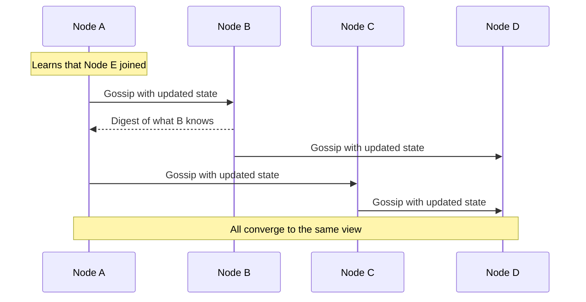

# Gossip Dissemination

## Description

In Gossip Dissemination, each node keeps the metadata it knows about the cluster (membership, node state, partition information) and, at regular intervals, for example every second, picks one or a few random nodes and exchanges what it knows with them. Each node that receives new information passes it on in the following rounds, so it spreads epidemically.

Because peers are chosen at random, the information reaches every node in a number of rounds that grows logarithmically with the cluster size, without relying on central storage and without each node talking to every other node. Implementations usually send state digests and versions (see [Version Vector](/architecture/distributed-systems/data-replication/version-vector)) to decide what each side needs to receive, and can work by push, pull, or both.

It's used by Cassandra, Consul (Serf), Akka Cluster, and Riak to propagate membership and detect failures.

## Problems it solves

- All-to-all communication consumes too much network in large clusters.
- Metadata must reach every node without a shared repository.
- Information should keep propagating even if some network links or nodes fail.

## When to use

- Large, decentralized clusters with no fixed leader that need to spread membership and node state.
- Systems that accept eventual consistency for metadata.
- Failure detection at scale, combined with indirect [Heartbeat](/architecture/distributed-systems/data-replication/heartbeat).

## When to avoid

- Decisions that require strong consistency or total order (use a [Consistent Core](/architecture/distributed-systems/cluster-management/consistent-core)).
- Small clusters, where sending to everyone is cheap and simpler.
- When propagation latency must be strictly and predictably bounded.

## Trade-offs

| Benefit | Cost / Risk |
| --- | --- |
| Low, constant network load per node | Only eventual convergence; nodes have temporarily different views |
| No single point of failure | Redundant messages and continuous background traffic |
| Resilient to partial network failures | Hard to debug and to predict the exact propagation time |
| Scales to thousands of nodes | Probabilistic failure detection, with a risk of false positives |

Additional considerations:

- Tune the interval and fan-out to balance convergence speed against network cost.
- Use versions or logical clocks to resolve conflicts between received information.
- Seed nodes help new members join the cluster.

## Diagram

Information originates at one node and spreads in rounds, with each node passing it on to randomly chosen peers.

## Related patterns

- [Heartbeat](/architecture/distributed-systems/data-replication/heartbeat) — liveness signals that gossip can carry to detect failures.
- [Version Vector](/architecture/distributed-systems/data-replication/version-vector) — versions the exchanged information and resolves conflicts.
- [Emergent Leader](/architecture/distributed-systems/cluster-management/emergent-leader) — the emergent leader uses the membership view spread by gossip.
- [Consistent Core](/architecture/distributed-systems/cluster-management/consistent-core) — a centralized, strongly consistent alternative for metadata.

## Reference

- [Pattern page in the Patterns of Distributed Systems catalog](https://martinfowler.com/articles/patterns-of-distributed-systems/gossip-dissemination.html)
