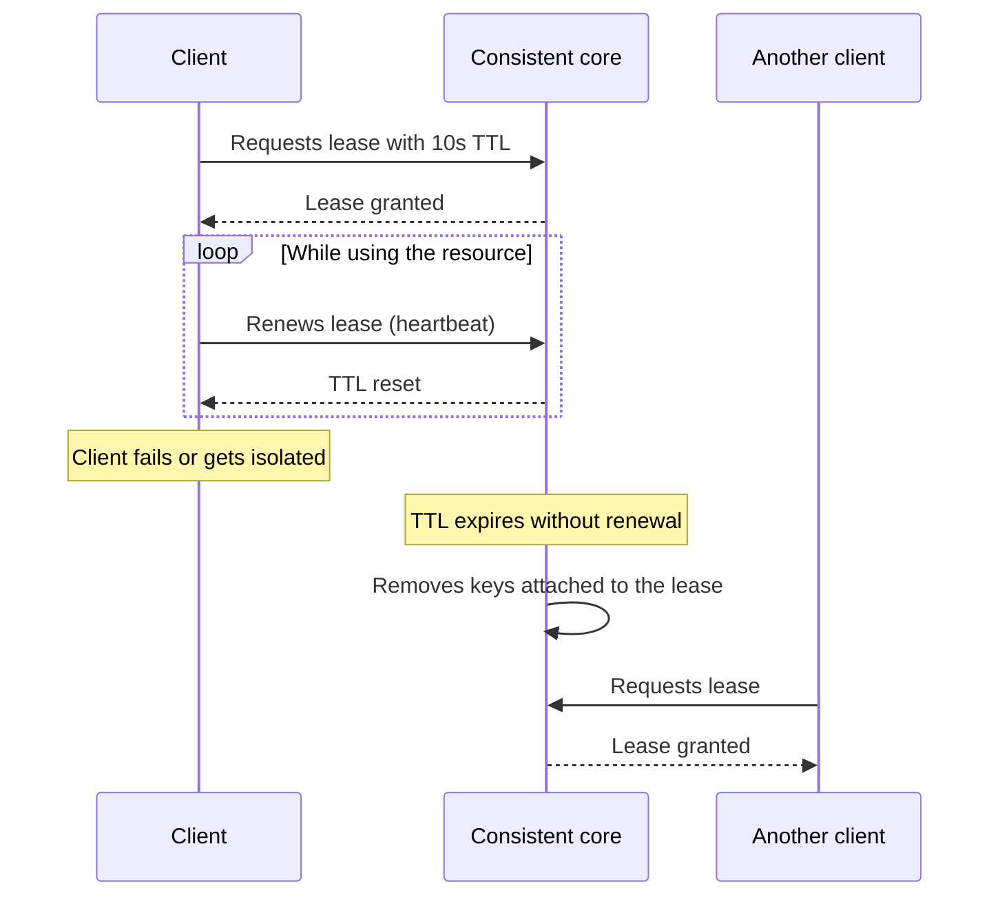

# Lease

## Description

A Lease is a grant of exclusive access to a resource for a limited time. The node that wants the resource requests the lease from a [Consistent Core](/architecture/distributed-systems/cluster-management/consistent-core), receives a deadline (time-to-live, TTL), and must renew it periodically for as long as it keeps using the resource. If it stops renewing, the lease expires and the resource can be handed to another node.

Renewal is usually done through [Heartbeat](/architecture/distributed-systems/data-replication/heartbeat) messages the client sends to the core. The core replicates lease creation and renewal, so that a new leader of the core itself keeps honoring them. Keys or metadata entries can be attached to the lease and removed automatically when it expires, which is the basis of member registration and distributed locks in ZooKeeper (sessions and ephemeral nodes), etcd (leases), and Chubby.

## Problems it solves

- A node with exclusive access can hang, become isolated from the network, or suffer a long process pause, and it shouldn't hold the resource forever.
- Without a deadline, it's impossible to tell a slow node from a dead one and safely release the resource.
- Ephemeral state (member registration, lock, leadership) needs to be cleaned up automatically when the owner disappears.

## When to use

- Distributed locks and mutual exclusion over shared resources.
- Registration of members and service instances that should vanish when the node goes down.
- Temporary leadership over a partition or task.
- Ephemeral data tied to the life of a client session.

### When to avoid

- When correctness depends on strict exclusivity and the protected resource doesn't validate a fencing token (for example, [Generation Clock](/architecture/distributed-systems/data-replication/generation-clock)): an owner with a long pause can act after the lease has expired.
- When there's no consistent core to manage the leases.
- For short tasks, where a simple lock or an idempotent operation is enough.

## Trade-offs

| Benefit | Cost / Risk |
| --- | --- |
| Automatic release of resources held by failed nodes | The resource is unavailable until the deadline passes |
| Simple, time-based failure detection | Depends on clocks that advance at a similar pace (see [Clock-Bound Wait](/architecture/distributed-systems/distributed-time/clock-bound-wait)) |
| Ephemeral state consistent with the client's lifetime | Constant renewal traffic |
| Avoids deadlocks caused by dead owners | Pauses (GC, network) can cause false expiration and two nodes believing they're the owner |

Additional considerations:

- Choose the TTL by balancing failover speed against the risk of false positives.
- The owner should stop using the resource before its local deadline if it can't renew.
- Use fencing tokens so the resource rejects operations from old owners.

## Diagram

The client keeps the lease as long as it renews. When it stops renewing, the core expires it and the resource can be granted to another client.

## Related patterns

- [Consistent Core](/architecture/distributed-systems/cluster-management/consistent-core) — where leases are created, replicated, and expired.
- [Heartbeat](/architecture/distributed-systems/data-replication/heartbeat) — the mechanism used to renew the lease.
- [Clock-Bound Wait](/architecture/distributed-systems/distributed-time/clock-bound-wait) — deals with clock uncertainty, which matters when measuring expiration.
- [State Watch](/architecture/distributed-systems/cluster-management/state-watch) — other nodes are notified when a lease expires.
- [Leader Election](/cloud/cloud-design-patterns/distributed-coordination/leader-election) — leader election often implemented with leases.

## Reference

- [Pattern page in the Patterns of Distributed Systems catalog](https://martinfowler.com/articles/patterns-of-distributed-systems/lease.html)
