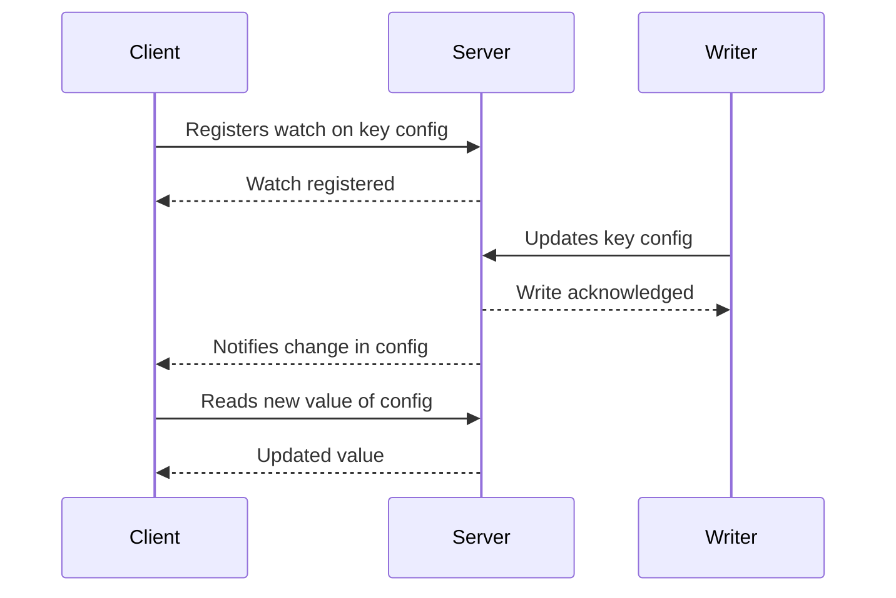

# State Watch

## Description

In State Watch, the client registers with the server its interest in changes to certain values (a key, a prefix, a node's state). When one of those values changes, the server sends the client a notification, and the client then reacts without having to poll the server repeatedly.

Because a single client can watch many values, the pattern relies on a [Single-Socket Channel](/architecture/distributed-systems/node-communication/single-socket-channel): all watches and notifications travel over one connection, and registration requests can be batched with a [Request Pipeline](/architecture/distributed-systems/node-communication/request-pipeline). The server keeps a map of which clients watch which keys and fires events as it applies each change.

It's the watches feature of ZooKeeper and etcd, and it's used to track changes in membership, configuration, leader, and lease expiration.

## Problems it solves

- Constant polling complicates client logic and wastes network and server CPU.
- Opening one connection per watched value overloads the server.
- Clients need to react quickly to cluster state changes, such as nodes joining and leaving.

## When to use

- Clients that need to react to changes in configuration, membership, or leadership.
- When many clients watch a few values that rarely change.
- Together with a [Consistent Core](/architecture/distributed-systems/cluster-management/consistent-core) and [Lease](/architecture/distributed-systems/cluster-management/lease), to know when a lease has expired.

### When to avoid

- Data that changes at a very high frequency: the event flow can be larger than polling's, and a dedicated stream is a better fit.
- When the client needs every event with no loss and the protocol only guarantees notification of the latest state.
- When the number of watchers per key is huge and the server can't handle the fan-out.

## Trade-offs

| Benefit | Cost / Risk |
| --- | --- |
| Less traffic and lower reaction latency than polling | The server keeps per-watcher state (memory and registrations) |
| Event-driven client logic | Reconnections can lose events; the client must re-read the state and re-register its watches |
| One connection for many watches | Fan-out of many notifications can cause load spikes |

Additional considerations:

- On reconnect, the client should compare the current state with the last known one and re-register its watches.
- Notifications usually only indicate that something changed, leaving it to the client to fetch the new value.
- The order of notifications relative to reads should be defined to avoid inconsistent reads.

## Diagram

The client registers its interest once, and the server notifies it when the value changes, avoiding repeated queries.

## Related patterns

- [Observer](/coding/gof/behavioral/observer) — the same concept, at local scale, inside a single process.
- [Publisher-Subscriber](/architecture/cloud-design-patterns/messaging/publisher-subscriber) — asynchronous messaging with subscribers.
- [Consistent Core](/architecture/distributed-systems/cluster-management/consistent-core) — typically offers watches over its metadata.
- [Lease](/architecture/distributed-systems/cluster-management/lease) — lease expiration is a typical watched event.
- [Single-Socket Channel](/architecture/distributed-systems/node-communication/single-socket-channel) — shared channel for the notifications.
- [Request Pipeline](/architecture/distributed-systems/node-communication/request-pipeline) — reduces the cost of registering many watches.

## Reference

- [Pattern page in the Patterns of Distributed Systems catalog](https://martinfowler.com/articles/patterns-of-distributed-systems/state-watch.html)
