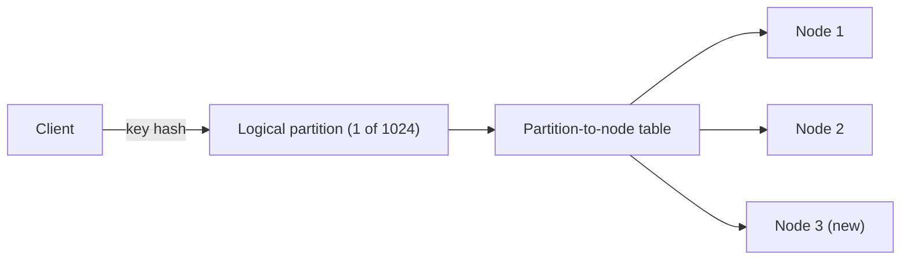

# Fixed Partitions

## Description

Fixed Partitions keeps the number of logical partitions in a cluster constant. Each key is mapped by a hash function to a partition, and it's the partitions that are assigned to nodes. Because the number of partitions never changes, the key → partition relationship stays stable for the whole life of the cluster.

When a node joins or leaves, only a few whole partitions change owner. The rest of the data stays where it is. The number of partitions is chosen up front, with enough headroom for the largest expected cluster size (for example, thousands of partitions for tens of nodes).

The partition → node mapping must be known to the clients or to the nodes that route requests. It is usually kept by a coordination service, such as a Consistent Core.

## Problems it solves

- The naive `hash(key) % N` mapping changes for almost every key when N (nodes) changes, forcing massive data movement.
- Data must be distributed evenly across nodes.
- The node responsible for a key must be located without querying the whole cluster.
- Data movement when resizing the cluster should be a small fraction of the data, done in manageable units.

## When to use

- Data distributed by key hash, with no need for range queries.
- Clusters that grow and shrink over time (key-value stores, message brokers, distributed caches).
- When the total data volume is predictable enough to choose a suitable number of partitions.

### When to avoid

- When range queries over keys are frequent: the hash spreads neighboring keys across all partitions (see Key-Range Partitions).
- When the data volume is highly unpredictable: too many partitions create metadata overhead, and too few limit scalability.
- When the key distribution is heavily skewed and hashing doesn't prevent hot spots.

## Trade-offs

| Benefit | Cost / Risk |
| --- | --- |
| Rebalancing moves only whole partitions, not individual keys | The number of partitions must be decided in advance and is hard to change |
| Predictable key location with no lookup | Requires maintaining and propagating the partition → node table |
| Even distribution via hashing | Range queries must access all partitions |
| Partitions are the unit of replication and recovery | Unevenly sized partitions can cause imbalance |

- Each partition usually has its own log and replicas, which increases operational cost when there are many partitions.
- While a partition is being moved, reads and writes must remain consistent.
- Observability: tracking size and load per partition helps detect imbalance.

## Diagram

The key hash always yields the same partition; only the partition → node table changes when the cluster is resized, moving some partitions to the new node.

## Related patterns

- [Key-Range Partitions](/architecture/distributed-systems/data-partitioning/key-range-partitions) — an alternative that preserves key order for range queries
- [Consistent Core](/architecture/distributed-systems/cluster-management/consistent-core) — maintains the partition-to-node mapping consistently
- [Sharding](/cloud/cloud-design-patterns/data-management/sharding) (cloud) — horizontal partitioning of data across separate data stores

## Reference

- [Pattern page in the Patterns of Distributed Systems catalog](https://martinfowler.com/articles/patterns-of-distributed-systems/fixed-partitions.html)
