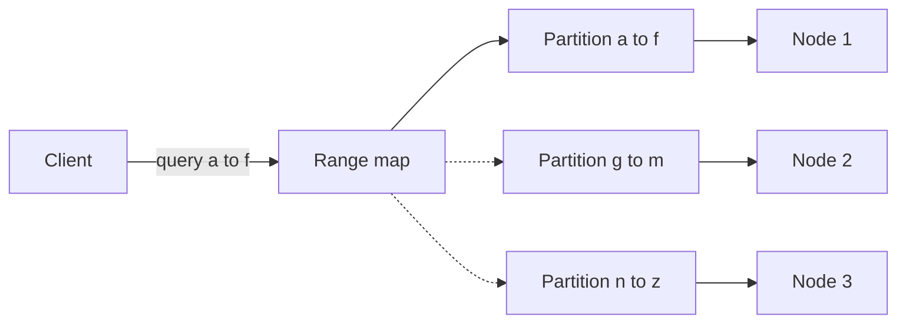

# Key-Range Partitions

## Description

Key-Range Partitions divides the ordered key space into contiguous ranges, and each range becomes a logical partition. The partitions are then assigned to the cluster's nodes. Keys that are close in order land in the same partition, which makes range reads efficient.

A range query (for example, names from "a" to "f") is routed only to the partitions whose ranges overlap the requested span, without scanning the whole cluster. The range → node map must be available to whoever routes the requests.

Because key distribution isn't always uniform, systems that use this pattern often split a partition that has grown too large or become hot, and merge small partitions. This is a common practice in databases such as HBase, CockroachDB, and TiKV, not an essential part of the pattern.

## Problems it solves

- With hash partitioning, a query over a range of keys has to hit all partitions.
- Key order must be preserved for efficient sequential scans.
- The partitions covering a given range must be located quickly.
- Partition sizes should be able to follow the actual distribution of the data.

## When to use

- Workloads with frequent range queries or ordered scans.
- Ordered key-value or tabular stores (Bigtable style).
- When data volume grows unpredictably and partitions need to split dynamically.

## When to avoid

- When keys are monotonic (timestamps, sequential IDs): writes concentrate on the last partition, creating a hot spot.
- When access is only by exact key and even load distribution is the priority (prefer Fixed Partitions).
- When there's no infrastructure to maintain the range map and coordinate splits.

## Trade-offs

| Benefit | Cost / Risk |
| --- | --- |
| Range queries touch few partitions | Risk of hot spots with sequential or popular keys |
| Key order preserved | Less even load distribution than hashing |
| Partitions can split as data grows | Splitting and moving require coordination and map consistency |
| Location by lookup in the range map | Metadata is more complex than a hash function |

- Choosing good initial boundaries (pre-splitting) avoids concentrating load at the start.
- Updates to the range map must be consistent, otherwise clients route to the wrong node.
- Observability: monitor size and request rate per range.

## Diagram

The query is routed only to the partition whose range covers the requested span; the other partitions are not accessed.

## Related patterns

- [Fixed Partitions](/architecture/distributed-systems/data-partitioning/fixed-partitions) — a hash-based alternative, without efficient range support
- [Consistent Core](/architecture/distributed-systems/cluster-management/consistent-core) — maintains the partition mapping consistently
- [Sharding](/architecture/cloud-design-patterns/data-management/sharding) (cloud) — horizontal partitioning, including a range-based strategy

## Reference

- [Pattern page in the Patterns of Distributed Systems catalog](https://martinfowler.com/articles/patterns-of-distributed-systems/key-range-partitions.html)
