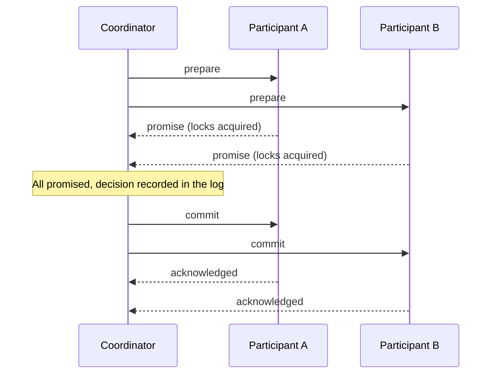

# Two-Phase Commit

## Description

Two-Phase Commit (2PC) writes data atomically across multiple nodes, typically in different partitions. A coordinator drives the protocol in two phases: in the prepare phase, it asks each participant whether it can commit; in the commit phase, only if all have promised, it tells everyone to commit.

In the prepare phase, each participant acquires the resources it needs (such as locks on the keys) and durably records its promise before replying. Once it has promised, it can no longer back out on its own. If any participant refuses or doesn't respond, the coordinator orders a rollback and the locks are released.

Participants and the coordinator use a durable log, such as a Write-Ahead Log, to record their decisions. That way, after a crash and restart, each node recovers the transaction state and can complete the protocol. In real databases, it's usually combined with versioned values and clocks to order transactions.

## Problems it solves

- Updates that span multiple partitions must be atomic: either all take effect or none do.
- No node may expose the data to clients before knowing the other nodes' decisions.
- Each participant must know everyone's outcome before committing.
- The protocol must survive node failures, with durable decisions.

## When to use

- Transactions that touch several partitions of the same database, with a strong atomicity requirement.
- When strong consistency across partitions matters more than latency.
- In systems where all participants are trusted and controlled by the same platform.

## When to avoid

- When the transaction crosses independent services or different organizations: prefer Saga with compensation.
- In high-availability scenarios under network partitions, since the protocol blocks.
- When latency is critical or lock contention is high.
- When the data can be modeled so the operation fits in a single partition.

## Trade-offs

| Benefit | Cost / Risk |
| --- | --- |
| Atomicity across multiple partitions | Locks held during both phases reduce concurrency |
| Participants decide consistently | If the coordinator fails after prepare, participants are blocked |
| Durable decisions enable recovery | More round trips and disk writes increase latency |
| Simple model to reason about | Reduced availability: any unavailable participant aborts the transaction |

- The coordinator is a critical point; it's usually replicated (for example, with a replicated log) to avoid blocking.
- Deadlocks between concurrent transactions require detection or timeouts.
- Observability: track transactions in the prepared state and how long they've been pending.

## Diagram

If any participant refuses in the prepare phase, the coordinator sends rollback to everyone instead of commit, and the locks are released.

## Related patterns

- [Write-Ahead Log](/architecture/distributed-systems/data-replication/write-ahead-log) — guarantees the durability of the coordinator's and participants' decisions
- [Replicated Log](/architecture/distributed-systems/data-replication/replicated-log) — allows the coordinator's state to be replicated to avoid blocking
- [Versioned Value](/architecture/distributed-systems/data-replication/versioned-value) — stores the versions written by the transaction
- [Hybrid Clock](/architecture/distributed-systems/distributed-time/hybrid-clock) — orders transactions across nodes with timestamps
- [Fixed Partitions](/architecture/distributed-systems/data-partitioning/fixed-partitions) and [Key-Range Partitions](/architecture/distributed-systems/data-partitioning/key-range-partitions) — the partitions the transaction typically operates on
- [Saga](/architecture/cloud-design-patterns/distributed-coordination/saga) (cloud) — an alternative without global locks, based on compensation
- [Compensating Transaction](/architecture/cloud-design-patterns/distributed-coordination/compensating-transaction) (cloud) — undoes steps that were already committed instead of blocking

## Reference

- [Pattern page in the Patterns of Distributed Systems catalog](https://martinfowler.com/articles/patterns-of-distributed-systems/two-phase-commit.html)
