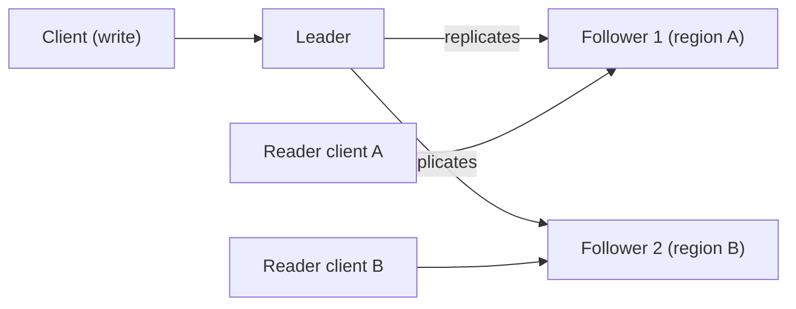

# Follower Reads

## Description

In Follower Reads, writes still go through the leader, but read-only requests can be served by followers, especially the one closest to the client. This spreads the read load across more nodes and reduces latency in multi-datacenter deployments, where the leader may be in another region.

The cost is that a follower can lag behind the leader, so a read may return slightly stale data. The follower should serve only data up to the High-Water Mark. For stronger reads, the client can pass the minimum version it needs to see (for example, a Versioned Value or a log index), and the follower waits or redirects if it hasn't reached that version yet.

It appears in Kafka (consumers reading from replicas), ZooKeeper (reads from any server), databases with read replicas, and Raft with follower reads.

## Problems it solves

- The leader is overloaded when it receives every request in a cluster with a high read load.
- Remote clients suffer extra latency when they reach a leader in another region.

## When to use

- Mostly read workloads.
- Multi-region deployments, where local reads reduce latency.
- When slightly stale data is acceptable or reads can be made by minimum version.

### When to avoid

- Workloads that always require the latest read (linearizability) with no versioning mechanism.
- Systems where a read right after a write must reflect the client's own write and there is no session guarantee.

## Trade-offs

| Benefit | Cost / Risk |
| --- | --- |
| Scales reads and relieves the leader | Reads can be stale (eventual consistency) |
| Lower latency for nearby clients | Guarantees such as read-your-writes need additional mechanisms |
| Higher read availability during leader problems | Routing clients to the right follower adds complexity |

- **Minimum version:** combine with Versioned Value or High-Water Mark for monotonic reads.
- **CQRS:** separating reads from writes follows a similar idea at the application level.

## Diagram

Writes go to the leader, while reader clients query the nearest follower.

## Related patterns

- [Leader and Followers](/architecture/distributed-systems/data-replication/leader-and-followers) — the pattern this optimization builds on
- [High-Water Mark](/architecture/distributed-systems/data-replication/high-water-mark) — the limit of what a follower can serve
- [Versioned Value](/architecture/distributed-systems/data-replication/versioned-value) — makes it possible to read from a minimum version
- [CQRS](/architecture/cloud-design-patterns/data-management/cqrs) — separation of reads and writes at the application level

## Reference

- [Pattern page in the Patterns of Distributed Systems catalog](https://martinfowler.com/articles/patterns-of-distributed-systems/follower-reads.html)
