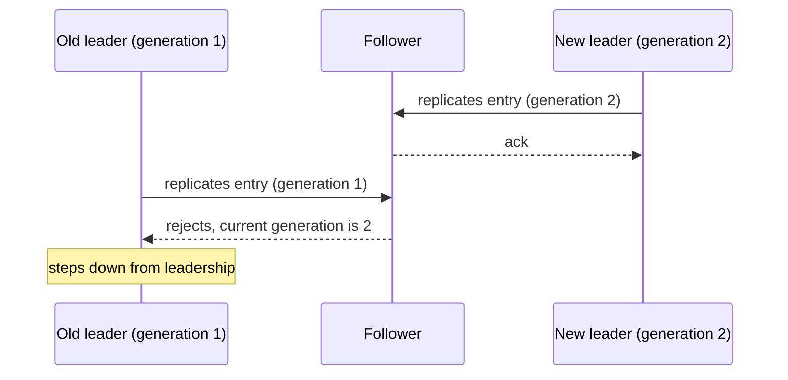

# Generation Clock

## Description

The Generation Clock is a monotonically increasing number that identifies the current leader's "tenure". Each new election increments the generation number. It's written with every Write-Ahead Log entry, so it survives restarts, and it's sent in every replication message.

If a follower receives a message with a generation lower than the one it has already seen, it knows the message comes from a deposed leader and rejects it with a failure. The old leader, on receiving that response, realizes it has been replaced and steps down. Followers also use the generation, together with the High-Water Mark, to identify conflicting log entries after a leader change.

It's the idea behind Raft's *term*, ZooKeeper ZAB's *epoch*, and Kafka's *leader epoch*.

## Problems it solves

- A leader can become disconnected (GC, network) and start sending requests again after another leader has been elected.
- The cluster needs to recognize requests from an old leader.
- The old leader needs to realize it has been replaced and step down.
- The generation identifier must survive restarts.

## When to use

- Any cluster using Leader and Followers with elections.
- When stale messages must be rejected after failures or network partitions.
- In consensus protocols, to order concurrent proposals.

### When to avoid

- Leaderless or single-server systems, where there are no concurrent tenures.
- When causality must be tracked across many events (use logical clocks or vectors).

## Trade-offs

| Benefit | Cost / Risk |
| --- | --- |
| Blocks old leaders and stale messages | Requires persisting the generation and including it in every message |
| Simple: a monotonic integer | Doesn't capture causality between events, only the order of tenures |
| Helps resolve log conflicts after elections | Frequent elections increment the generation and may indicate instability |

- **Persistence:** write the generation before answering a vote request.
- **Election:** a candidate asks for votes with a generation higher than the current one.

## Diagram

The follower has already seen generation 2 and rejects the old leader's message, which learns that it has been deposed.

## Related patterns

- [Leader and Followers](/architecture/distributed-systems/data-replication/leader-and-followers) — each leader election increments the generation
- [Write-Ahead Log](/architecture/distributed-systems/data-replication/write-ahead-log) — the generation is written to every log entry
- [High-Water Mark](/architecture/distributed-systems/data-replication/high-water-mark) — used together to resolve log conflicts
- [Paxos](/architecture/distributed-systems/data-replication/paxos) — uses the Generation Clock in the prepare phase
- [Lamport Clock](/architecture/distributed-systems/distributed-time/lamport-clock) — another monotonic logical clock, with per-event granularity

## Reference

- [Pattern page in the Patterns of Distributed Systems catalog](https://martinfowler.com/articles/patterns-of-distributed-systems/generation-clock.html)
