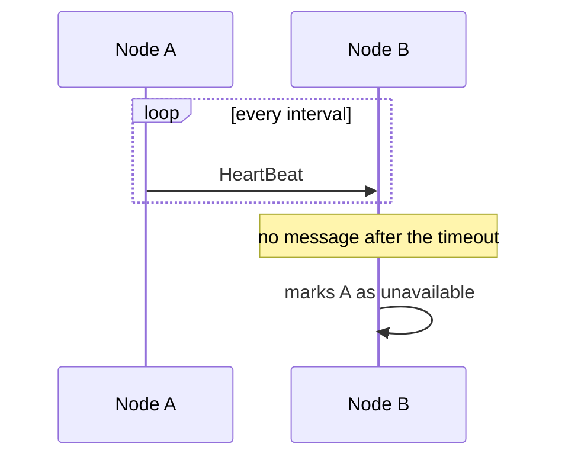

# HeartBeat

## Description

In HeartBeat, each server periodically sends other servers a short message saying it's still alive. The receiver keeps the time of the last message received from each node and, if none arrives within a timeout, considers that node unavailable and can redirect its responsibilities.

The send interval should be longer than the network round-trip time, and the timeout is usually a multiple of the interval, to tolerate occasional delays without declaring false negatives. There are two common forms: the leader sends heartbeats to the followers, which start an election if they miss them; or every node sends to and receives from every other node, which scales poorly in large clusters and leads to alternatives such as Gossip Dissemination.

Used in ZooKeeper, etcd (Raft), Kafka, and Cassandra to detect node and leader failures.

## Problems it solves

- Quickly detecting that a server has failed, so requests for its data are redirected.
- Knowing when to start a new leader election.
- Telling a slow node from a dead one by tuning the timeout.

## When to use

- Clusters that store partitioned or replicated data and need to react to node failures.
- Leadership based on Leader and Followers, where followers need to know whether the leader is alive.

### When to avoid

- Very large clusters where all-to-all traffic is prohibitive (prefer gossip).
- When the network is so unstable that the timeout produces constant false positives without adaptive tuning.

## Trade-offs

| Benefit | Cost / Risk |
| --- | --- |
| Fast, simple failure detection | Constant network traffic that grows with cluster size |
| Foundation for elections and data reassignment | Pauses (GC, network) can cause false positives and unnecessary elections |
| Easy to implement | Tuning the interval and timeout is a compromise between speed and stability |

- **Timeout:** high values reduce false alarms and delay real detection.
- **Long pauses:** a node paused by GC may come back believing it's still the leader, which the Generation Clock handles.
- **Adaptive detectors:** algorithms such as phi-accrual avoid fixed values.

## Diagram

Node A sends periodic heartbeats; when node B stops receiving them within the timeout, it considers A unavailable.

## Related patterns

- [Leader and Followers](/architecture/distributed-systems/data-replication/leader-and-followers) — followers use the heartbeat to detect a leader failure
- [Lease](/architecture/distributed-systems/cluster-management/lease) — a time-bound grant that also depends on periodic renewal
- [Health Endpoint Monitoring](/architecture/cloud-design-patterns/resiliency/health-endpoint-monitoring) — external health checking, the platform-layer equivalent
- [Generation Clock](/architecture/distributed-systems/data-replication/generation-clock) — protects against leaders that return after a pause

## Reference

- [Pattern page in the Patterns of Distributed Systems catalog](https://martinfowler.com/articles/patterns-of-distributed-systems/heartbeat.html)
