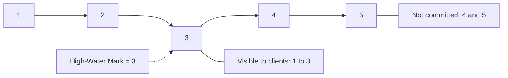

# High-Water Mark

## Description

The High-Water Mark is an index in the log that marks the last entry successfully replicated to a majority (quorum) of nodes. The leader computes it from the followers' acknowledgments and sends it along with replication messages (or in HeartBeats), so every node knows how far the log is safe. It's also called the *commit index*.

Only entries up to the mark are exposed to clients and applied to the state machine. Entries above it exist in the leader's log or in some followers' logs, but they can be discarded in a leadership change, so they must never be shown.

In Kafka, the partition's high-water mark defines what consumers can read; in Raft, it's the *commitIndex*.

## Problems it solves

- The leader can fail before sending entries to any follower, or after sending them to only some.
- Followers end up with different logs: some with fewer entries, others with more.
- Each node needs to know which part of the log is safe to expose to clients.

## When to use

- Any replicated log with a leader and followers.
- When reads (including on followers) must see only durable data.
- To decide which entries to truncate after a new leader is elected.

### When to avoid

- Single-node systems, where there is no replication.
- When immediate visibility of unconfirmed data is acceptable (weak consistency).

## Trade-offs

| Benefit | Cost / Risk |
| --- | --- |
| Clients never see data that could be lost | Visibility delay: data appears only after majority replication |
| Allows safely truncating unconfirmed entries | The leader must track each follower's progress |
| Foundation for consistent reads on followers | Followers learn the mark with a delay, so they may lag behind |

- **Propagation:** the mark travels in HeartBeats and replication messages.
- **After a failure:** the new leader truncates entries above the mark that conflict with the current generation.

## Diagram

Entries 1 to 3 are already on a majority and visible; entries 4 and 5 can still be discarded.

## Related patterns

- [Write-Ahead Log](/architecture/distributed-systems/data-replication/write-ahead-log) — the log whose safe portion the mark delimits
- [Leader and Followers](/architecture/distributed-systems/data-replication/leader-and-followers) — the leader computes and propagates the mark
- [Majority Quorum](/architecture/distributed-systems/data-replication/majority-quorum) — the mark is defined by the majority
- [Replicated Log](/architecture/distributed-systems/data-replication/replicated-log) — entry commits follow the mark
- [Low-Water Mark](/architecture/distributed-systems/data-replication/low-water-mark) — complementary mark at the lower end
- [Follower Reads](/architecture/distributed-systems/data-replication/follower-reads) — followers serve reads up to the mark

## Reference

- [Pattern page in the Patterns of Distributed Systems catalog](https://martinfowler.com/articles/patterns-of-distributed-systems/high-watermark.html)
