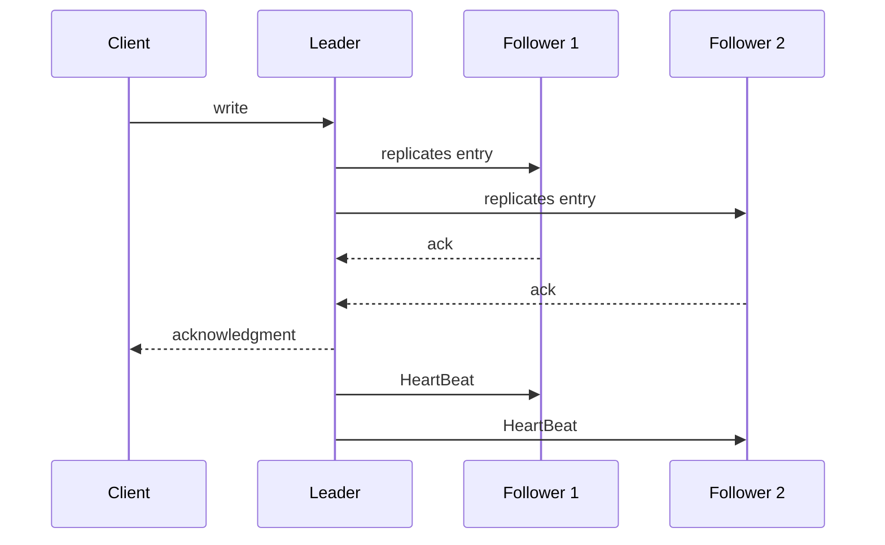

# Leader and Followers

## Description

In Leader and Followers, one server in the cluster is chosen as the leader and makes decisions on behalf of the group: it receives writes, defines the order of updates, and propagates them to the other servers, the followers. Since there is a single decision point, there's no need to coordinate all nodes on every operation, and the clients' view stays consistent.

The leader is chosen by election at startup and again when it fails. Followers track the leader through HeartBeat; if they stop receiving messages for a while, they start a new election. A Generation Clock identifies each leader tenure, making it possible to reject messages from old leaders, and the High-Water Mark defines how far the replicated data can already be exposed.

The pattern is the foundation of systems such as ZooKeeper (ZAB), etcd (Raft), and Kafka partitions, where each partition has a leader for writes. It also appears in relational databases with primary and secondary replicas.

## Problems it solves

- Majority quorums for reads and writes aren't enough: in certain failure scenarios, clients can see inconsistent data.
- An isolated server doesn't know the state of the others, and the divergence could only be resolved by reading from several nodes.
- Independent decisions on each node produce divergent states.
- Coordinating all nodes on every decision has a high performance and complexity cost.

## When to use

- Replicated data that needs a total order of updates and strong consistency guarantees.
- Consensus, coordination, and replicated storage systems where writes must go through a single point.
- When an election mechanism is an acceptable price for simpler replication.

### When to avoid

- Workloads that require writes at multiple geographically distributed points with low local latency (consider multi-leader or leaderless).
- When the single leader becomes a write bottleneck and partitioning is preferable.
- Systems where brief unavailability during elections is unacceptable.

## Trade-offs

| Benefit | Cost / Risk |
| --- | --- |
| Well-defined update order and consistency that's simple to reason about | The leader is a write bottleneck and a single decision point |
| Direct replication of the leader's log to the followers | A leader failure causes a window of unavailability until the new election |
| Tolerance to follower and leader failures through election | Risk of two leaders coexisting without a Generation Clock and a quorum |

- **Failure detection:** depends on HeartBeat and on timeouts tuned to the network.
- **Split brain:** prevent it with a quorum and a generation number.
- **Reads:** can be served by followers with Follower Reads, accepting potentially stale data.

## Diagram

The client writes to the leader, which replicates the entry to the followers and responds after the acknowledgments, sending a periodic HeartBeat to signal that it's alive.

## Related patterns

- [HeartBeat](/architecture/distributed-systems/data-replication/heartbeat) — detects the leader's failure
- [Generation Clock](/architecture/distributed-systems/data-replication/generation-clock) — identifies the leader's tenure and rejects old leaders
- [High-Water Mark](/architecture/distributed-systems/data-replication/high-water-mark) — defines what followers can expose
- [Majority Quorum](/architecture/distributed-systems/data-replication/majority-quorum) — defines how many acknowledgments the leader needs
- [Replicated Log](/architecture/distributed-systems/data-replication/replicated-log) — the leader replicates its log to the followers
- [Follower Reads](/architecture/distributed-systems/data-replication/follower-reads) — reads served by followers
- [Emergent Leader](/architecture/distributed-systems/cluster-management/emergent-leader) — an alternative where the leader emerges from the order in which nodes joined
- [Leader Election](/architecture/cloud-design-patterns/distributed-coordination/leader-election) — cloud pattern for electing a coordinator among instances

## Reference

- [Pattern page in the Patterns of Distributed Systems catalog](https://martinfowler.com/articles/patterns-of-distributed-systems/leader-follower.html)
